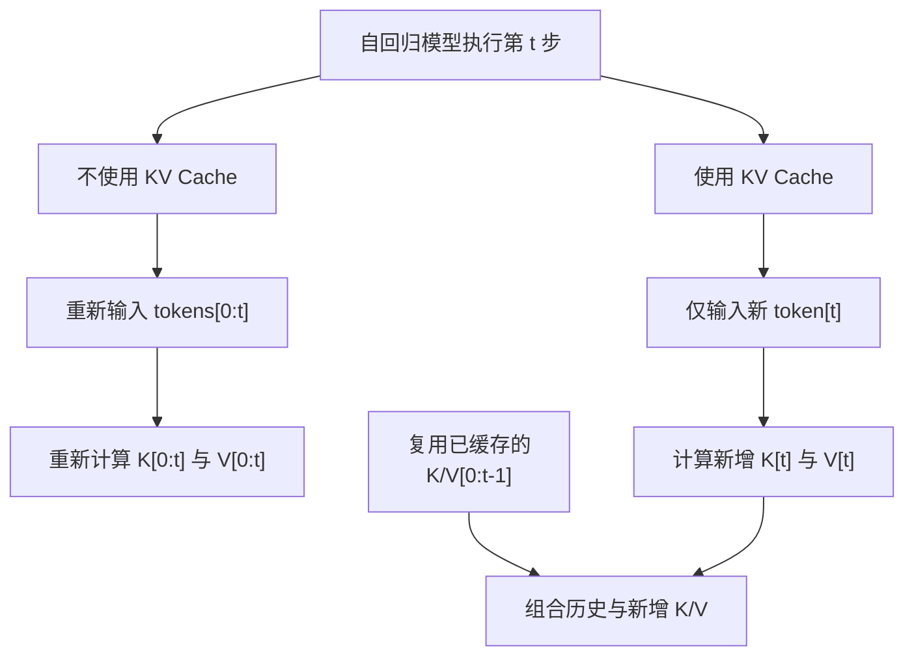

# Attention、KV Cache 与高效计算

注意力模式、KV cache 和高效 kernel 分别回答“能看哪里”“复用什么”“怎样更快算”。把三者混在一起，容易把系统优化误写成模型能力。

## 1. 三种访问关系

全局注意力允许每个 query 读取全部 key；因果注意力屏蔽未来；窗口或稀疏注意力只保留规定连接。改变 mask 会改变模型的信息可达性，因此通常需要训练或至少质量验证。

对长度 $N$、每头维度 $d$，朴素分数计算约为 $O(N^2d)$，且显式 $N\times N$ 分数矩阵可能成为显存瓶颈。这里的复杂度并不直接给出实际延迟，后端融合和内存流量同样关键。

## 2. prefill、decode 与 KV cache

自回归模型在 prefill 阶段一次处理已有上下文，为每层生成 K/V；decode 每次追加新 token。若不缓存，第 $t$ 步会重新计算前 $t-1$ 个 token 的 K/V；缓存后只计算新 token，再读取历史 K/V：

缓存失效条件来自模型与上下文语义：权重变化、位置索引/旋转编码不一致、前缀被改写或缓存张量 dtype/layout 不兼容，都不能直接复用。分页缓存改善不等长请求的内存管理，本身不改变注意力定义。

## 3. FlashAttention 与 FlashInfer

FlashAttention 对精确注意力做分块，减少高带宽内存与片上存储之间的往返，目标是 IO-aware 的速度和显存改进；它并不等于稀疏近似。FlashInfer 更面向推理服务的 attention、sampling 与分页 KV 等 kernel。两者是否更快取决于 GPU 架构、dtype、head 维、序列长度和集成版本，不能把某张卡的 benchmark 外推到 NPU。

## 4. 视觉流式状态不是 LLM KV cache

视觉逐帧模型也会缓存 token，但有效类比要求：新帧以因果方式追加；旧 token 的位置与坐标语义稳定；后续层允许复用既有 K/V。若每帧都重新归一化全局坐标、修改旧帧特征或双向注意全部视图，旧缓存可能需要重算。

LingBot-Map 的锚点、参考窗口和轨迹记忆带有几何职责；RTAB-Map 数据库保存可检索节点和约束。它们都“保存历史”，却不是 Transformer KV cache。缓存只保留网络计算状态，也不自动提供闭环、几何一致性或可恢复地图。

## 5. 怎样验证优化没有改坏结果

先在同一输入和 dtype 下比较参考实现与优化 kernel 的输出/梯度容差，再跑模型层输出，最后检查任务指标。计时时必须 warm-up 并在设备侧同步；同时报告序列长度、batch、缓存占用和是否含数据搬运。

如果窗口、token 淘汰或量化改变了数学输入，应视为模型/近似变更，而不是仅做 kernel 等价替换。

## 参考

- [FlashAttention 官方实现与论文入口](https://github.com/Dao-AILab/flash-attention)
- [FlashInfer 文档](https://docs.flashinfer.ai/)
