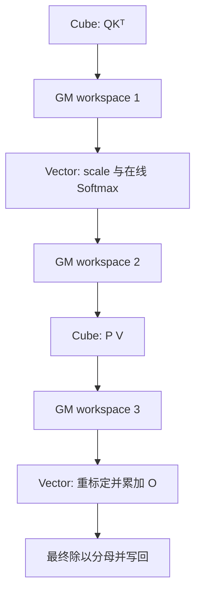

# Attention Kernel

注意力的数学定义是

$$
O=\operatorname{softmax}(QK^{\mathsf T}s)V.
$$

直接物化完整分数矩阵会产生 $O(N^2)$ 中间存储。Flash Attention 的关键是按 K/V tile 流式处理分数并维护在线 softmax 统计量，从而减少远端内存往返；它不改变为稀疏注意力。

## 1. 在线 Softmax 递推

对第 $j$ 个 score tile $S_j$，维护每行最大值 $m_j$、归一化分母 $\ell_j$ 和未最终归一化输出 $O_j$：

$$
m_j=\max(m_{j-1},\max S_j),\qquad
\alpha_j=e^{m_{j-1}-m_j},
$$

$$
\ell_j=\alpha_j\ell_{j-1}+\sum e^{S_j-m_j},
$$

$$
O_j=\alpha_jO_{j-1}+e^{S_j-m_j}V_j,
\qquad O=O_J/\ell_J.
$$

重标定 $\alpha_j$ 使旧分母和旧输出转移到新的数值基准，避免直接计算大指数。

## 2. TileLang 基线的真实路径

[`flash_attn_bhsd.py`](https://github.com/tile-ai/tilelang-ascend/blob/c3b324ac955271fd245346be465fbdd39fd4bd18/examples/flash_attention/flash_attn_bhsd.py) 默认使用 64×64 score tile、FP16 Q/K/V 和 FP32 统计量/累加。数据在 C/V 两类 scope 间流动：

这里使用三个 GM workspace 交换 C/V 数据，因此不能称为“中间值全部留在片上的完全融合实现”。`set_cross_flag/wait_cross_flag` 保护 producer-consumer 关系，`barrier_all` 提供较保守的同侧流水约束。

## 3. Q 常驻与数据复用

同一 query tile 会与多个 K/V tile 相乘，因此让 Q 在 L1 常驻可减少 GM→L1 重复搬运。是否能“大常驻”取决于 L1 容量、Q tile、并行 stage 和 P/V 路径的 buffer。容量不足时只能缩短驻留范围，不能通过增加同步消除真实空间约束。

K/V 通常随序列 tile 流入；score 在 Vector 中完成 scale、mask、max、exp 和 sum；概率再送给 Cube 乘 V。Cube 与 Vector 耗时不平衡会让另一侧出现气泡，需用 stage 数、tile 和同步频率共同调整。

## 4. 当前实现边界

- 基线是非 causal 路径，不能自动代表带 causal mask 的实现；
- 序列 block 数采用整除假设，尾块需单独核对；
- 自动流水的一个 h16/d128 示例在源码中标为 known broken，不能作为已验证路径；
- 历史 benchmark 只给出 A3 等有限环境信息，缺少完整 SKU、工具链和复现日志，因此这里只把它作为仓库记录，不引用其百分比作通用结论。

## 5. 与 GPU FlashAttention 的联系

两者都通过分块在线 softmax 避免完整分数矩阵 materialization，也都受片上容量和数据复用限制。GPU 通常以 thread block/warp、shared memory/register 组织；这里则显式协调 Cube、Vector、L1/L0/UB 和 workspace。算法递推可复用，线程和存储映射不可直接照搬。

模型层的 Attention 与 KV cache 基础见 [Attention、KV Cache 与高效计算](../Attention、KVCache与高效计算.md)。

