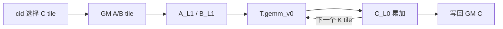

# GEMM Kernel

GEMM 是理解 NPU 的理想主线：数学结构规则，性能却取决于 tile、layout、搬运和流水。以下源码案例固定到 TileLang-Ascend `c3b324a`。

## 1. 数学语义与累加精度

$$
C_{ij}=\sum_{k=0}^{K-1}A_{ik}B_{kj}.
$$

kernel 常用 FP16/BF16 输入和 FP32 累加，最后再转换输出。改变 $K$ 分块会改变浮点加法顺序，因此验证应使用与 dtype 匹配的容差，而不是要求 bitwise 相同。

## 2. 基础 TileLang 数据流

[`example_gemm.py`](https://github.com/tile-ai/tilelang-ascend/blob/c3b324ac955271fd245346be465fbdd39fd4bd18/examples/gemm/example_gemm.py) 的实例使用 $M_t=128,N_t=256,K_{L1}=64$：

`T.gemm_v0` 隐藏 L1→L0A/L0B 与 Cube 计算；第一个 $K$ tile 用 `init=True`，后续 tile 累加。示例在 copy 与 GEMM 间使用保守的 `barrier_all`，清楚但不一定最佳。

基础示例的 M/N 使用整除 tile 数，没有尾块处理；K 虽以 `ceildiv` 循环，固定 copy 仍要求调用者核对末块。它是数据流教材，不是任意 shape 的生产接口。

## 3. 显式双缓冲版本

[`example_gemm_intrinsic.py`](https://github.com/tile-ai/tilelang-ascend/blob/c3b324ac955271fd245346be465fbdd39fd4bd18/examples/gemm/example_gemm_intrinsic.py) 展开两级环形 buffer：

- `S1=2`：A/B 的 L1 槽，GM→L1 由 MTE2 搬运；
- `S2=2`：A/B 的 L0 槽，L1→L0 由 MTE1 搬运；
- L0C 保存输出累加；M pipe 执行 `T.mma`，FIX 路径写回；
- `set_flag/wait_flag` 在每个 slot 上转交所有权。

该示例实例化 `K_L1=256, block_K=64`，代码中 `kk==3` 与四个 L0 子块绑定，不能把它当作任意参数模板。其价值在于展示显式流水的结构，而不是给出通用最优 tile。

## 4. 复用与运算强度

一个 $M_t\times N_t$ 输出 tile 每个 $K_t$ 分段约执行 $2M_tN_tK_t$ 次浮点运算。若 A/B 各加载一次，则输入字节近似

$$
B_{in}=b_A M_tK_t+b_B K_tN_t.
$$

增大 $M_t,N_t$ 可增加输入复用，但会扩大 L0C、L1 和写回压力；增大 $K_t$ 可减少循环和同步，却扩大输入 tile。Roofline 只能提示方向，实际还受 layout 转换、流水气泡、尾块和指令利用率影响。

## 5. CPU/GPU/NPU 对照

CPU 8×8 AVX2 微内核把 C 累加在 YMM 寄存器，packing 保证 A 广播和 B 连续加载；GPU GEMM 通常由 workgroup 协作搬 tile 并让各线程持有子累加器；这里则让 L1/L0A/B/C 与 Cube 明确承担 staging 和计算。三者都沿 $K$ 复用并减少远端访问，但“寄存器块”“shared tile”“L0C tile”不是相同硬件对象。

## 6. 正确性与性能证据

正确性至少检查 shape、transpose、dtype、尾块和容差；性能则记录设备型号、CANN/编译器、commit、tile、warm-up、同步和计时边界。仓库示例中的 tile 与 core 数是特定案例，不应直接移植为产品默认值。

