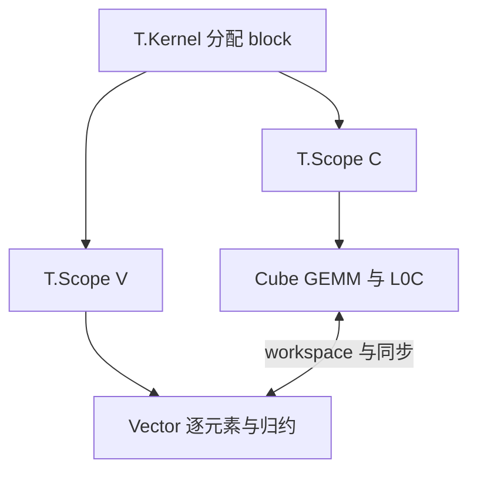

# Kernel 编程模型

以下解释固定到 TileLang-Ascend `ascendc_pto` 分支 commit [`c3b324a`](https://github.com/tile-ai/tilelang-ascend/tree/c3b324ac955271fd245346be465fbdd39fd4bd18)。DSL 对象先构造 TIR，并不在 Python 执行时直接搬运 NPU 数据。

## 1. `T.Kernel`：划分设备工作

`with T.Kernel(blocks, is_npu=True)` 建立 NPU launch frame。当前实现只允许一维 block extent；默认返回 Cube/Vector 相关索引，developer frame 的 `threads=1/2` 又有该后端的 C/V ratio 语义。它不能按 CUDA 的任意三维 grid/block 机械解释。

在基础 GEMM 中，一个 `cid` 选择一个输出 tile：

$$
b_m=\left\lfloor\frac{cid}{N_{tiles}}\right\rfloor,
\qquad b_n=cid\bmod N_{tiles}.
$$

这是任务分配；tile 内如何执行仍由 copy、Cube 指令与后续 lowering 决定。

## 2. `T.Tensor`：全局接口而非局部分配

`T.Tensor(shape, dtype)` 是构造 TIR `Buffer` 的 proxy，默认 scope 为 global。它描述 kernel 输入输出的 shape、dtype 和地址契约；`A: T.Tensor((M,K), "float16")` 不表示 A 已在 L1，也不自动决定 layout。

局部存储由明确 allocation 表达：

| DSL | TIR scope | 典型硬件职责 |
| --- | --- | --- |
| `T.alloc_L1` | `shared.l1` | Cube 输入的大 tile 与复用 |
| `T.alloc_L0A` | `wmma.matrix_a` | Cube A 输入 |
| `T.alloc_L0B` | `wmma.matrix_b` | Cube B 输入 |
| `T.alloc_L0C` | `wmma.accumulator` | Cube 累加结果 |
| `T.alloc_ub` | `shared.ub` | Vector 中间值 |

shape 与 dtype 会进入容量规划，生命周期则影响能否复用物理地址。

## 3. `T.Scope`：标记计算资源

`with T.Scope("C")` 和 `with T.Scope("V")` 在 IR 中标记 Cube/Vector 区域，PTO codegen 据此组织相应代码。它不是普通的 Python lexical scope，也不是任意命名空间；当前实现把 `"V"` 特判为 Vector，其他字符串落到 Cube 路径，公共代码应只使用明确的 `C/V`。

## 4. `T.Parallel`：逻辑元素并行

`T.Parallel(*extents, coalesced_width=...)` 生成带注解的 parallel loops。它描述可并行的迭代空间，实际怎样映射到向量指令、layout 和设备资源由后续 pass 决定。审查的 GEMM 和主要 Flash Attention 示例没有依靠它，因此不能杜撰“每次迭代对应一个 NPU lane”。

## 5. `T.copy`：受约束的数据移动

当前分支公共 `T.copy` 实际绑定到 Ascend 专用 `npu_copy_v2`，支持 transpose、padding 和部分尾块参数。源码 lowering 明确处理的 scope 路径包括 GM→L1、L1→L0A/B、L0C→GM、GM↔UB、UB→L1、L0C→UB 和 UB→UB；它不是任意两个 buffer 之间都可直接搬运的赋值。

## 6. `T.gemm_v0`：把较低层细节封装起来

`T.gemm_v0(A,B,C,...)` 的当前契约是 A/B 位于 L1、C 位于 L0C；内部处理 L1→L0A/B 和 Cube GEMM。`init=True` 表示开始新的累加，后续 $K$ tile 通常用 `False` 继续累加。

`kL0Size` 控制内部 $K$ 子块，源码要求为正、16 的倍数且不大于 4095。仓库注释中的容量例子只说明设计权衡，不是所有昇腾产品的固定容量。

## 7. Developer 与 Expert

Developer 风格使用较抽象的 `alloc_shared/alloc_fragment`，让 pass 推断 scope、同步和复用；Expert 风格显式分配 L1/L0/UB，并用 flags 转交 slot ownership。前者提高可写性，后者暴露更多调优空间和正确性责任。二者最终都必须满足相同的硬件数据依赖。

## 源码入口

- [`Kernel`](https://github.com/tile-ai/tilelang-ascend/blob/c3b324ac955271fd245346be465fbdd39fd4bd18/tilelang/language/kernel.py)、[`TensorProxy`](https://github.com/tile-ai/tilelang-ascend/blob/c3b324ac955271fd245346be465fbdd39fd4bd18/tilelang/language/proxy.py)
- [`Parallel`](https://github.com/tile-ai/tilelang-ascend/blob/c3b324ac955271fd245346be465fbdd39fd4bd18/tilelang/language/parallel.py)、[`Scope`](https://github.com/tile-ai/tilelang-ascend/blob/c3b324ac955271fd245346be465fbdd39fd4bd18/tilelang/language/warpgroup.py)
- [`allocate`](https://github.com/tile-ai/tilelang-ascend/blob/c3b324ac955271fd245346be465fbdd39fd4bd18/tilelang/language/allocate.py)、[`copy_op`](https://github.com/tile-ai/tilelang-ascend/blob/c3b324ac955271fd245346be465fbdd39fd4bd18/tilelang/language/copy_op.py)、[`gemm_v0`](https://github.com/tile-ai/tilelang-ascend/blob/c3b324ac955271fd245346be465fbdd39fd4bd18/tilelang/language/ascend.py)

