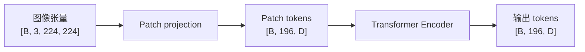

# 张量、算子与神经网络计算

读模型结构时，最可靠的问题不是“用了什么网络名”，而是：每一步接收什么 shape、dtype 和 layout，产生什么张量，又需要保存哪些中间结果。

## 1. 张量的三层信息

张量由数值、形状和存储解释共同定义。图像常写成 $[B,C,H,W]$，其中 $B$ 是 batch；但有些运行时使用 $[B,H,W,C]$。同一组数值若 layout 不同，算子对连续维和访存的假设也不同。

假设一张 $224\times224$ RGB 图像，batch 为 2，FP32 输入的逻辑形状为 $[2,3,224,224]$，仅元素存储约为

$$
2\times3\times224\times224\times4\ \text{bytes}\approx1.15\ \text{MiB}.
$$

`transpose` 常只改变 stride，返回视图；后续算子若要求连续内存，`contiguous()` 或隐式转换才会真正复制。只看 Python 层 shape 无法判断是否发生了拷贝，应结合 stride、运行时日志和 profiler。

## 2. 从图像到 patch 特征

ViT 用卷积或 unfold 将边长为 $P$ 的 patch 投影到宽度 $D$。若 $P=16$，则 $224\times224$ 图像产生 $14\times14=196$ 个 patch：



全局表示可来自额外的 class token 或 patch 聚合；局部表示保留每个 patch 的向量。二者不能直接等同于图像检索描述子或像素级几何对应，后续仍需要聚合、上采样、匹配或任务头。

## 3. 算子如何组合

线性层 $Y=XW^\top+b$ 中，若 $X\in\mathbb{R}^{B\times N\times D_{in}}$、$W\in\mathbb{R}^{D_{out}\times D_{in}}$，输出为 $[B,N,D_{out}]$。`b` 的 $[D_{out}]$ 形状通过广播作用到前两维。广播通常不先复制完整张量，但若写回、改变布局或后端不支持该 stride，仍可能产生临时缓冲。

`reshape` 只有在新形状与原 stride 兼容时才是视图；`permute` 后再 `reshape` 很可能触发复制。性能排查因此要同时记录算子、shape、stride 和设备，而不是只统计 FLOPs。

## 4. 计算图与自动微分

训练前向会构造从损失回到可训练叶子张量的依赖图。反向传播按链式法则累积梯度：

$$
\frac{\partial L}{\partial x}=\frac{\partial L}{\partial y}\frac{\partial y}{\partial x}.
$$

参数是会被优化器更新的持久张量；激活是本次前向产生、常为反向保存的中间值；workspace 是某个 kernel 为排序、卷积或矩阵乘法临时申请的缓冲。三者都占显存，但生命周期和优化方式不同。

## 5. 一个可复用的 shape 检查

```python
# 可运行的 PyTorch 片段
x = torch.randn(2, 3, 224, 224)
patch = torch.nn.Conv2d(3, 768, kernel_size=16, stride=16)
y = patch(x)                          # [2, 768, 14, 14]
tokens = y.flatten(2).transpose(1, 2) # [2, 196, 768]
print(tokens.shape, tokens.stride(), tokens.is_contiguous())
```

验证模型时应把关键层 shape、dtype、数值范围和 layout 作为接口测试。跨框架导出后，先比较这些中间量，再比较最终任务指标，能更快区分预处理、布局和算子误差。

下一步可读 [Transformer 与 Vision Transformer（ViT）](./Transformer与VisionTransformer（ViT）.md)；训练图、冻结和推理模式见[训练、推理与知识迁移](./训练、推理与知识迁移.md)。

## 参考

- [PyTorch Tensor Views](https://docs.pytorch.org/docs/stable/tensor_view.html)
- [PyTorch Autograd Mechanics](https://docs.pytorch.org/docs/stable/notes/autograd.html)
