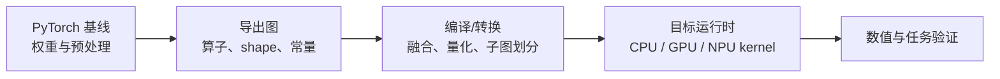

# 模型导出、异构推理与性能测量

机器人视觉中的完整应用例子见[从 PyTorch 到 ONNX 与 RKNN](../robotics-systems/deployment/从PyTorch到ONNX与RKNN.md)和[视觉定位的 CPU、GPU 与 NPU 分工](../robotics-systems/deployment/视觉定位的CPU、GPU与NPU分工.md)。

部署链不是把 `.pt` 改成另一个后缀，而是把框架程序约束成可交换计算图，再由目标运行时把算子映射到 kernel 和硬件。

## 1. 从程序到导出图

框架模型可含 Python 控制流、动态 shape 和自定义算子。导出时需要给出输入签名，把可表示部分转换为图中的节点、张量和常量。ONNX 定义 IR 与算子语义；它不保证所有运行时都支持每个 opset、动态维或自定义函数。

图融合把连续算子合并为更少的 kernel；fallback 则把不支持子图放回 CPU 或其他后端。fallback 可能数值正确却因设备同步和布局转换变慢，所以要检查转换报告，而不只是“导出成功”。

## 2. 一次完整的正确性检查

冻结输入及预处理，先比较框架 eager 与导出图；再比较目标运行时。记录输入 layout、resize/归一化、动态维、opset、权重哈希和输出名称。误差定位从第一个显著偏离的中间节点开始，最后才跑任务指标。

若转换同时进行了量化，应把“图转换误差”和“数值格式误差”拆成两个基线；量化验证见[数值精度、量化与结果验证](./数值精度、量化与结果验证.md)。

## 3. CPU、GPU 与 NPU 的边界

CPU 擅长控制流与小规模通用算子；GPU 适合高并行 kernel；NPU 依赖编译器支持的图与数据格式。实际分工由算子覆盖、tensor 大小、内存共享和拷贝决定，不能按模块名称预设“网络必在 NPU、几何必在 CPU”。

CAM-3576Q38 上的 RKNN、驱动、BSP 和板级约束见[硬件与部署边界](../robotics-systems/deployment/CAM-3576Q38硬件与部署.md)。通用导出步骤并不能证明某个具体 RKNN 工具链已经支持模型全部算子。

## 4. 延迟、吞吐与同步

只计异步 kernel 提交会低估延迟。设备计时需在边界处同步，并注明 warm-up、输入 shape、batch、dtype 和频率状态。端到端边界可拆为：采集/解码、预处理、H2D、网络、后处理、D2H 与下游消费。

吞吐是单位时间完成量；单请求延迟是一个样本从进入到输出；P50/P95 描述分布。各模块 P95 不能直接相加成整链 P95，因为慢事件可能不在同一帧且模块会并行。应以同一 input ID 做端到端追踪。

## 5. 可复现性能记录

记录模型 commit/权重、导出器、opset、编译器/运行时/驱动、设备功耗与频率、线程/stream、预处理和计时点；同时报告准确性基线、峰值内存、fallback 列表及 P50/P95。这样性能数字才说明“哪一条链在什么条件下更快”。

## 参考

- [ONNX IR Specification](https://onnx.ai/onnx/repo-docs/IR.html)
- [PyTorch Export](https://docs.pytorch.org/docs/stable/export.html)
- [RKNN-Toolkit2](https://github.com/airockchip/rknn-toolkit2)
