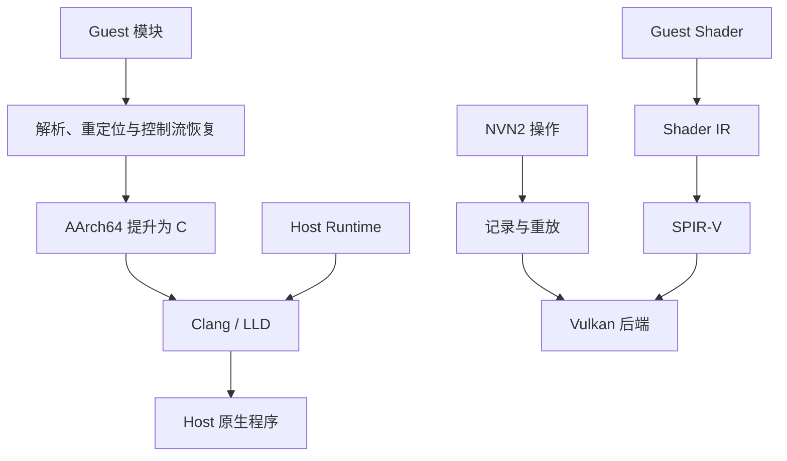

# Hookshot 源码阅读

本页以公开仓库 `main` 分支的 commit [`ba005ca`](https://github.com/NotRexed/Hookshot/tree/ba005ca4fa179ccd2140f06f9308d0ff63894ff6) 为基线。仓库将特定 AArch64 程序静态提升并编译为 Windows/Linux 原生程序，同时用 host runtime 和 Vulkan 路径承接所需系统与图形语义。它不是通用模拟器，也不是拥有原始源码的常规跨平台移植。

## 计划笔记

| 稳定文件名 | 主要问题 | 优先阅读入口 |
| --- | --- | --- |
| `binary-lifting.md` | 模块、重定位、指令和函数如何变成可编译的 C | `nx2/nso2.py`、`nx2/image.py`、`nx2/lift.py`、`nx2/insn.py` |
| `host-runtime.md` | 提升后的程序依赖哪些 host 侧系统和 SDK 语义 | `host/hos_*.c`、`host/nn_*.c` |
| `nvn-to-vulkan.md` | NVN2 操作如何被记录、重放并映射到 Vulkan | `gpu/render/rx_nvn.cpp`、`gpu/vk/` |
| `shader-translation.md` | Shader 如何从 guest 表示进入 IR 和 SPIR-V | `gpu/vk/eden/shader_recompiler/`、`gpu/shaderbatch.cpp` |

## 怎样读这条链

先读公开的 [`docs/design.md`](https://github.com/NotRexed/Hookshot/blob/ba005ca4fa179ccd2140f06f9308d0ff63894ff6/docs/design.md)，确认构建期和运行期各自负责什么。然后沿 `nso2.py` / `image.py` 的模块输入走到 `lift.py`，观察 guest 寄存器、内存与控制流怎样被表达。host runtime 与 GPU 路径要分别追踪，最后再在生成的 host 可执行程序处汇合。

GPU 页面还会对照 [`BAKE.md`](https://github.com/NotRexed/Hookshot/blob/ba005ca4fa179ccd2140f06f9308d0ff63894ff6/BAKE.md) 和 [`gpu/vk/VULKAN.md`](https://github.com/NotRexed/Hookshot/blob/ba005ca4fa179ccd2140f06f9308d0ff63894ff6/gpu/vk/VULKAN.md)。其中带日期的状态记录只描述当时实现，不能当作 Vulkan 或 shader 翻译的通用限制。

## 记录规则

- 仓库不包含游戏内容；笔记也不记录获取、提取或绕过保护的步骤。
- “生成 C”是保持 guest 语义的一种实现途径，不等于恢复了原始源码。
- host runtime 的某个函数存在，不足以证明所有边界条件都已实现；要继续检查调用、返回值和错误路径。
- 公开设计文档、当前源码和实验观察分别标注，不把推断写成仓库作者已声明的事实。

通用知识回到 [编译器与程序翻译](../../compilers/)、[操作系统](../../operating-systems/) 和 [图形与 GPU](../../graphics-gpu/) 维护。
