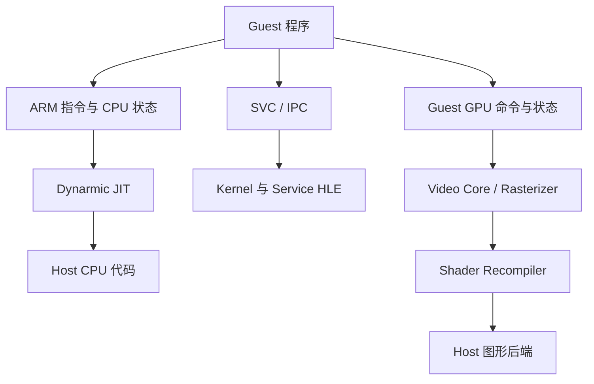

# Lichii 源码阅读

本页以公开仓库 `nx2` 分支的 commit [`babdb6b`](https://github.com/zortos293/Lichii/tree/babdb6bb752af8a35e94b305613d6be7ba7e6217) 为基线。Lichii 是由既有模拟器代码发展而来的实验性 Switch / Switch 2 模拟器，适合观察一个完整运行时怎样同时连接 CPU、HLE 和 GPU；具体兼容状态与工程日志只对该版本成立。

## 计划笔记

| 稳定文件名 | 主要问题 | 优先阅读入口 |
| --- | --- | --- |
| `cpu-jit.md` | guest 指令怎样进入 Dynarmic，CPU 状态怎样进出 JIT | `src/core/arm/dynarmic/`、`docs/dynarmic/Design.md` |
| `horizon-hle.md` | SVC、kernel object、scheduler、IPC 与 service 如何分层 | `src/core/hle/kernel/`、`src/core/hle/service/` |
| `shader-recompiler.md` | guest shader 怎样经过 frontend、IR、优化和 backend | `src/shader_recompiler/` |
| `gpu-thread-split.md` | GPU front/back 线程如何划分职责并设置同步点 | `NX2_GPU_THREAD_SPLIT.md` 与对应 `video_core` 实现 |

## 第一轮阅读顺序

先用 [`docs/dynarmic/Design.md`](https://github.com/zortos293/Lichii/blob/babdb6bb752af8a35e94b305613d6be7ba7e6217/docs/dynarmic/Design.md) 建立 JIT 的块、IR 和后端概念，再追踪 CPU backend 如何进入它。随后从 SVC 进入 kernel/service，而不是从服务目录随机浏览。GPU 部分先读 shader recompiler 的目录分层，再把 [`NX2_GPU_THREAD_SPLIT.md`](https://github.com/zortos293/Lichii/blob/babdb6bb752af8a35e94b305613d6be7ba7e6217/NX2_GPU_THREAD_SPLIT.md) 与相同 commit 的实现互相核对。

## 记录规则

- 区分 Lichii 自身改动、继承的上游设计与第三方库能力，不能把整个目录都归因于单一项目。
- 文档中的目标架构要用源码验证；工程日志中“已实现”“stub”或测试结果不外推到其他 commit。
- 只研究公开源码结构，不记录受保护程序、密钥、固件或规避保护的流程。
- 性能结论必须附平台、构建选项、工作负载和采样方法；没有测量时只讨论结构，不猜测快慢。

通用原理分别回到 [JIT/AOT 与 binary lifting 规划](../../compilers/)、[HLE 与操作系统规划](../../operating-systems/) 和 [图形与 GPU 规划](../../graphics-gpu/) 维护。
