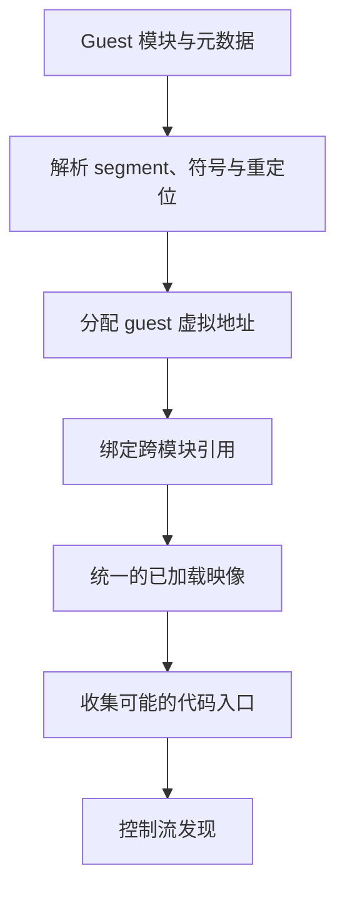
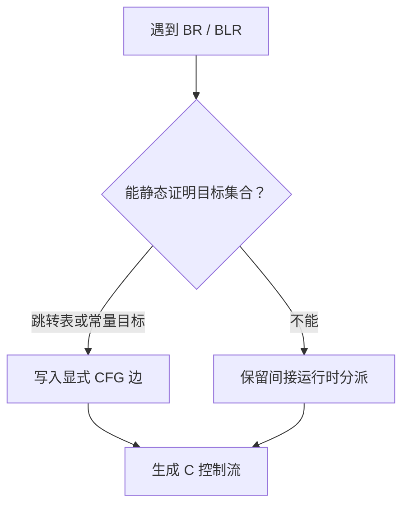

# 从 ARM64 机器码恢复程序：Binary Lifting

普通前端从源码 token 和 CFG 文法获得结构；binary lifting 的输入已经丢失了变量名、类型与 AST。先读[语法与语义前端](./frontend/)和[中间代码生成](./middle-end/intermediate-code-generation.md)，有助于理解 lifter 必须重新建立哪些信息、哪些信息已经无法可靠恢复。

Binary lifting 的目标不是还原作者当年的 C++ 源码，而是把机器码转换成一种更容易分析、变换和重新生成的表示，同时保持程序可观察行为。

对于 Hookshot，这个表示最终是显式操作 guest 状态的 C。要得到这些 C，工具不能只顺序反汇编每个 4 字节 ARM64 指令；它还要重建加载后的地址、识别代码入口、恢复控制流，并为静态阶段无法确定的行为保留运行时路径。

## 1. 反汇编、反编译和 lifting 的区别

| 操作 | 常见输出 | 主要目的 |
| --- | --- | --- |
| 反汇编 | ARM64 汇编文本 | 让人或工具看到指令编码对应的操作 |
| 反编译 | 接近高级语言的伪代码 | 帮助人理解意图，不一定能重新编译并保持全部语义 |
| Binary lifting | IR、C 或另一种机器无关表示 | 支持分析、变换、验证并重新生成可执行代码 |

Lifting 更关心“语义是否闭合”，而不是输出是否像人写的源码。变量名、类结构和原始控制结构可能已经丢失，但寄存器、内存、分支和异常的效果必须保留。

## 2. 第一步是重建加载后的程序映像

可执行模块里的指令经常引用符号、全局对象或其他模块。直接把文件中的 `.text` 当作独立字节数组，会遗漏加载地址和重定位后的目标。

Hookshot 当前流程先解析模块，再由 `nx2/image.py` 按选定布局放置模块、建立导出符号集合、应用重定位并记录代码范围。`nx2/lift.py` 随后针对这个**已布局的 guest 映像**工作。

这一步和普通 loader 有共同点，但目的不同：loader 为马上执行准备映像；lifter 还要把地址关系变成后续静态分析的事实。

## 3. 机器码没有可靠的“函数边界标签”

ARM64 指令通常定长，但“哪里是函数”“哪些字节是代码”仍不由定长编码自动解决。可靠入口可能来自：

- 模块入口和导出符号；
- 异常展开或 frame 描述信息；
- 直接调用指令的目标；
- 重定位或地址构造所指向的代码位置；
- 运行时观测到但静态阶段遗漏的入口。

Hookshot 的 `lift.py` 在映像已有入口的基础上，还会检查由 `ADR` / `ADRP+ADD` 构造的代码地址，再交给 a64-kit 的 `Lifter.discover()`。这说明函数发现不是一次线性扫描，而是从证据集合出发反复扩展可达代码。

同时也不能把每个“看起来像指令”的 4 字节都当作代码：只读数据、跳转表和对齐填充可能混在邻近区域。错误地把数据解码成指令会制造假的控制流。

## 4. 从指令流恢复控制流图

a64-kit 先把影响控制流的指令分类：

- `B`、条件分支、`CBZ`、`TBZ` 形成直接边；
- `BL` 通常形成函数调用；
- `RET` 结束当前调用；
- `BLR`、`BR` 的目标来自寄存器，需要进一步处理；
- `SVC`、trap 和 instruction-cache 操作进入特殊运行时边界；
- 其他指令交给逐指令语义翻译器。

直接分支目标写在指令中，较容易加入控制流图。间接跳转只告诉我们“目标在寄存器里”，而寄存器值可能由前面多条指令、内存表甚至运行时输入共同决定。

### 跳转表不是普通的间接跳转

编译器常把 `switch` 降低为：检查索引范围 → 从表中读取偏移 → 加到基地址 → `BR`。Hookshot 的 lifter 会在间接分支前做受限的符号追踪，识别常见的 ARM64 跳转表构造，并把恢复出的目标变成 C `switch` 或等价分派。

这类恢复依赖模式和边界证据。若不能证明目标集合完整，就不能为了“静态化”随意猜测。Hookshot 会统计没有恢复出表的 `BR`，并为必要的间接调用/跳转保留 runtime lookup。

## 5. 指令语义怎样变成 C

Hookshot vendored 的 a64-kit 把每个 guest 函数建模为接收 `Ctx*` 的 C 函数。`Ctx` 中保存：

- `X0–X30` 和作为 SP 使用的状态；
- 向量寄存器；
- 条件标志；
- `FPCR`、`FPSR` 等浮点状态。

普通数据处理指令可转成对这些字段的操作；guest load/store 通过 guest 地址到 host 内存的映射 helper；直接调用变为写入 guest LR 后调用另一个 lifted C 函数；间接调用通过目标表或 site cache 查找。

生成 C 的价值在于复用成熟 host 编译器，但 C 也是一份必须遵守的语言契约：

- guest 无符号回绕不能意外变成有符号溢出的未定义行为；
- 非对齐访问和别名不能假设与 host 天然相同；
- 原子读改写和 memory ordering 要保留；
- ARM 浮点异常、NaN、舍入和 flush-to-zero 不能只用 host 默认表达式替代；
- guest 的寄存器 ABI 与 host C ABI 是两个层次。

当前 `nx2/insn.py` 还为基础 translator 未覆盖的 ARMv8.x 指令形式补充 C 语义，并把控制流分类和逐指令翻译入口包装起来。这种扩展能力说明“翻成 C”不是一次字符串替换，而是持续维护的 ISA 语义层。

## 6. 函数模型怎样处理跨函数状态

把 guest 函数转为 C 函数后，host 编译器会按照 host ABI 保存寄存器；但 guest ABI 规则并不会自动出现。因此 lifted code 必须决定哪些 guest 字段在调用前写回 context、哪些在调用后重新读取，以及间接调用、tail call、SVC 和 trap 哪些状态对外可见。

这也是显式 `Ctx` 的优势：guest 状态不必强行占用同名 host 寄存器，可以在 C 局部值、context 内存和 host 寄存器之间由编译器优化。但同步边界如果标错，就会出现只在特定调用链中暴露的错误。

## 7. 静态提升仍然需要运行时

即使所有已发现指令都生成了 C，以下责任仍存在：

- guest 地址空间和内存权限；
- 间接目标查找与未识别目标处理；
- 系统调用、服务和 SDK 边界；
- 线程、同步、计时和异常；
- guest 可修改内存与 host 资源之间的一致性。

因此 Hookshot 的结果是“lifted program + host runtime”，不是一份脱离 guest 执行模型的普通应用源码。静态 lifting 解决 CPU 指令翻译的一部分，不会自动完成 HLE、GPU API 映射或系统集成。

## 8. 怎样验证 lifting 没有悄悄改变程序

有用的证据按层次组织：

1. **覆盖统计**：统计无法翻译的指令形式、未恢复的间接分支和函数完整率。
2. **逐指令差分**：对相同初始寄存器和内存，比较 lifted 语义与可信参考执行器。
3. **函数级差分**：比较函数调用前后的寄存器、向量、标志和改写页面。
4. **构建闭包**：链接阶段不应留下意外的未定义 lifted symbol。
5. **端到端观测**：验证系统边界和长时间状态，但不能替代更小粒度的差分测试。

“程序能够启动”只能证明某条路径没有立即失败，不能证明全部指令形式、异常路径和并发行为正确。

下一篇 [中间表示为何是翻译系统的核心](./intermediate-representation.md) 会对比：Hookshot 选择 C 作为可编译的中间载体，而 Dynarmic 使用自己的 typed SSA IR 连接 A64 frontend 与多个 host backend。

## 9. 安全分析关心的是边界，而不只是可翻译性

函数发现、CFG 和数据流也是逆向分析的基础，但安全结论还要追踪输入可控性、范围/权限检查和最终使用点。“成功提升并运行”不能证明 parser、guest memory 或 hostcall 边界安全；“找不到某个间接目标”也只是分析不完备，不能直接等同于恶意行为。证据分级与静态/动态互证见 [逆向工程的方法与证据](../security-re/reverse-engineering.md)，对象格式和 relocation 的解析边界见 [可执行文件格式](../security-re/executable-formats.md)。

## 源码阅读入口

- Hookshot [`docs/design.md`](https://github.com/NotRexed/Hookshot/blob/ba005ca4fa179ccd2140f06f9308d0ff63894ff6/docs/design.md)：整体静态重编译边界；其中项目状态只对该 commit 成立。
- Hookshot [`nx2/image.py`](https://github.com/NotRexed/Hookshot/blob/ba005ca4fa179ccd2140f06f9308d0ff63894ff6/nx2/image.py)：模块布局、符号、重定位和入口准备。
- Hookshot [`nx2/lift.py`](https://github.com/NotRexed/Hookshot/blob/ba005ca4fa179ccd2140f06f9308d0ff63894ff6/nx2/lift.py)：发现、覆盖检查、跳转表统计与 C 输出。
- Hookshot [`a64-kit/a64_lift.py`](https://github.com/NotRexed/Hookshot/blob/ba005ca4fa179ccd2140f06f9308d0ff63894ff6/third_party/a64-kit/lift/a64_lift.py)：函数模型、控制流分类、间接分派和代码生成。
- Hookshot [`nx2/insn.py`](https://github.com/NotRexed/Hookshot/blob/ba005ca4fa179ccd2140f06f9308d0ff63894ff6/nx2/insn.py)：当前项目补充的 ARMv8.x 指令语义。
