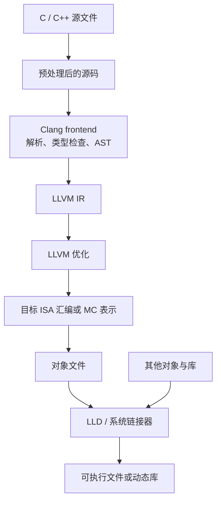
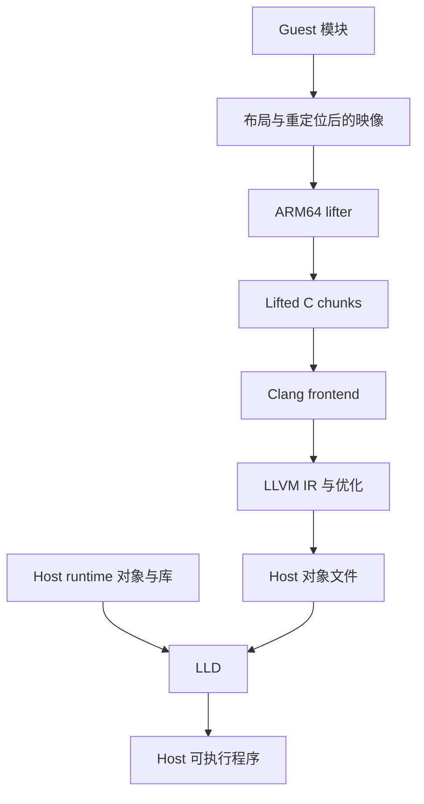
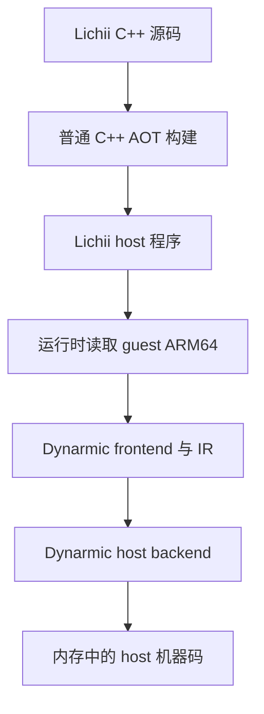

# 从 Clang 到链接器：编译流水线

“用 Clang 编译”经常把多个阶段压缩成一句话。实际上，Clang driver 会组织预处理、语言前端、LLVM 优化与代码生成、汇编和链接；每个阶段拥有不同输入、输出与错误边界。

传统的 scanner、parser、semantic analysis、TAC 与 code generation 已分别放在[编译器前端](./frontend/)、[中端](./middle-end/)和[后端](./backend/)；本文只负责把这些概念连接到 Clang/LLVM、对象文件和链接器，不重复完整推导。

理解这些阶段后，才能准确回答 Hookshot 中的两个问题：ARM64 指令在何处变成 C，C 又在何处变成 host 机器码？也能避免误以为 Lichii 的 Dynarmic 在运行时调用 LLVM。

## 1. 普通 C/C++ 编译链



Clang 既可以指语言前端，也常指组织整条链的 `clang` driver。LLVM IR 是 Clang frontend 和 LLVM backend 之间的一层表示；assembler 把目标指令与重定位信息编码进对象文件；linker 解析跨对象符号、安排最终地址并输出可执行文件或库。

## 2. 对象文件为什么不是“小型可执行文件”

单个源文件编译时，编译器不知道其他 translation unit 中函数和全局对象的最终地址。因此对象文件通常包含：

- 机器码和数据 section；
- 定义和引用的 symbol；
- 等待链接器修补的 relocation；
- 可选的调试、异常展开和元数据。

链接器把对象与库合并，选择符号定义，进行 section 合并与地址布局，并应用重定位。动态链接程序还会留下由 loader 在装载时处理的动态依赖与重定位。

因此，Hookshot 把 lifted C 编译成 `.o` 后，guest 程序还没有闭合。只有 host runtime、生成的函数表和所有 lifted chunk 一起链接成功，才说明静态符号依赖至少在 link-time 形成闭包。

## 3. Hookshot 中存在两段前后相接的翻译

Hookshot 的第一段不是 Clang 完成的：Python 与 vendored a64-kit 负责解析 guest 映像、发现函数、恢复控制流并输出 C。第二段才进入通用编译工具链。



这个分层解释了“ARM64 转 C 为什么可行”：lifter 已经把 guest ISA 语义写进 C 状态机；Clang 不需要理解原始 ARM64 程序，只需要按照 C 语义为目标 host 生成代码。

反过来，Clang 也不会替 lifter 恢复遗漏的跳转表、guest 系统调用或内存映射。这些不属于 C compiler 的输入信息。

## 4. `nx2/build.py` 实际组织了什么

在当前 Hookshot 版本中，build driver 会：

- 收集 lifted `code_*.c`、生成的 A64 表与 runtime 源文件；
- 选择目标 Clang 工具链和编译 flags；
- 分别编译 lifted code、host runtime 与图形后端；
- 对普通 lifted chunk 和 hot code 使用不同优化策略；
- 根据源码、依赖和 flags 形成对象缓存 key，复用未变化的 `.o`；
- 最后通过 `-fuse-ld=lld` 或对应 LLD driver 链接程序与动态库。

大量生成 C 会让“构建工程”本身成为系统问题。`nx2/chunks.py` 使用稳定的 guest 地址边界切分生成文件，避免一个函数长度变化后让后续所有 chunk 边界漂移；build driver 还根据预估编译成本和可用内存调度并行任务。

这些机制改变构建时间和增量构建范围，不改变 guest 指令语义。笔记应把**语义正确性**与**构建吞吐优化**分开讨论。

## 5. 为什么不是所有生成代码都直接 `-O3`

优化等级越高，编译器启用的 pass 和尝试范围通常越多，但构建时间、峰值内存和代码体积也可能增长。对机器生成的巨大函数或控制流密集代码，高优化级别未必得到成比例收益。

Hookshot 当前默认对大部分 lifted code 使用较温和的优化，对根据 profile 识别的 hot code采用单独策略。这体现了一个通用原则：

> 把昂贵优化预算放到可测量的热点上，而不是假设每个生成函数都值得相同的编译成本。

具体 `-O1`、`-O2` 选择是当前工程策略，不是静态重编译的普遍最优值。它会随编译器版本、函数形态、目标 CPU 和测量方法变化。

## 6. Lichii 有两条不同的编译链

Lichii 本身的 C++ 源码需要在发布前经过普通 AOT 编译，其中包括 Dynarmic frontend、IR passes 和 host backends。但运行 guest 程序时，流程是：



Dynarmic 当前拥有自己的 decoder、IR、optimization passes、register allocation 和多个 host backend。运行时 host code emission 并不是“生成 LLVM IR，再启动 Clang/LLD 链接”。LLVM 可能参与构建 Lichii 本身，但不是这条 guest JIT 热路径的必需阶段。

## 7. LLVM、Clang、汇编器、LLD 的职责边界

| 组件 | 主要责任 | 不负责什么 |
| --- | --- | --- |
| Clang frontend | 解析 C/C++、类型检查、生成 LLVM IR | 不恢复任意 ARM64 二进制的函数与控制流 |
| LLVM optimizer | 在 LLVM IR 上做合法变换 | 不定义 guest ISA 和 guest OS 语义 |
| LLVM target backend | 指令选择、寄存器分配、目标代码生成 | 不替代链接器解析跨对象符号 |
| Assembler / MC | 编码目标指令，生成对象 section、symbol、relocation | 通常不知道最终进程虚拟地址 |
| LLD | 合并对象与库、解析符号、布局并应用重定位 | 不修正 lifter 已经生成的错误 guest 语义 |

工具链可以由 driver 一次调用完成，但调试时要知道错误属于哪一层：C 语义错误、LLVM 优化触发的未定义行为、对象符号缺失和链接布局问题需要不同证据。

## 8. 用编译器输出观察每个阶段

对自己编写的小型 C 文件，可以用以下命令建立阶段感：

```bash
clang -E demo.c -o demo.i
clang -S -emit-llvm -O0 demo.c -o demo.ll
clang -S -O2 demo.c -o demo.s
clang -c -O2 demo.c -o demo.o
readelf -S -s -r demo.o
clang -fuse-ld=lld demo.o -o demo
readelf -l -d demo
```

再用 `clang -### demo.c` 观察 driver 将调用哪些子步骤。命令和输出受平台、对象格式、Clang 版本与链接方式影响；Windows/COFF 环境应使用对应工具，不把 ELF 命令当作跨平台固定接口。

## 9. 阅读大型构建脚本时先找什么

1. 输入源码是手写、生成，还是二者混合？
2. 哪些 flags 影响语义，哪些只影响性能和诊断？
3. 目标 triple、CPU feature 与 ABI 在哪里指定？
4. 对象缓存 key 是否包含源码、header、flags 和工具链版本？
5. 最终链接哪些 runtime、静态库和动态库？
6. 未定义符号是允许留给 loader，还是应当导致构建失败？
7. map file、symbol table 和调试信息怎样映射回 guest 地址？

至此，第一组形成一条完整链：先在 [JIT 与 AOT](./jit-and-aot.md) 选择翻译时机，再由 [Binary Lifting](./binary-lifting.md) 恢复机器码结构，通过 [IR](./intermediate-representation.md) 分隔语义与后端，最后在本篇落到对象文件和链接产物。

## 源码与官方文档入口

- Hookshot [`nx2/build.py`](https://github.com/NotRexed/Hookshot/blob/ba005ca4fa179ccd2140f06f9308d0ff63894ff6/nx2/build.py)：当前 Clang 编译、对象缓存、并行调度与 LLD 链接。
- Hookshot [`nx2/chunks.py`](https://github.com/NotRexed/Hookshot/blob/ba005ca4fa179ccd2140f06f9308d0ff63894ff6/nx2/chunks.py)：稳定 chunk 与生成代码增量构建。
- Lichii [`Dynarmic source tree`](https://github.com/zortos293/Lichii/tree/6cd99d2e1523706c491031740b167201ca8f0acf/src/dynarmic/src/dynarmic)：frontend、IR 与各 host backend。
- [Clang Command Guide](https://clang.llvm.org/docs/CommandGuide/clang.html)：driver、编译阶段和常用输出选项。
- [LLD 官方文档](https://lld.llvm.org/)：LLVM linker 及其不同对象格式 driver。
