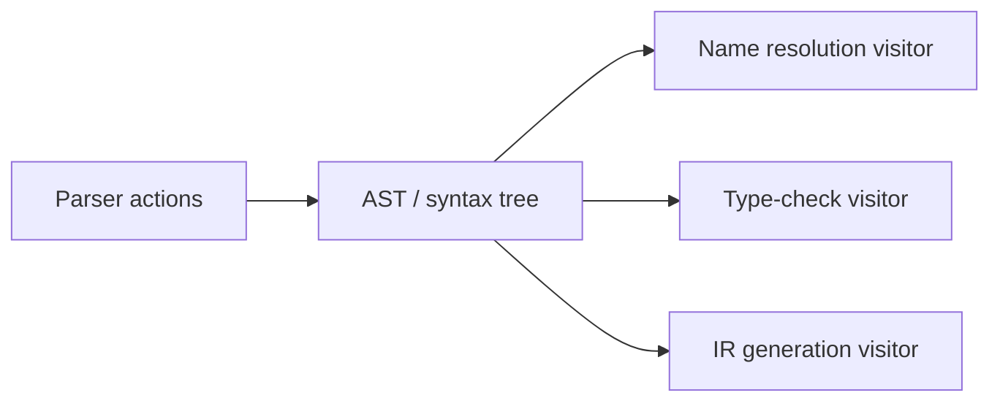

# 语法制导翻译：属性、动作与树遍历

parser 只证明“这个结构符合文法”。要构造 AST、计算类型或生成 IR，还需把值和动作附着到语法结构。语法制导定义（SDD）描述**属性之间的依赖**；语法制导翻译方案（SDT）把**可执行动作**嵌入产生式。

## 1. 综合属性与继承属性

对产生式 $A\to XYZ$：

- $A$ 的综合属性由子节点 $X/Y/Z$ 的属性向上计算；
- 子节点的继承属性由父节点或左侧兄弟传入。

表达式值天然适合综合属性：

```text
E → E1 + T    { E.val = E1.val + T.val }
E → T         { E.val = T.val }
T → INT       { T.val = INT.lexval }
```

声明 `int a, b` 则可把 `int` 的类型作为继承属性向变量列表传递。属性不是必须在 parse 时立刻求值；依赖图无环时可按拓扑顺序计算。

## 2. S-attributed 与 L-attributed

只含综合属性的 S-attributed SDD 可在 LR 规约时自底向上求值：右部属性已在栈上，规约动作计算左部属性。

L-attributed SDD 允许某个右部符号的继承属性依赖父节点和它左边兄弟的属性，因此能按深度优先、从左到右求值。它覆盖了常见声明与环境传递，但不允许依赖尚未访问的右侧兄弟。

“S/L-attributed”说的是依赖结构，不等同于“必须用 LR/LL parser”。不同 parser 只是决定哪些属性能自然地边解析边算，哪些需要显式树和第二遍遍历。

## 3. 从产生式到 AST

考虑：

```text
E → E1 + T  { E.node = Add(E1.node, T.node) }
E → T       { E.node = T.node }
T → id      { T.node = Name(id.lexeme) }
```

输入 `a+b` 的括号、`E/T` 中间层和 token 节点无需全部留进 AST；最终只需 `Add(Name(a), Name(b))`。若保留完整 parse tree，之后也能用 visitor 压缩，但会多一层实现复杂度。

## 4. SDT 的动作放在哪里

后缀动作 `A→XYZ {action}` 在规约后执行，容易用于综合属性。动作插在产生式中间时，工具通常把它改写成隐式空产生式；此时可见的栈值和错误恢复行为会变化，不能把动作位置只当排版。

副作用应谨慎：若解析器需要回溯，或错误恢复绕过某些动作，直接修改全局符号表可能留下半完成状态。对确定性 LR parser，常见做法仍是 parse 时建树，后续独立 pass 管理作用域和类型。

## 5. 与 visitor 的关系

Visitor 把“树结构”和“对树执行的操作”分开：



这并不否定 SDD。visitor 的每个返回值、环境参数和节点字段，本质上仍在实现属性依赖，只是求值调度从 parser stack 移到了显式 traversal。

例如表达式 visitor 返回 `Type` 是综合属性；进入函数体时传入当前 scope 是继承属性；IR visitor 返回 `place` 和 `code` 也是综合属性。明确这一点后，多遍编译器就不是互不相关的回调集合。

## 6. SPL 项目的对应关系

Phase 1 的 Bison action 通过 `addn/add1/add0` 创建语法树，token 的 `treeNode*` 从 Flex 经 `yylval` 进入规约动作。Phase 2/3 再递归访问节点，给节点附上类型信息或生成 IR。这条实现把“建树”和“求语义”分成多遍，更接近 visitor 方案。

它没有建立一套通用属性求值引擎；因此笔记应说“源码实现了这些属性依赖”，而不是声称项目直接实现了课本中的任意 SDD 调度算法。

继续阅读[语义分析](./semantic-analysis.md)看环境和类型如何成为属性，再到[中间代码生成](../middle-end/intermediate-code-generation.md)看 `place/code/true/false` 等属性如何降低为 TAC。

## 资料

- CS323 [Chapter 4](https://github.com/sitefan-coursework/CS323_Compilers/blob/f8ae1184dd9bc182be14edd4562724a3f1a8a4db/Lecture_Notes/Chapter4.pdf)
- SPL Phase 1 [`syntax.y`](https://github.com/sitefan-coursework/SPL_Compiler/blob/8513ac9ecfb5fd13c7a846534e777806d67398b3/Phase_1/src/syntax.y)

