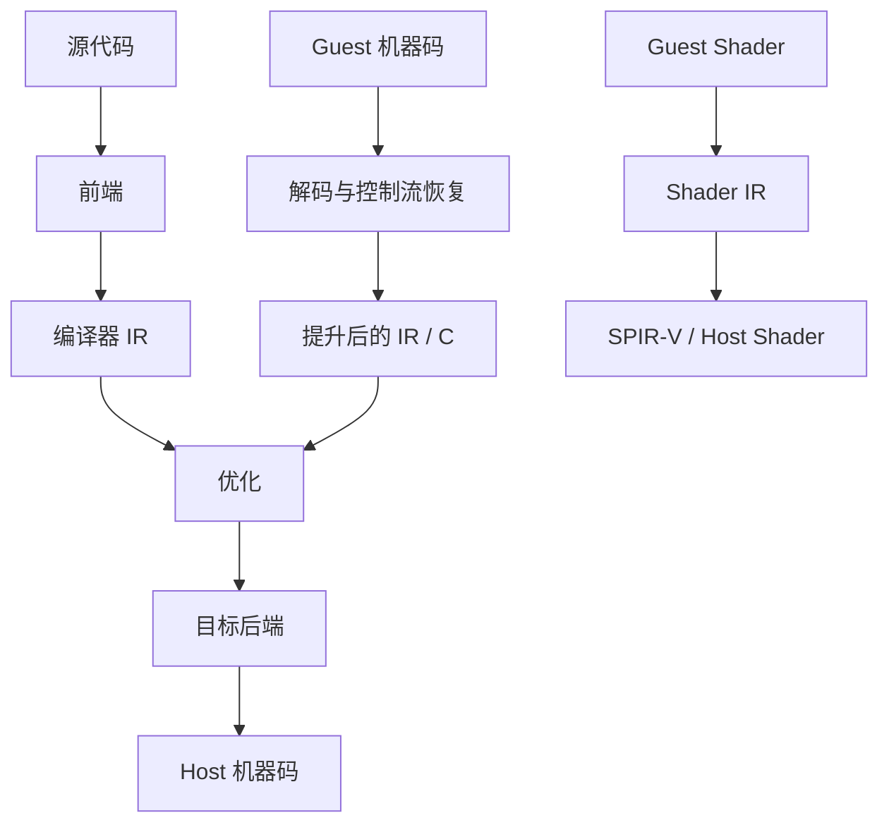

# 编译器与程序翻译

传统编译器把源语言降低到目标 ISA；模拟器和静态重编译器面对的输入却常常已经是机器码。它们仍需完成“恢复语义、转换表示、优化、生成目标代码”，只是信息更少，控制流和系统边界也更难还原。

## 阅读顺序

| 顺序 | 笔记 | 要建立的认识 |
| --- | --- | --- |
| 1 | [JIT 与 AOT：翻译时机的选择](./jit-and-aot.md) | 为什么 Lichii 在运行时翻译，而 Hookshot 在构建时翻译 |
| 2 | [从 ARM64 机器码恢复程序：Binary Lifting](./binary-lifting.md) | 怎样恢复指令语义、控制流、函数、跳转表与运行时状态 |
| 3 | [中间表示为何是翻译系统的核心](./intermediate-representation.md) | IR 如何隔离 guest 前端、优化与 host 后端 |
| 4 | [从 Clang 到链接器：编译流水线](./compilation-pipeline.md) | Clang、LLVM、汇编器、对象文件和链接器怎样协作 |

Shader 重编译仍作为后续专题；先建立这组 CPU 与程序翻译基础，再进入图形侧的指令、资源和管线语义。

## 三种容易混淆的路径

| 路径 | 输入 | 翻译发生时机 | 主要难点 |
| --- | --- | --- | --- |
| 普通 AOT 编译 | 源代码 | 构建期 | 保留语言语义并面向目标机优化 |
| JIT / 动态二进制翻译 | IR、字节码或 guest 机器码 | 运行期 | 启动成本、缓存、间接跳转、自修改代码与精确状态 |
| 静态二进制提升 | guest 可执行文件 | 构建期 | 函数边界、控制流、重定位、动态行为和系统接口 |

“先转成 C”并不会自动解决二进制提升问题：生成的 C 只是中间载体，guest 寄存器、内存和控制流的语义仍须显式保存。相反，JIT 也不天然比 AOT 更快；它用运行时信息换取额外编译和缓存成本。

AI Infra 中的 [模型导出、异构推理与性能测量](../../ai-infra/模型导出、异构推理与性能测量.md) 也会经过计算图、转换和 lowering，但输入语义、允许的变换与目标运行时不同。可以类比编译思想，不能把两者当成同一套编译器。
