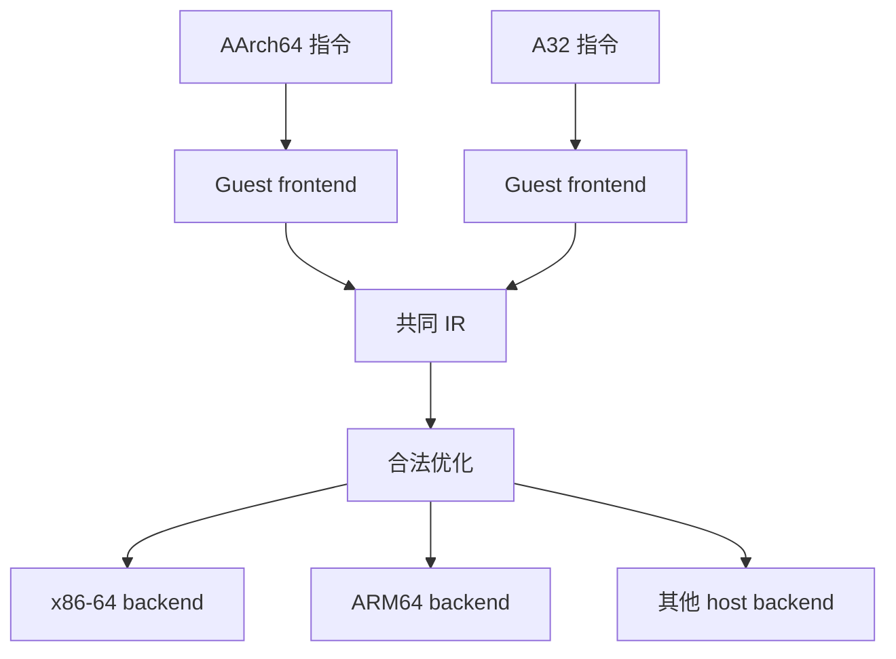

# 中间表示为何是翻译系统的核心

如果每种 guest ISA 都直接对应每种 host ISA，支持 (N) 个前端和 (M) 个后端可能需要维护 (N\times M) 套翻译逻辑。中间表示（Intermediate Representation，IR）把问题拆成“guest 语义 → IR”和“IR → host 语义”，让解码、优化与代码生成拥有共同边界。

若还没有建立传统编译器主线，先读[中间代码生成](./middle-end/intermediate-code-generation.md)、[控制流图与数据流分析](./middle-end/control-flow-and-data-flow.md)和[经典编译优化](./middle-end/compiler-optimizations.md)。TAC、LLVM IR、Dynarmic IR 与 shader IR 都叫 IR，但抽象层次、类型系统和可观察语义不同。

IR 不是越接近高级语言越好，也不是某种固定格式。它应当显式表达当前系统最关心的语义，同时隐藏后续阶段不需要反复处理的编码细节。

## 1. IR 位于哪一层



前端负责解释 guest 指令“是什么意思”，后端负责在 host 上“怎样实现这个意思”。优化器位于两者之间，只能进行 IR 语义允许的等价变换。

## 2. 基本块、控制流图和终结指令

**基本块**是一段只有一个入口、控制只从末尾离开的直线代码。多个基本块通过分支边构成控制流图（CFG）。JIT 常以基本块为最小翻译和缓存单位，因为从某个 PC 开始解码到分支为止，边界能在运行时快速确定。

IR block 末尾需要明确的 terminal，例如：

- 跳到已知下一个 guest block；
- 根据条件选择两个目标；
- 返回 dispatcher，让它根据 guest PC 再决定；
- 触发异常、系统调用或停止执行。

terminal 不是普通算术指令。它描述生成代码结束后控制权属于谁，也是 block linking 和 cache dispatch 的基础。

## 3. 为什么 SSA 适合优化

静态单赋值（SSA）要求每个 IR 值只定义一次。下面是概念示意，并非 Dynarmic 的逐字输出：

```text
%x1 = GetX 1
%x2 = GetX 2
%sum = Add %x1, %x2
SetX 0, %sum
```

由于 `%sum` 只有一个定义，优化器更容易回答：它来自哪里、被谁使用、是否为常量、删除某条指令后还有没有消费者。常量传播、无用代码消除和冗余 context 读写消除都受益于明确的数据依赖。

SSA 并不意味着物理 CPU 有无限寄存器。后端仍需做 register allocation，把 IR value 放到有限 host 寄存器或栈槽中。

## 4. Dynarmic 的 IR 负责什么

Dynarmic 的设计文档把翻译分为五步：decode、translate、optimize、emit、execute。文档的开头和部分示例仍以早期 A32 实现为背景，因此不能单凭它判断当前 A64 覆盖；当前 Lichii 源码已经包含 A64 frontend、typed ordered SSA IR，以及 x64、ARM64、RISC-V 64、LoongArch 64 等后端目录。

对当前 A64 路径，更可靠的阅读顺序是：

1. `frontend/A64/decoder/`：根据指令位模式选择 visitor；
2. `frontend/A64/translate/`：从当前 location 开始读取并翻译基本块；
3. A64 `IREmitter`：生成通用 IR 操作；
4. `ir/opt_passes.cpp`：执行 callback 配置折叠、context get/set 消除、常量传播和无用代码消除等；
5. 具体 host backend：寄存器分配并发射 host 指令。

Dynarmic IR 不只包含 `Add`、`And` 这类算术，还需要表达：

- 读写 guest 通用寄存器、向量寄存器和标志；
- guest 内存访问；
- supervisor call、异常与 cache 操作；
- guest location 和 block terminal；
- host 后端无法直接提供时需要 polyfill 的操作。

这种“context 操作很多”的 IR 看起来比普通表达式树繁琐，却给优化器机会消除相邻的 guest 状态读写，并在必须返回 runtime 时保持精确状态。

## 5. Lichii 怎样选择 IR 优化

Lichii 的 `ArmDynarmic64::MakeJit()` 通过 `UserConfig` 控制 Dynarmic 优化。调试模式可以分别关闭 block linking、return stack buffer、快速 dispatcher、get/set elimination、constant propagation 和其他 IR 优化；paranoid 模式可以整体关闭优化。

这个接口说明了两点：

第一，优化是语义实现的一部分，不只是“编译器神奇地让代码变快”。当调试或内存访问需要在更细边界停下时，某些跨指令优化不能继续沿用。

第二，准确性开关和优化开关不能混为一谈。安全的等价变换应保持 guest 语义；允许改变浮点误差、NaN 或同步行为的选项需要单独声明条件，不能默认为无害。

## 6. Hookshot 的 C 是不是 IR

从程序转换的角度，Hookshot 生成的 C 确实承担了一层中间表示的作用：它不追求恢复原始源码，而是显式编码 guest context、内存和控制流，再交给 Clang。

但它与 Dynarmic IR 有重要区别：

| 维度 | Dynarmic IR | Hookshot lifted C |
| --- | --- | --- |
| 主要消费者 | Dynarmic 自己的优化与 host backend | Clang 前端及 LLVM 优化/后端 |
| 粒度 | JIT 基本块与显式 terminal | guest 函数和 C 控制流 |
| 语义规则 | 由 Dynarmic opcode 与 verifier 定义 | 同时受 C 语言规则约束 |
| 生命周期 | 运行时生成，随后发射为内存中的 host code | 构建时写成文件，编译为对象并链接 |
| 可移植性 | 需要实现新的 host backend | 可复用支持目标平台的 C/LLVM 工具链 |

因此，把 C 称为“便携 IR”有助于理解架构，但不能忽略 C 的未定义行为、别名、浮点和原子语义。为了让 Clang 正确优化，生成器必须输出一份合法且语义明确的 C 程序。

## 7. 为什么不直接逐指令发射 host 指令

直接映射看似更简单，例如 guest add 对应 host add，但很快会遇到：

- guest 与 host 标志位定义不同；
- 一条 guest 指令可能需要多条 host 指令或 helper；
- host 没有对应指令，需要分解；
- 连续 guest 指令产生的中间状态可以合并或消除；
- guest 寄存器数、向量宽度和浮点行为不同；
- 同一前端需要支持多个 host ISA。

IR 让前端先写出“正确但未必最快”的语义，再由优化器和后端根据 host 能力选择实现。代价是需要维护 IR verifier、优化合法性、register allocator 和 backend。

## 8. IR 优化必须证明什么

一个变换能减少指令，并不代表可以使用。至少要检查：

- 对所有可能输入，输出寄存器和内存是否一致；
- guest flags、异常和 trap 时机是否保持；
- 浮点舍入、NaN、signed zero 和异常标志是否一致；
- 原子性、memory ordering 与可见性是否保持；
- 被删除的 context 写入是否会在 callback、SVC 或 block exit 前被观察。

这也是差分测试适合指令翻译器的原因：为同一初始状态执行 reference 与 translated path，比较完整的可观察状态。随机测试可以扩大覆盖，但无法替代对优化前提的推理。

## 9. 与 Shader Recompiler 的联系

Shader recompiler 同样需要 frontend → IR → optimization → backend，因为 guest shader ISA、host SPIR-V 和 GPU 驱动之间也存在语义差异。但 shader IR 还要表达执行阶段、纹理、采样、资源绑定和 SIMT 行为。CPU IR 的概念可以迁移，具体 opcode 与合法变换不能直接照搬。

下一篇 [从 Clang 到链接器](./compilation-pipeline.md) 将沿 Hookshot 的 lifted C 继续向下，解释 C 怎样经过 Clang/LLVM、对象文件和 LLD 变成最终程序；也会区分这条 AOT 工具链与 Dynarmic 自己的运行时代码生成。完成图形与 GPU 基础后，可继续阅读 [Shader Recompiler：从 GPU ISA 到 SPIR-V](./shader-recompilation.md)，观察 stage、texture 和 descriptor 语义怎样进入另一种 IR。

## 源码阅读入口

- Lichii [`Dynarmic Design`](https://github.com/zortos293/Lichii/blob/6cd99d2e1523706c491031740b167201ca8f0acf/docs/dynarmic/Design.md)：阶段、ordered SSA、terminal 和 register allocation 的入门；A64 细节需对照当前源码。
- Lichii [`A64 translate`](https://github.com/zortos293/Lichii/blob/6cd99d2e1523706c491031740b167201ca8f0acf/src/dynarmic/src/dynarmic/frontend/A64/translate/a64_translate.cpp)：从 location 读取并翻译基本块。
- Lichii [`IR optimization passes`](https://github.com/zortos293/Lichii/blob/6cd99d2e1523706c491031740b167201ca8f0acf/src/dynarmic/src/dynarmic/ir/opt_passes.cpp)：A64 context elimination、constant propagation 与 DCE。
- Hookshot [`a64-kit/a64_lift.py`](https://github.com/NotRexed/Hookshot/blob/ba005ca4fa179ccd2140f06f9308d0ff63894ff6/third_party/a64-kit/lift/a64_lift.py)：guest 函数和控制流到 C 的模型。
- [LLVM Language Reference](https://llvm.org/docs/LangRef.html)：LLVM IR 的官方语义参考；它与 Dynarmic IR 是不同系统。
