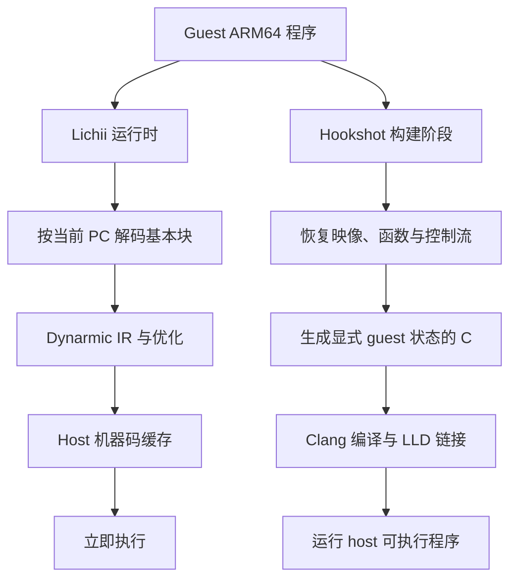
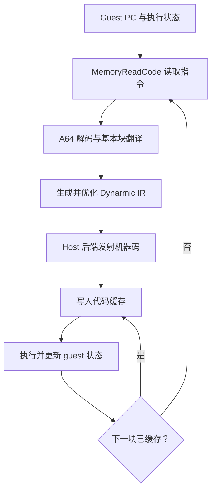

# JIT 与 AOT：翻译时机的选择

Lichii 和 Hookshot 都要让 ARM64 guest 程序在另一套 host 环境中运行，但选择了不同的时间边界：Lichii 在程序运行时按需生成 host 代码，Hookshot 在构建阶段把已知程序提升为 C，再编译、链接成 host 可执行程序。

区别不只是“什么时候调用编译器”。它决定了翻译器能看到哪些信息、必须保留哪些运行时设施，以及代码变化时由谁负责重新生成结果。

## 1. JIT 与 AOT 在这里分别指什么

**JIT（Just-In-Time）**在执行临近时翻译代码。动态二进制翻译器通常从当前 guest PC 开始读取指令，形成基本块，经过 IR 和优化后生成 host 机器码，并缓存生成结果。再次执行相同块时可以直接进入代码缓存。

**AOT（Ahead-Of-Time）**在运行前完成翻译。Hookshot 的输入已经是 ARM64 机器码，所以它不是普通的“源代码 AOT 编译”，而是**静态二进制提升 + 普通 host 编译**：先恢复足够的程序结构并生成 C，再让 Clang 与 LLD 完成后续工作。



## 2. Lichii 的运行时翻译链

在当前公开版本中，Lichii 的 `ArmDynarmic64::MakeJit()` 创建 `Dynarmic::A64::UserConfig`，把以下边界交给 Dynarmic：

- 读取指令和访问 guest 内存的 callback；
- guest 页表和 fastmem 映射；
- 处理器编号、exclusive monitor 和系统寄存器状态；
- 时钟、周期计数与异常回调；
- 代码缓存容量与安全/非安全优化开关。

线程执行最终进入 `Dynarmic::A64::Jit::Run()`；单步调试进入 `Step()`。因此 Dynarmic 不是一个离线调用的 Clang 前端，而是 Lichii CPU 执行器内部的一部分。

第一次到达某个 guest 位置时，典型路径可以抽象为：



这里的“动态”很重要：待运行程序是模拟器的输入，不必在构建 Lichii 时就固定；间接分支的实际目标会在运行时出现；某些代码页还可能被调试器或 guest 修改。

## 3. 为什么 JIT 需要代码缓存和失效

如果每次到达同一 PC 都重新解码、优化和发射，翻译成本会反复发生。代码缓存把 guest 位置及其相关执行模式映射到已生成的 host 代码，使热块可以直接复用；块链接、快速分派和返回栈缓冲等优化进一步减少反复回到 dispatcher 的成本。

缓存也带来一致性责任。当前 Lichii 代码中：

- `ClearInstructionCache()` 调用 `Jit::ClearCache()`；
- `InvalidateCacheRange(addr, size)` 同时丢弃 Lichii 的已缓存指令页，并调用 Dynarmic 的范围失效；
- Dynarmic callback 收到相应 instruction-cache 操作时，会请求停止当前执行，以便失效在安全边界生效。

因此，代码缓存不是普通的数据 memoization。它缓存的是“这些 guest 字节在某组模式下已经翻译出的可执行语义”；guest 指令、位置相关状态或翻译配置变化时，旧 host 代码可能不再有效。

## 4. Hookshot 的构建期翻译链

Hookshot 当前的 `nx2/lift.py` 先构造已经加载和重定位的 guest 映像，再发现函数、控制流与跳转表。启用写出后，a64-kit 生成多个 C 文件，并为运行时表、HLE hook 和独立运行环境生成辅助文件。随后 `nx2/build.py`：

1. 将 lifted C、AArch64 runtime 和 host runtime 分别编译为对象文件；
2. 默认用较温和的优化等级处理大量生成代码，对识别出的 hot code 使用单独策略；
3. 缓存对象文件，并用稳定 chunk 限制局部修改导致的全量重编译；
4. 通过 LLD 链接 host 可执行程序和所需动态库。

运行时不再为每个 guest 基本块启动动态代码生成器，但仍需要 guest context、内存映射、间接调用分派、系统接口替代和错误处理。AOT 移走的是主要翻译成本，不是 guest/host 语义差异。

## 5. 为什么“ARM64 → C → host 机器码”可行

关键不是把 ARM64 汇编逐字改写成“看起来像源代码”的 C，而是建立一个显式状态机。a64-kit 的模型把 guest 函数写成类似：

```c
void f_guest_address(Ctx *c);
```

其中 `Ctx` 保存 guest 通用寄存器、向量寄存器、栈指针、标志和浮点状态；guest 内存访问通过受控的地址映射或 helper 完成。直接分支可以变成 C 的 `goto` 或函数调用，不能静态确定的目标则进入运行时查找。

下面只是概念示意，不是仓库生成文本的逐字摘录：

```c
// guest: ADD X0, X1, X2
c->x[0] = c->x[1] + c->x[2];
```

只要生成器完整保存 ARM64 的整数溢出、标志、浮点、原子操作、内存顺序和异常语义，Clang 就能把这些 C 运算继续降低为 host 机器码。真正困难的正是“完整保存语义”：C 的未定义行为、host 浮点规则、并发内存模型和 guest ABI 都不能靠编译器自动猜出。

## 6. 两种选择的权衡

| 维度 | Lichii / 运行时 JIT | Hookshot / 静态提升 + AOT |
| --- | --- | --- |
| 翻译输入 | 当前执行到的 guest 指令块 | 构建时可获得的完整已知映像 |
| 翻译成本 | 首次执行和缓存失效时发生 | 主要发生在构建阶段 |
| 运行时灵活性 | 容易处理按需路径、未知输入和代码变化 | 更依赖静态覆盖、间接目标恢复与运行时兜底 |
| 优化范围 | 常以基本块或短 trace 为单位，受编译延迟约束 | 可借助 Clang 对较大 C 单元优化并由链接器统一组织 |
| 产物 | 内存中的 host 代码缓存 | 对象文件、可执行程序和运行时库 |
| 调试重点 | block key、dispatcher、cache invalidation、guest/host 状态切换 | 函数发现、控制流覆盖、生成 C、对象缓存与链接闭包 |

不能据此得出“JIT 一定启动慢但峰值快”或“AOT 一定性能更高”。结果取决于块粒度、生成代码质量、工作负载覆盖、构建优化等级、间接分派和内存模型等具体条件。

## 7. 两个容易忽略的双层编译

Lichii 本身仍要由 C++ 编译器 AOT 构建；只是它运行 guest 时，Dynarmic 又进行第二层 JIT。Hookshot 也有两层：Python lifter 生成 C，Clang 再把 C 降低到 host 对象文件。讨论“JIT 还是 AOT”时必须先说清楚对象是**宿主程序本身**还是**guest 程序**。

接下来阅读 [Binary Lifting](./binary-lifting.md)，具体看 Hookshot 如何为构建期翻译恢复足够的程序结构；[中间表示](./intermediate-representation.md) 则解释 Dynarmic 为什么不直接为每条 ARM64 指令手写一份 host 指令序列。

## 源码阅读入口

- Lichii [`arm_dynarmic_64.cpp`](https://github.com/zortos293/Lichii/blob/6cd99d2e1523706c491031740b167201ca8f0acf/src/core/arm/dynarmic/arm_dynarmic_64.cpp)：JIT 配置、执行、状态交换与代码缓存失效。
- Lichii [`Dynarmic A64 interface`](https://github.com/zortos293/Lichii/blob/6cd99d2e1523706c491031740b167201ca8f0acf/src/dynarmic/src/dynarmic/interface/A64/a64.h)：`Run`、`Step`、cache 与 guest 状态接口。
- Hookshot [`nx2/lift.py`](https://github.com/NotRexed/Hookshot/blob/ba005ca4fa179ccd2140f06f9308d0ff63894ff6/nx2/lift.py)：映像、发现、覆盖统计和 C 写出入口。
- Hookshot [`nx2/build.py`](https://github.com/NotRexed/Hookshot/blob/ba005ca4fa179ccd2140f06f9308d0ff63894ff6/nx2/build.py)：Clang 编译、对象缓存和 LLD 链接。
