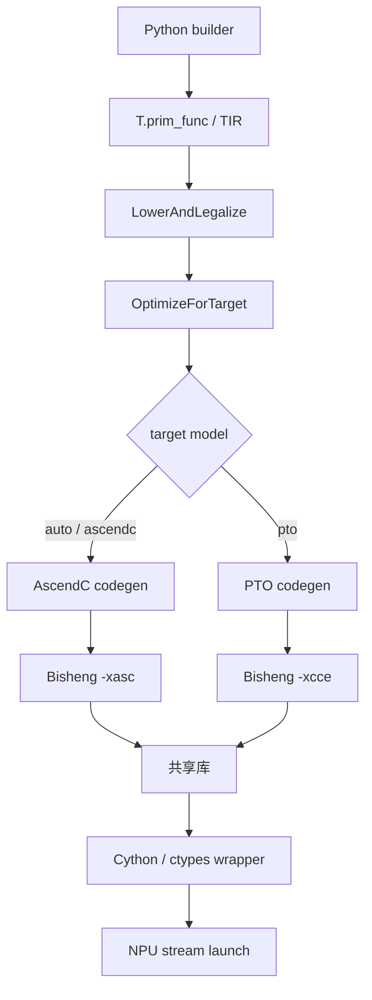

# Lowering 与硬件代码生成

Lowering 不是“一键把 TIR 变成 C++”，而是一串逐步收紧语义的 pass。以下固定到 `ascendc_pto` commit [`c3b324a`](https://github.com/tile-ai/tilelang-ascend/tree/c3b324ac955271fd245346be465fbdd39fd4bd18)。

## 1. 前端到设备源码

`engine/lower.py` 用 TVM Target 的 `model` 字段选择后端；`llvm` 在这里主要是 Target 外壳，不表示 NPU kernel 最终由 LLVM CPU backend 生成。

## 2. LowerAndLegalize 的职责

当前序列的关键阶段包括：

1. 推断 buffer scope，注入临时 buffer；
2. 处理 Vector resource index 与 shape；
3. 绑定 target、提取 host tiling 信息；
4. 把 `T.Parallel` 降为可支持的 Vector 表达；
5. 推导 layout；
6. lower `T.copy`、GEMM 等 tile op；
7. 传播 tail mask、处理 workspace reduction；
8. 合法化 vector loop 与安全内存访问。

这一阶段回答“抽象操作在目标后端是否合法、需要哪些具体 buffer/layout”，还没有完成最终物理地址和同步。

## 3. OptimizeForTarget 的职责

后续序列依次处理 buffer allocation location、跨 C/V pipeline、C/V ownership、pipeline planning/injection、buffer flatten、vectorize/unroll、storage rewrite、memory planning、sync insertion 和最终 resource-scope 验证。A2/A3 AscendC 路径还做相应 Vector 指令选择与 mask 合法化。

顺序反映依赖：pipeline 先产生版本化 buffer，memory planning 才能为最终生命周期分配地址；同步分析读取 `address_map/size_map` 后才能发现两个逻辑 buffer 的物理 alias。

## 4. Memory planning 不是 runtime malloc

`AscendMemoryPlanning` 收集 L1、UB、L0A/B/C allocation，按 32-byte 对齐计算 footprint，并把 byte offset/size 写回 PrimFunc 属性。关闭复用配置时仍线性排布；开启后用 liveness 和 linear scan 复用不重叠区域。

codegen 再把 offset 变为 AscendC `GetWithOffset` 或 PTO `TASSIGN`。源码中的容量预算是当前编译器常量，且不同平台路径并未完全统一参数化，不能当作所有昇腾产品的官方容量。

## 5. 同步插入的三个层次

1. 用户显式 `barrier_all/set_flag/wait_flag`；
2. `AscendSyncInsert` 根据读写、操作流水和物理 alias 分析 RAW/WAR/WAW，并检查 loop-carried dependency；
3. `AscendSyncInsertVS` 针对 Vector/Scalar/MTE2/MTE3 的相关依赖。

`CombineCV` 决定 operation 的 C/V ownership，`CrossCorePipeline` 负责跨 C/V workspace/pipeline versioning；二者都不等于普通 barrier 插入。

## 6. AscendC 与 PTO codegen

AscendC 后端生成 `__aicore__` kernel、GlobalTensor、TPipe/TBuf 与 host tiling/call 代码，再通过 `bisheng -xasc` 编译。PTO 后端生成 PTO Tile 和 `TADD/TEXP/TROWSUM`、`gemm_v0` 等形式，用 `TASSIGN` 绑定地址，再通过 `bisheng -xcce` 编译。

两者共享前面的部分 TIR 优化，但生成 API、host tiling 和工具参数不同。固定提交中 PTO 的 host tiling 输入处理为空，不能说它与 AscendC host tiling 功能完全等价。

## 7. CANN 边界

开源仓库能证明生成了什么源码、怎样调用 Bisheng 和怎样启动共享库；Bisheng/CANN 内部如何继续降低为设备二进制不在仓库中。官方资料确认可用 Bisheng 编译 AI Core operator，并由 CANN runtime 加载/启动，但不能凭上层源码补写其内部私有 pass。

## 源码入口

- [`phase.py`](https://github.com/tile-ai/tilelang-ascend/blob/c3b324ac955271fd245346be465fbdd39fd4bd18/tilelang/engine/phase.py)
- [`ascend_memory_planning.cc`](https://github.com/tile-ai/tilelang-ascend/blob/c3b324ac955271fd245346be465fbdd39fd4bd18/src/transform/ascend_memory_planning.cc)
- [`ascend_sync_insert.cc`](https://github.com/tile-ai/tilelang-ascend/blob/c3b324ac955271fd245346be465fbdd39fd4bd18/src/transform/ascend_sync_insert.cc)
- [`codegen_ascend.cc`](https://github.com/tile-ai/tilelang-ascend/blob/c3b324ac955271fd245346be465fbdd39fd4bd18/src/target/codegen_ascend.cc)、[`codegen_ascend_pto.cc`](https://github.com/tile-ai/tilelang-ascend/blob/c3b324ac955271fd245346be465fbdd39fd4bd18/src/target/codegen_ascend_pto.cc)
- [Ascend C operator compilation](https://www.hiascend.com/document/detail/en/CANNCommunityEdition/910/programug/Ascendcopdevg/docs/en/guide/programming_guide/compilation_and_execution/operator_compilation/ai_core_operator_compilation_basic_usage.md)

