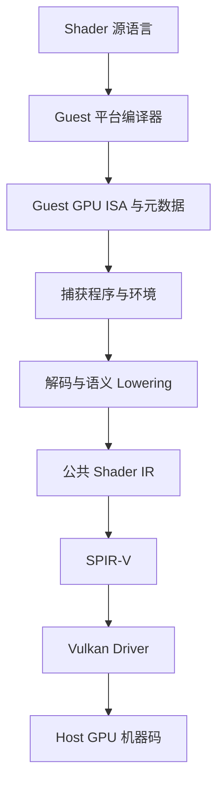
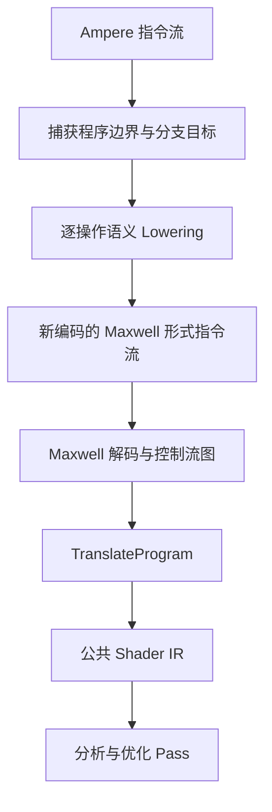
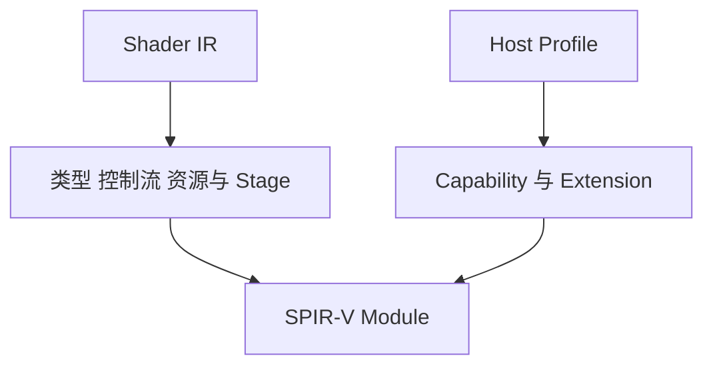

# Shader Recompiler：从 GPU ISA 到 SPIR-V

这条链仍可用 frontend → IR → optimization → backend 理解。传统基础见[编译器总览](./)、[数据流与优化](./middle-end/control-flow-and-data-flow.md)和[代码生成](./backend/code-generation.md)；shader 的执行阶段、资源和 SIMT 语义则必须由专用 IR 继续携带。

普通图形应用常从 GLSL、HLSL 等源语言开始；兼容层或模拟器面对的却可能是已经为 guest GPU 编译好的机器指令。Shader Recompiler 的任务不是恢复一份可读的原始源码，而是在保留执行阶段、控制流、资源访问与并行语义的前提下，把 guest GPU 程序转换成 host 图形 API 能接受的表示。

本文以固定版本的公开源码为例：Lichii `nx2` 的 `9441129819edfee62e65ff6030749e80f420ba1e`，以及 Hookshot `main` 的 `e9975d6c245275aaf89a34e8d17a6bbe8badab46`。两者包含继承自其他公开项目的代码；这里讨论可观察的实现路径，不把整套 Shader Recompiler 归因于单一项目或作者。

## 1. 为什么游戏里的 Shader 已经是机器指令

面向固定主机平台发布游戏时，开发者通常在构建阶段就知道目标 GPU 和平台 API。源 Shader 会被平台工具链预编译，游戏包或运行时缓存保存的是目标平台能直接消费的二进制及配套元数据。这样可以减少用户设备上的编译工作，也便于平台编译器针对确定的 GPU 做优化。

因此，在本文讨论的 guest 平台中，兼容层读取到的不是原始 HLSL/GLSL，而是 guest GPU ISA。它仍要知道程序属于 vertex、fragment 还是 compute stage，并取得资源描述、入口和管线状态，才能解释指令的完整含义。

这不是所有游戏和 API 的通用规则。有的平台会分发源码或中间表示，有的会同时保存多个变体。应先识别实际文件和运行时接口，不能看到一段二进制就假定它一定是最终 GPU 机器码。

这条链有两次容易混淆的“编译”：Shader Recompiler 把 guest 语义变成 SPIR-V；host Vulkan 驱动再把 SPIR-V 变成当前物理 GPU 的代码。

## 2. Ampere 与 Maxwell 是什么

Maxwell 和 Ampere 是 NVIDIA 的 GPU 架构家族，不是 Shader 语言，也不是两个可互换的文件格式。NVIDIA 的公开 CUDA 文档将 Maxwell 设备归为 compute capability 5.x，将 Ampere 设备归为 8.x。它们延续了相似的 GPU 并行编程模型，但硬件单元、指令编码、调度信息、寄存器与新功能都可能不同。

“都来自 NVIDIA”不意味着二进制兼容。即使两代 ISA 都有加法、分支和纹理操作：

- opcode 与字段位置可能不同；
- 一条新指令可能要拆成多条旧形式的操作；
- predicate、uniform register 和控制流约定可能改变；
- 新增的 tensor、mesh 或异步复制语义未必存在直接旧指令；
- 调度控制字和指令宽度也可能不同。

因此，Ampere → Maxwell 必须被理解为**有前提的语义转换**，不能理解为把 Ampere 字节重新标注成 Maxwell 字节。

## 3. Shader ISA 与 CPU ISA 有什么不同

两者都是机器级指令，但所处的执行环境不同。

| 维度 | CPU ISA | Shader / GPU ISA |
| --- | --- | --- |
| 执行主体 | 少量重量级 CPU 线程 | 大量 invocation，按 warp/subgroup 等批次执行 |
| 输入输出 | 寄存器、内存、调用约定、系统接口 | stage 输入输出、built-in、buffer、image、sampler |
| 控制流 | 以单线程 PC 为中心 | 需处理 lane 分歧、predicate 与重汇合 |
| 内存语义 | cache、原子、CPU memory model | storage class、scope、barrier、纹理和共享内存 |
| 专用操作 | 通用标量/向量指令为主 | 纹理采样、导数、插值、subgroup、矩阵等 |
| 外部契约 | ABI、OS、进程地址空间 | shader stage、descriptor、pipeline layout 与固定功能状态 |

CPU binary lifting 主要恢复寄存器、内存、异常和控制流；Shader Recompiler 还必须恢复“这次读取究竟是哪个纹理描述符”“输出写给哪个 stage location”“当前操作需要什么 capability”。只翻译算术 opcode，无法得到可用的 Shader。

## 4. 为什么能复用 Maxwell Frontend

固定版本的 Lichii 源码给出了一个非常明确的边界：`LowerToMaxwell()` 只降低那些能由既有 Maxwell frontend 表达的操作；输出是**新生成的指令**，不是对原生 Ampere 字节的重新解释。环境适配器随后补入调度/控制字，再把结果交给已有 Maxwell 路径。

能够复用的原因不在于两代硬件二进制兼容，而在于工程上已有一个成熟的 Maxwell frontend，它能把一组已知操作翻译到公共 IR。如果某个 Ampere 操作的语义可以用该 frontend 已理解的操作组合表达，就可以先生成等价的 Maxwell 形式，再复用后半段。

这段 lowering 还要处理：

- 源指令到输出指令的地址映射，以及 branch/call relocation；
- predicate、uniform register 与临时寄存器的映射；
- 一对多指令展开和不同字段编码；
- stage buffer、纹理访问等需要的适配信息；
- 不支持模式、越界目标和资源冲突的显式拒绝。

源码中的 `LoweredProgram` 同时保存新指令、源偏移映射、源程序大小、所需纹理 buffer 以及错误位置。它说明 lowering 不是无条件成功的黑盒，更不能推出“所有 Ampere Shader 都能在 Maxwell 硬件上执行”。这里的 Maxwell 形式只是复用 frontend 的内部桥梁，并非最终 host GPU 代码。

## 5. 从 Maxwell Frontend 到 Shader IR

Maxwell frontend 读取适配后的指令流，恢复控制流并构造 IR program。固定版本的 `TranslateProgram()` 不止做逐指令翻译，还会：

1. 根据 shader stage 补充 workgroup、geometry、tessellation 或 mesh 等信息；
2. 生成基本块和结构化控制流；
3. 进行 SSA rewrite、常量传播与无用代码消除；
4. 按 host 能力降低不支持的 FP64、FP16、Int64 或 barrier 形式；
5. 运行 global-memory、geometry、texture 与 rescaling 等 pass；
6. 汇总资源、输入输出和 capability 信息。

IR 的价值与 CPU 翻译相同：它把 guest 编码细节与后端分开。但 Shader IR 还必须携带 stage、attribute、texture、descriptor 和执行模型信息。详见[中间表示为何是翻译系统的核心](./intermediate-representation.md)与[Shader：可编程 GPU 阶段](../graphics-gpu/shaders.md)。

## 6. Shader IR 如何变成 SPIR-V

SPIR-V 是 Khronos 定义的二进制中间语言，不是某个品牌 GPU 的最终 ISA。一个模块包含类型、函数、控制流、entry point、execution model、storage class、decoration 和 capability 等信息。

Lichii 的 SPIR-V backend 接收四类关键输入：host `Profile`、`RuntimeInfo`、IR `Program` 和资源 `Bindings`。`EmitSPIRV()` 大致完成：

1. 为 IR value 建立 SPIR-V 类型和 ID；
2. 根据 stage 定义 entry point 与 execution mode；
3. 声明输入输出、built-in、buffer、image 和 sampler；
4. 把 IR opcode 发射为 SPIR-V 指令与结构化控制流；
5. 按实际使用声明 capability 和 extension；
6. 汇编并处理需要的后端修补。

生成的模块还必须同时满足 SPIR-V 规则和 Vulkan 的 SPIR-V execution environment。语法上能编码某条指令，不代表目标设备启用了相应 feature，也不代表 stage 接口和 descriptor layout 一致。

## 7. Vulkan Driver 如何得到目标 GPU 代码

Vulkan 接受 SPIR-V shader module，并在 pipeline 创建等阶段把入口、layout、specialization 与固定状态组合起来。驱动掌握物理设备的真实 ISA、寄存器文件、调度器、缓存和编译策略，因此由它完成剩余的验证、优化、寄存器分配、指令选择与调度，生成设备可执行代码。

Khronos 的 SPIR-V 规范也明确保留了这一步：SPIR-V 可以提前承担一部分编译工作，但目标相关的寄存器分配和调度仍可能很昂贵。因此：

- SPIR-V 可跨一类 Vulkan 实现表达语义，但不是“一次生成、所有 GPU 直接执行”；
- shader module 创建成功不保证完整 graphics pipeline 一定创建成功；
- pipeline cache 可以减少重复工作，但不能脱离设备、驱动版本和兼容规则任意搬运；
- 首次运行卡顿可能来自 guest 翻译，也可能来自 host 驱动 pipeline 编译。

这一步与[Vulkan 基础](../graphics-gpu/vulkan-basics.md)中的 pipeline object、layout 和 cache 直接相连。

## 8. 为什么编译还依赖 Texture、Buffer 和 GPU 状态

Guest 指令往往只给出寄存器、句柄或 constant-buffer 偏移；资源的真实类型、维度、格式和绑定位置来自当前 GPU 状态。相同指令位在不同 stage、descriptor 模式或 host feature 下，可能需要生成不同 SPIR-V。

需要把两类输入分开：

| 类别 | 例子 | 对重编译的影响 |
| --- | --- | --- |
| 编译期语义/特化状态 | shader stage、程序头、资源类型与维度、descriptor 模式、stage 接口、host capability | 可能改变 IR、SPIR-V、pipeline layout 或 cache key |
| 运行期绑定与数据 | 具体 texture texel、buffer 内容、draw 时动态 offset | 通常通过 descriptor/command 提供，不应全部烘焙进 Shader |

Texture 指令尤其依赖 descriptor：2D 还是 cube、sampled 还是 storage、返回类型、数组层和采样方式都会影响合法 SPIR-V 类型。Buffer 访问则需要知道地址模型、范围、读写性质与对应 binding。当前 GPU 状态还给出 shader stage、固定功能接口和相邻 stage 的契约。

但“依赖 Texture”不等于编译器必须读取整张纹理内容。通常需要的是**描述资源语义的元数据**；实际像素和 buffer 数据在运行时绑定。一个正确的 Shader cache key 应覆盖所有会改变生成代码的状态，而不是机械地散列每一份动态资源内容。

## 9. 一条完整的执行链

把以上步骤连起来，可以得到：

1. 从 guest GPU memory 捕获 Shader 机器指令，确定程序边界；
2. 读取 stage、程序头、纹理/constant-buffer 等必要环境；
3. 将受支持的 Ampere 操作语义 lowering 成新的 Maxwell 形式指令；
4. 复用 Maxwell frontend 恢复 CFG，并翻译到公共 Shader IR；
5. 运行与 host capability、资源访问有关的分析和 lowering pass；
6. 将 IR、runtime info 和 bindings 发射成 SPIR-V；
7. 用 SPIR-V 与 Vulkan pipeline state 创建 host pipeline；
8. host 驱动再编译成目标 GPU 代码并执行。

调试时应先判断故障位于哪一层：捕获错误、未支持 opcode、错误 relocation、IR lowering、无效 SPIR-V、descriptor/pipeline 不匹配和 Vulkan 同步错误的症状可能相似，修复位置却完全不同。

## 10. 阅读边界与下一步

本文最重要的边界是：

- Ampere → Maxwell 是受限的语义 lowering，不是原始字节复用；
- Maxwell frontend 是通向公共 IR 的内部前端，不是最终硬件后端；
- SPIR-V 是 Vulkan 消费的中间表示，host 驱动仍要生成设备代码；
- Shader 语义由指令、stage、资源描述和 pipeline 状态共同决定；
- 公开源码中的继承目录、项目适配与上游通用实现需要分别归因。

建议先后回看 [GPU 执行架构](../graphics-gpu/gpu-architecture.md)、[纹理、采样器与 Framebuffer](../graphics-gpu/textures-and-sampling.md)和[Vulkan 基础](../graphics-gpu/vulkan-basics.md)，再沿下面的固定源码入口逐层跟踪。

## 公开资料与源码入口

- NVIDIA [Maxwell Tuning Guide](https://docs.nvidia.com/cuda/archive/9.1/maxwell-tuning-guide/index.html) 与 [Ampere Tuning Guide](https://docs.nvidia.com/cuda/ampere-tuning-guide/index.html)：架构家族和 GPU 并行执行背景；它们不是本文 guest Shader 编码的完整 ISA 规范。
- Khronos [SPIR-V Specification](https://registry.khronos.org/SPIR-V/specs/unified1/SPIRV.html)：SPIR-V 的模块、SSA、execution model 与 capability。
- Vulkan Specification [Shaders](https://docs.vulkan.org/spec/latest/chapters/shaders.html)：Vulkan 如何接收 SPIR-V module 并选择 entry point。
- Lichii [`lower_to_maxwell.h`](https://github.com/zortos293/Lichii/blob/9441129819edfee62e65ff6030749e80f420ba1e/src/shader_recompiler/frontend/ampere/lower_to_maxwell.h)：受支持 Ampere 操作到新 Maxwell 形式指令的 lowering 与失败边界。
- Lichii [`shader_environment.cpp`](https://github.com/zortos293/Lichii/blob/9441129819edfee62e65ff6030749e80f420ba1e/src/video_core/shader_environment.cpp)：捕获 native program、缓存 lowering 结果并建立 frontend 环境。
- Lichii [`translate_program.cpp`](https://github.com/zortos293/Lichii/blob/9441129819edfee62e65ff6030749e80f420ba1e/src/shader_recompiler/frontend/maxwell/translate_program.cpp)：CFG、IR 与优化 pass 的入口。
- Lichii [`emit_spirv.cpp`](https://github.com/zortos293/Lichii/blob/9441129819edfee62e65ff6030749e80f420ba1e/src/shader_recompiler/backend/spirv/emit_spirv.cpp)：从 IR program、profile、runtime info 和 bindings 发射 SPIR-V。
- Hookshot [`lower_to_maxwell.h`](https://github.com/NotRexed/Hookshot/blob/e9975d6c245275aaf89a34e8d17a6bbe8badab46/gpu/vk/eden/shader_recompiler/frontend/ampere/lower_to_maxwell.h) 与 [`emit_spirv.cpp`](https://github.com/NotRexed/Hookshot/blob/e9975d6c245275aaf89a34e8d17a6bbe8badab46/gpu/vk/eden/shader_recompiler/backend/spirv/emit_spirv.cpp)：对照 Hookshot 固定版本中采用的对应路径；目录名也表明这部分代码的来源关系。
