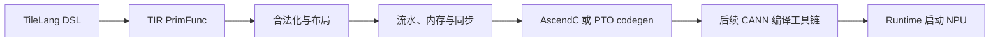

# 张量编译器

传统编译器把语言语义降低为目标 ISA；张量编译器还要回答 shape、layout、tile、并行层级和存储 scope。它的输入通常已经是一个数值算子或 tensor program，而不是包含任意系统调用和对象模型的完整应用。

## 1. 三种“编译”不要混为一谈

| 系统 | 基本输入 | 主要决策 | 输出 |
| --- | --- | --- | --- |
| 传统语言编译器 | 源语言 AST/IR | 类型、控制流、指令与 ABI | 对象文件/机器码 |
| 模型图编译器 | 算子图 | 图级融合、设备放置、全图内存 | 一组 kernels 与执行计划 |
| Tensor/kernel 编译器 | 单个或少量 tensor programs | tile、layout、scope、同步、codegen | 特化设备 kernel |

TileLang-Ascend 当前链属于第三类。它可被模型运行时调用，但审查的路径没有完成整模型分区、跨算子调度或全图内存规划。

## 2. Tensor DSL 为什么存在

直接写设备 intrinsic 能精确控制，却把算法与某代硬件绑定；只写 $C=AB$ 又缺少分块、复用和同步信息。Tensor DSL 在两者之间保留：

- 逻辑 shape、dtype 与索引语义；
- kernel/block、parallel loop 与 pipeline；
- L1/L0/UB 等 scope；
- copy、GEMM、reduce 等 tile operation；
- 可由 pass 推断或显式指定的 layout 和同步。

这些信息进入 TIR 后，编译器才能在“等价变换”和“硬件合法性”两条边界内工作。

## 3. TVM TIR 的角色

TIR 是带有 loop、buffer、scope、intrinsic 和属性的低层 IR。它比 AST 更接近执行，却仍保留足够结构供 pass 分析：循环可做 pipeline，buffer 可做 liveness，读写集合可推导依赖，target-specific op 可继续 lowering。

IR 的价值不是名字叫“中间表示”，而是每一层只承诺一组明确不变量。传统 TAC/LLVM IR 基础见 [中间表示](./intermediate-representation.md)。

## 4. Pass 之间为何有顺序

如果 memory planning 先于最终 pipeline versioning，新增 ring buffer 可能没有地址；如果同步分析早于 layout/scope lowering，它看不到真实物理 alias；如果 codegen 还负责猜测调度，前面 IR 便无法检查和复用。因此 TileLang-Ascend 先做 scope/layout/tile lowering，再做 pipeline、flatten、memory planning 和 sync insertion，最后生成目标代码。

具体 pass 链见 [Lowering 与代码生成](./lowering-and-codegen.md)。

## 5. JIT 的准确含义

TileLang `@tilelang.jit` 在某组 shape/tile 参数首次实例化时：构造 PrimFunc、运行 TIR passes、生成 AscendC/PTO 源码、调用 Bisheng 编译共享库并缓存。后续相同 cache key 复用产物。

这不同于 [Dynarmic JIT](./jit-and-aot.md)：Dynarmic 在 guest 程序运行中按 PC/基本块翻译 Guest CPU 指令；TileLang 输入是已知 tensor program，缓存单位是 kernel specialization。二者都“运行时发生编译”，输入语义、触发时机和目标完全不同。

## 6. Runtime 不只是 `src/runtime/`

在所审查 commit，NPU 执行依赖 codegen 生成的 host `call`、Bisheng/CANN 链接、Cython/ctypes 适配、PyTorch NPU tensor 与当前 stream。仓库 `src/runtime/runtime.cc` 只注册 CUDA TMA helper，不是昇腾 runtime 主链。

运行时负责参数与 pointer、输出/workspace 分配、stream 和 kernel launch；它不重新决定 tile 数学语义。调用默认异步，因此 benchmark 还要在边界显式同步。

## 7. `npuir` 是另一条路线

固定 `npuir` 分支 [`bd7c60c`](https://github.com/tile-ai/tilelang-ascend/tree/bd7c60c312b0721885c78d1ce03c62be9225314c) 采用 TIR→MLIR/HIVM/HFusion→`bishengir-compile`→device object→CANN runtime 注册/启动的路线；它不是 `ascendc_pto` 中 AscendC/PTO codegen 的一个别名。两分支 commit、工具依赖和 runtime wrapper 都不同，功能不能拼接描述。

此外该固定提交的 `target='npuir'` 进入缓存键，但内部 compile 调 `lower(self.mod)` 未显式继续传 target，依赖 auto detection 找到 `bishengir-compile`。这是一项实现耦合，不应写成所有混合工具链环境都能可靠透传 target。

## 参考入口

- [TVM TensorIR](https://tvm.apache.org/docs/deep_dive/tensor_ir/)
- [TileLang JIT（固定 commit）](https://github.com/tile-ai/tilelang-ascend/blob/c3b324ac955271fd245346be465fbdd39fd4bd18/tilelang/jit/__init__.py)
- [TileLang lowering（固定 commit）](https://github.com/tile-ai/tilelang-ascend/blob/c3b324ac955271fd245346be465fbdd39fd4bd18/tilelang/engine/lower.py)

