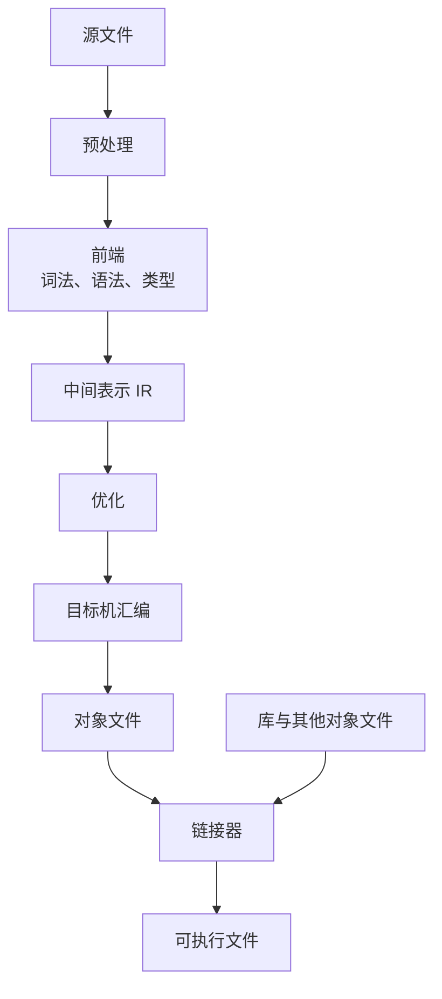
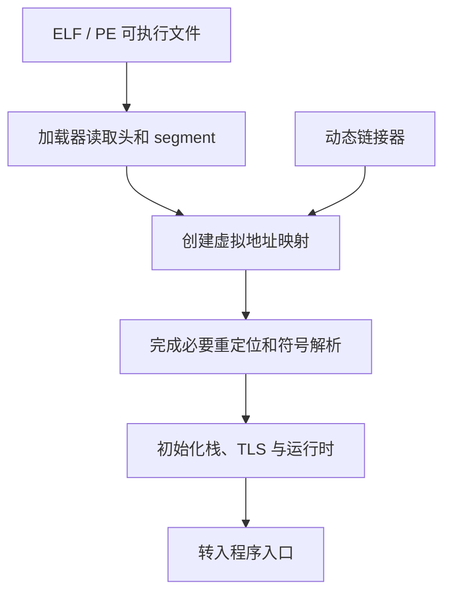

# 程序如何真正运行

在命令行输入 `./app` 时，操作系统并不理解 C++ 的类、Rust 的 trait 或 Python 的函数。它首先识别可执行文件格式，建立进程地址空间，再把控制权交给约定的入口地址。这一页先给出全景，后续各篇再拆开 ISA、ABI、虚拟内存和编译器。

## 1. 从源码到可执行文件

以 C/C++ 为例，常见的 ahead-of-time 编译链可写成：



编译单元通常不知道外部函数最终住在哪个地址，因此对象文件里会保留符号和重定位信息。链接器把多个输入合并，解析符号，布置代码和数据，并产生 ELF、PE 等格式。

“编译成功”不等于“一定可运行”。可执行文件还假设了指令集、操作系统 ABI、动态库、CPU 特性和加载器行为。

## 2. 文件映像不是进程内存的简单拷贝

加载器读取程序头和 segment 信息，将需要的文件区域映射到虚拟地址空间。一个典型进程会包含：

- 可执行代码与只读数据映射；
- 可写全局数据与零初始化区域；
- 由 allocator 管理的堆；
- 每个线程的栈和 thread-local storage；
- 动态库、内存映射文件和运行时区域。

虚拟地址由页表转换为物理页。相同的数值地址在不同进程中可以指向不同物理内存；访问权限也是页映射的一部分。



## 3. ISA 与 ABI 分别约定了什么

**ISA** 定义机器指令及其可见状态，例如寄存器、内存访问、分支、原子操作和 SIMD。**ABI** 定义已编译模块怎样合作，包括调用约定、栈对齐、数据类型布局、系统调用编号和二进制格式约定。

同一 ISA 上也可以有不同 ABI；一段机器码能被 CPU 解码，不代表它能和当前操作系统的库、栈规则和系统调用正确互操作。

## 4. CPU 执行与操作系统边界

CPU 根据程序计数器取得指令，解码并改变寄存器或内存状态。现代 CPU 内部可以乱序执行和投机执行，但必须在 ISA 允许的可观测边界上保持正确结果。

普通应用不能直接执行所有特权操作。它通过系统调用请求内核完成文件、虚拟内存、线程和 IPC 操作。这个过程不是“调用一个普通 C 函数”：它涉及约定的寄存器/内存参数、特殊指令、特权级切换与内核校验。

## 5. GPU 是另一条受约束的执行链

图形 API 调用通常由用户态驱动组织为命令和资源描述，再通过内核驱动提交给 GPU。GPU 与 CPU 可以并行，所以“API 返回”往往不等于“GPU 已经完成”。fence、semaphore、barrier 和 cache 一致性共同规定了何时可以安全读写资源。

这与 [视觉定位的 CPU、GPU 与 NPU 分工](../../robotics-systems/deployment/视觉定位的CPU、GPU与NPU分工.md) 中的设备提交和同步成本是同一类基础问题；本板块后续会从 Vulkan 和图形管线角度展开。

## 6. Lichii 和 Hookshot 改写了链条的不同位置

| 案例 | CPU 代码 | OS 边界 | GPU 路径 |
| --- | --- | --- | --- |
| Lichii | 运行时用 Dynarmic 等后端将 guest ARM 代码翻译为 host 代码 | 在模拟器内实现 kernel/service 语义 | 解释 guest GPU 状态，将 shader 翻译到 host 图形后端 |
| Hookshot | 构建时将特定 AArch64 程序提升为 C，再由 host 编译器 AOT 编译 | host runtime 重实现所需 Horizon/SDK 边界 | 记录 NVN2 操作，用 Vulkan 重放并重编译 shader |

这两种路径都不是“把 ARM 机器码直接当 x86-64 执行”。它们都必须保存必要的 guest 语义，只是翻译时机、适用范围和运行时责任不同。

## 7. 一个可重复的最小观测

可以对自己写的短 C 程序执行：

```bash
cc -O0 -g -c hello.c -o hello.o
readelf -h -S -s -r hello.o
objdump -drwC hello.o
cc hello.o -o hello
readelf -l -d hello
strace -f ./hello
```

观察问题应分层：

1. `.o` 中哪些外部符号还没有地址？
2. 链接后增加了哪些 segment 和动态依赖？
3. `main` 之前哪些启动代码已经执行？
4. 输出一行文本最终触发了哪些系统调用？
5. `-O0` 和 `-O2` 的汇编不同，哪些是优化等价变换，哪些是 ABI 必须保留的规则？

命令输出受操作系统、架构、编译器和链接方式影响，笔记中应记录这些条件，不把某一次输出当作所有平台的固定样子。

下一步可按 [基础原理规划](./) 进入二进制表示、ISA/Assembly、ABI 和内存层次。
