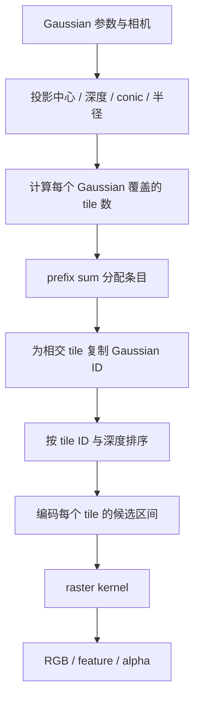

# Gaussian Rasterizer 的 GPU 实现

[Gaussian Splatting 渲染](../../slam/3dgs/gaussian-splatting-rendering.md)给出了像素公式；这一篇把公式落实到 GPU 数据流，并以公开课程项目 commit [`23feeef`](https://github.com/Tiansuanyu/gaussian-grouping-project/tree/23feeef7ded25b2374fbb027d667e91500efd1d0) 为案例比较不同后端。重点是**做了几次几何预处理、几次像素 raster、每次携带多少通道**，而不是只看后端名称。

## 1. 为什么不能逐像素扫描全部 Gaussian

若屏幕有 $P$ 个像素、场景有 $N$ 个 Gaussian，朴素求值需要 $O(PN)$ 次覆盖测试。GPU 实现先建立屏幕空间加速结构：

固定 commit 中的 diff rasterizer 用 $16\times16$ tile。排序后的候选数组让每个 CUDA block 处理一个 tile、每个 thread 负责一个像素；block 以批次把 Gaussian 属性读入 shared memory，再让 256 个像素线程复用。

## 2. 预处理阶段

预处理对每个 Gaussian 完成：

1. world-to-camera 变换与视锥剔除；
2. SH 在观察方向上的颜色求值（也可由调用方预计算）；
3. 将三维 covariance 投影为二维 covariance；
4. 对角线加入低通项并求逆，得到 conic $(A,B,C)$；
5. 用最大特征值估计三倍标准差半径；
6. 计算 bounding rectangle 覆盖多少 tile。

课程项目所含 [`forward.cu`](https://github.com/Tiansuanyu/gaussian-grouping-project/blob/23feeef7ded25b2374fbb027d667e91500efd1d0/submodules/diff-gaussian-rasterization/cuda_rasterizer/forward.cu) 可核对投影与 conic；[`rasterizer_impl.cu`](https://github.com/Tiansuanyu/gaussian-grouping-project/blob/23feeef7ded25b2374fbb027d667e91500efd1d0/submodules/diff-gaussian-rasterization/cuda_rasterizer/rasterizer_impl.cu) 可核对 prefix sum、键生成、radix sort 与 tile ranges。

复制条目数不是 Gaussian 数量的固定倍数。大 ellipse 会命中更多 tile，因而 sorting 和 raster 工作量同时增大。这也是只用 $N$ 预测渲染耗时不可靠的原因。

## 3. Raster kernel

每个像素线程遍历所属 tile 的近似前到后候选。令偏移 $\Delta=(d_x,d_y)$、conic 为 $(A,B,C)$，指数项为

$$
q=-\frac12(Ad_x^2+2Bd_xd_y+Cd_y^2),
$$

$q>0$ 表示数值上落在椭圆峰值之外的非法情况并跳过；否则

$$
\alpha=\min(0.99,o\exp(q)),\qquad
\mathbf C\leftarrow\mathbf C+T\alpha\mathbf c,
\qquad T\leftarrow T(1-\alpha).
$$

固定实现会跳过很小的 alpha，并在 $T$ 足够小时停止。一个 warp 内像素可能因椭圆覆盖和 early termination 走不同分支，这会产生 divergence；但按 tile 组织仍能复用候选数据并保持连续输出写入。

## 4. Backward 为什么更重

颜色梯度不只影响当前 Gaussian：$\alpha_i$ 也改变后方所有贡献的透射率。backward 需要反向重放候选并累计：

- 每通道 feature/color 的梯度；
- opacity 梯度；
- 2D mean 与 conic 梯度；
- 再由预处理 backward 传到 3D mean、covariance、scale、rotation 和 SH。

gsplat v1.5.3 的 CUDA 实现可从固定 commit 的 [`RasterizeToPixels3DGSFwd.cu`](https://github.com/nerfstudio-project/gsplat/blob/937e29912570c372bed6747a5c9bf85fed877bae/gsplat/cuda/csrc/RasterizeToPixels3DGSFwd.cu) 与 [`RasterizeToPixels3DGSBwd.cu`](https://github.com/nerfstudio-project/gsplat/blob/937e29912570c372bed6747a5c9bf85fed877bae/gsplat/cuda/csrc/RasterizeToPixels3DGSBwd.cu) 核对。backward 为每个通道保存/累积更多状态，所以通道数对 shared memory、寄存器和原子更新的压力通常比 forward 更明显。

## 5. 四条可比较的执行路径

Gaussian Grouping 要同时渲染 3 通道 RGB 和 16 通道 identity feature。课程 fork 的 profiling 区分了四条路径：

| 路径 | 几何投影/排序 | 像素 raster | 通道 payload | 定位 |
| --- | ---: | ---: | --- | --- |
| `diff` | 1 次 | 1 次 | 自定义 RGB + object | Gaussian Grouping 原有参考后端 |
| `gsplat_two_pass` | 2 次 | 2 次 | 3、16 | 高层 API 直接调用两次的基线 |
| `gsplat_single` | 1 次 | 2 次 | 3、16 | shared-geometry split，默认可移植后端 |
| `gsplat_native19` | 1 次 | 1 次 | 19 | patched gsplat 的 opt-in 后端 |

这里的 `diff` 是 **Gaussian Grouping 已扩展过 object feature 的 rasterizer**，不是“未修改原始 3DGS 只能输出 RGB”的上游版本。

最容易混淆的是 `gsplat_single`：名字来自 profiling，但它不是单次 raster。fork 的 [`_render_gsplat()`](https://github.com/Tiansuanyu/gaussian-grouping-project/blob/23feeef7ded25b2374fbb027d667e91500efd1d0/gaussian_renderer/__init__.py) 只做一次 `fully_fused_projection`、`isect_tiles` 和 `isect_offset_encode`，然后分别以 3 通道和 16 通道调用两次 `rasterize_to_pixels`。所以更准确的名字是 **shared-geometry split raster**。

这四个 gsplat API 的职责不能混在一起：

- `fully_fused_projection()`：把三维 mean/covariance 投影为 2D mean、depth、radius 与 conic；
- `isect_tiles()`：枚举 Gaussian–tile 相交条目并按 tile/depth 组织；
- `isect_offset_encode()`：把排序条目编码成各 tile 的起始 offset；
- `rasterize_to_pixels()`：消费共享几何与 offset，对给定 channel payload 做逐像素 alpha 合成。

前两步决定“谁可能影响哪个像素以及大致顺序”，最后一步决定“要把哪些属性按权重合成”。因此 RGB 和 identity 可共享几何，却仍可选择分两次 raster。

Native19 则把 $[\mathbf c;\mathbf e]\in\mathbb R^{19}$ 拼接后只调用一次 raster，再把输出切回 RGB 和 identity。它没有改变 alpha 合成公式，只改变 payload 与 kernel 实例化。

## 6. 为什么 stock gsplat 不能自动得到 Native19

gsplat v1.5.3 为有限的 `CDIM` 编译模板实例。其 wrapper 支持列表包含 16、17、32、33 等维度，但不含 19；一般路径可能把通道补到下一个受支持维度。对 19 通道补到 32 会执行 13 个无用通道。

课程 fork 的 Native19 patch 在 wrapper/dispatch 和 forward、backward 显式实例中加入 `CDIM=19`。高层代码还检查安装的 wrapper 是否真的支持 19，若不支持就报错，而不是悄悄走 padded 32。可复现改动保存在公开仓库的 [`gsplat_native19_remote.patch`](https://github.com/Tiansuanyu/gaussian-grouping-project/blob/23feeef7ded25b2374fbb027d667e91500efd1d0/profiling_results/gsplat_native19_remote.patch)。

“通道拼起来”本身不保证更快：一次 19 通道 kernel 可能使用更多寄存器、降低 occupancy。收益来自少一次候选遍历、kernel launch 和中间读写，代价则是单 kernel 资源变大；最终必须测量。

## 7. 等价性要验证到哪一层

若两条路径使用相同投影、排序、alpha 和参数，RGB/identity 的数学权重应相同。但不同后端还可能在 anti-aliasing、半径、clamp、SH 求值或浮点归约顺序上有差异。因此合理验证层次是：

1. shape、坐标约定和输出语义一致；
2. forward 误差在明确容差内；
3. 关键参数的 backward 梯度一致或通过有限差分检查；
4. 短训练曲线和最终任务指标没有异常偏移；
5. 再比较同一协议下的计时与峰值显存。

这比声称“公式一样所以逐 bit 一样”更准确。下一篇用真实 profiling 解释[通道融合、占用率与性能测量](./gpu-kernel-optimization.md)。
