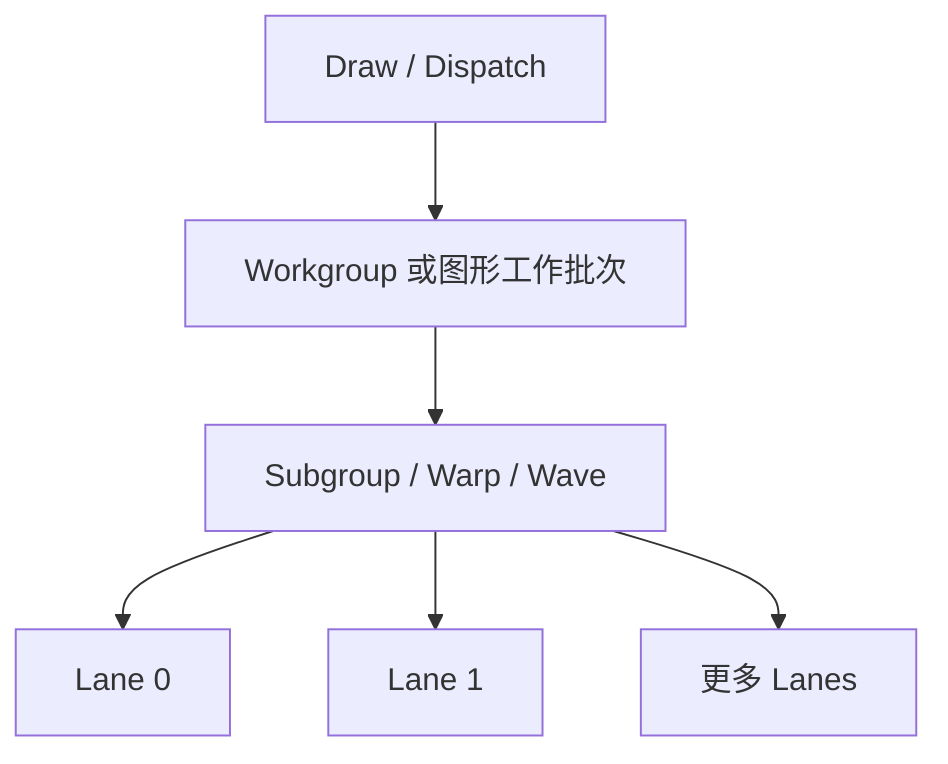
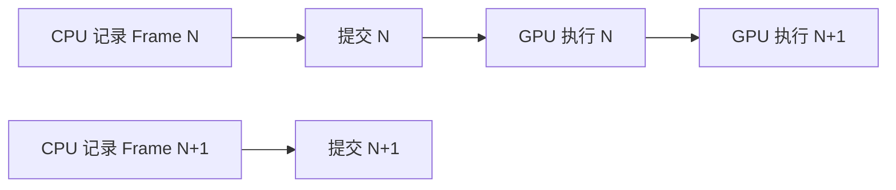

# GPU 执行架构

GPU 用大量相似执行单元吞吐许多并行工作，并通过快速切换可运行线程组隐藏内存和流水线延迟。它与 CPU 的区别不是“核心更多”这么简单，而是调度粒度、缓存、寄存器规模和优化目标不同。

## 1. 从 API Invocation 到硬件线程组

应用看到 vertex、fragment 或 compute invocation；硬件通常把若干 invocation 组成一个同时发射指令的组，NVIDIA 常称 warp，AMD 常称 wavefront，其他架构也有自己的 subgroup 模型。

Warp/wave 大小不是跨厂商常量，也不必与 shader local size 相同。一个 workgroup 可以包含多个 subgroups；subgroup 还可能是 API 暴露的可查询属性。

## 2. SIMT 与 SIMD 的关系

SIMD 指一条指令显式操作一个向量；SIMT 让程序看起来由多个标量 invocation 执行，硬件再把它们成组发射。两者在物理执行上可能很接近，但编程模型不同：每个 invocation 有自己的 ID、寄存器和控制流状态。

如果同一 subgroup 内部分 lanes 进入 `if`，其余 lanes 进入 `else`，硬件可能分别执行两条路径并屏蔽无关 lanes。这就是 branch divergence。它降低并行利用率，但不表示所有条件分支都应消除：一致分支、短分支和编译器 predication 可能代价很小。

## 3. 延迟隐藏和占用率

当一个 warp 等待显存时，scheduler 可以发射另一个已就绪 warp。一个计算单元上同时驻留的 warp/workgroup 越多，可用于隐藏延迟的选择通常越多；这种可驻留程度常称 occupancy。

Occupancy 受到以下资源共同限制：

- 每个 invocation 使用的 registers；
- 每个 workgroup 使用的 shared memory；
- local size 与硬件最大线程/warp 数；
- 架构的寄存器文件、调度槽和并发 workgroup 上限。

高 occupancy 不是最终目标。一个算法可能以更多寄存器减少重复访存，即使 occupancy 下降，总时间仍更短。必须结合瓶颈和实际 profile 判断。

一个具体案例是 3D Gaussian rasterizer 将 3 通道 RGB 与 16 通道 identity 合为 Native19 kernel：forward occupancy 因寄存器增加而下降，但少一次候选遍历后，固定实验中总时间仍更短。数据、协议和适用边界见[GPU Kernel 优化：通道融合、占用率与测量](./gpu-kernel-optimization.md)。

## 4. 内存层次

| 层次 | 常见特点 | 使用注意 |
| --- | --- | --- |
| Registers | 每个 invocation 私有、最快、容量有限 | 过多会降低驻留或发生 spill |
| Shared / Workgroup memory | 同一 workgroup 显式共享 | 需 barrier，注意 bank conflict |
| L1 / Texture cache | 局部访问与采样优化 | 命中模式依架构和访问类型而异 |
| L2 | 多计算单元共享的片上缓存 | 不替代 API 内存可见性规则 |
| Device memory / VRAM | 容量大、延迟高 | 依赖合并访问和延迟隐藏 |
| Host-visible memory | CPU 可映射或统一内存 | 带宽、缓存一致性与迁移成本不同 |

“显存”既可能指独立 GPU 的设备本地内存，也可能指集成 GPU 与 CPU 共享的物理内存。共享物理内存不等于零成本：缓存、地址可见性和同步仍然存在。

## 5. 合并访问与局部性

相邻 lanes 访问相邻地址时，硬件更容易把请求合成较少的 memory transactions。跨大 stride、随机 gather 或结构体布局不合适会浪费带宽。

纹理采样器针对二维局部性、过滤和压缩格式优化；storage buffer 更通用。选择资源类型不能只看语法方便，还要考虑访问模式、格式和缓存路径。

## 6. GPU 指令和流水线

GPU ISA 通常包含标量/向量算术、纹理、load/store、atomic、barrier、subgroup 操作和专用矩阵计算。不同指令的吞吐与 latency 不同，且会争用不同执行管线。

性能上要区分：

- compute-bound：算术或特定功能单元饱和；
- bandwidth-bound：数据传输受限；
- latency-bound：并行度不足以隐藏依赖或访存等待；
- synchronization-bound：barrier、atomic 或 queue dependency 限制并行。

只看 GPU utilization 百分比无法确定属于哪类瓶颈。

架构家族相近也不表示机器指令二进制兼容。[Shader Recompiler：从 GPU ISA 到 SPIR-V](../compilers/shader-recompilation.md) 以 Ampere 与 Maxwell 为例，区分共同的 GPU 执行模型、不同的 ISA 编码，以及为了复用 frontend 所做的受限语义 lowering。

## 7. 图形阶段如何映射到硬件

Vertex、fragment 和 compute shader 常复用可编程执行单元，但光栅、纹理、ROP/depth 等也可能有专用固定功能。Fragment work 由覆盖关系生成，可能以像素 quad 组织以计算导数；compute work 则由 dispatch 的 workgroup 显式产生。

桌面 immediate-mode 和移动 tile-based GPU 还可能以不同方式组织 attachment：后者倾向在片上 tile 中完成一部分渲染，减少外部带宽。API 的 render pass、load/store 等信息可以帮助驱动优化，但不能假设所有 GPU 内部实现相同。

## 8. CPU 与 GPU 并行

CPU 通常负责场景更新、资源管理和命令记录，GPU 异步消费 queue 中的工作。CPU 提交后即可继续准备后续帧；若立即等待 fence，便会丢失流水并行。

多帧 in flight 需要为仍在使用的 command buffer、uniform、descriptor 和 attachment 准备独立生命周期。资源复用点由同步证明，而不是按“CPU 已提交”猜测。

下一篇 [Vulkan 基础](./vulkan-basics.md) 把这些硬件能力映射为 API 对象；[GPU 内存与同步](./gpu-memory-and-sync.md) 再定义异步访问何时安全。

## 参考入口

- [Vulkan Guide：Subgroups](https://docs.vulkan.org/guide/latest/subgroups.html)：API 如何暴露 subgroup 能力。
- [Vulkan Specification：Limits](https://docs.vulkan.org/spec/latest/chapters/limits.html)：workgroup、subgroup 与资源上限的规范入口。
- [CUDA Programming Guide](https://docs.nvidia.com/cuda/cuda-programming-guide/index.html)：以 CUDA 术语解释 warp、memory hierarchy 和 occupancy；这些术语不能直接外推到所有 GPU。
