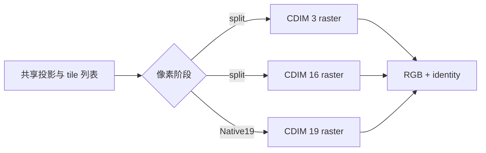

# GPU Kernel 优化：通道融合、占用率与测量

“把两个 kernel 融成一个”是方向，不是结论。融合会减少 launch、中间读写和重复遍历，也会增加寄存器、shared memory 与单线程工作。课程项目的 3+16 通道 Gaussian rasterizer 提供了一个边界清晰的案例。

## 1. 优化对象是什么

Gaussian Grouping 对同一组已排序 Gaussian 合成：

- RGB：3 个通道；
- identity：16 个通道。

shared-geometry split 已经消除了重复投影和 tile sorting，但像素阶段仍读两次候选。Native19 将两个 payload 拼成 19 通道，在一次候选遍历中更新共同的 $\alpha$ 与 $T$：

与把两个任意算子融合不同，这里两个输出恰好共享候选、顺序和 alpha 权重，因而具备很强的复用基础。

## 2. 模板通道与资源使用

固定通道维度允许编译器展开小循环和确定 shared-memory 布局，但每个 `CDIM` 都要有模板实例。课程项目在 gsplat v1.5.3 的 dispatch 中新增 19，而不把 19 pad 到 32。

在该版 kernel 中，forward 动态 shared memory 的基础部分约为

$$
256(4+12+12)=7168\ \text{bytes},
$$

backward 还包含随通道数增长的缓存，近似多出

$$
256\times4\times C\ \text{bytes}.
$$

因此 $C=19$ 的 backward 仅通道相关项就约为 19 KiB。实际可驻留 block 数还受寄存器、架构的每 SM 限制和编译选项共同约束，不能只用 shared memory 一项推断。

## 3. Occupancy 审计

公开报告 [`PTXAS_OCCUPANCY.md`](https://github.com/Tiansuanyu/gaussian-grouping-project/blob/23feeef7ded25b2374fbb027d667e91500efd1d0/profiling_results/PTXAS_OCCUPANCY.md) 对 `sm_70`、$16\times16=256$ threads/block 的目标 kernel 同时检查 PTXAS 与 cubin。摘取关键结果：

| CDIM | 阶段 | registers/thread | dynamic shared memory | resident blocks/SM | occupancy |
| ---: | --- | ---: | ---: | ---: | ---: |
| 3 | forward | 40 | 7,168 B | 6 | 75% |
| 16 | forward | 56 | 7,168 B | 4 | 50% |
| 19 | forward | 72 | 7,168 B | 3 | 37.5% |
| 32 | forward | 64 | 7,168 B | 4 | 50% |
| 3 | backward | 74 | 10,240 B | 3 | 37.5% |
| 16 | backward | 112 | 23,552 B | 2 | 25% |
| 19 | backward | 122 | 26,624 B | 2 | 25% |
| 32 | backward | 162 | 39,936 B | 1 | 12.5% |

这里有三个重要认识：

1. 资源使用不一定随通道数严格单调，例如编译器让 CDIM 32 forward 使用的寄存器少于 19；
2. 19 通道 forward occupancy 比 3 和 16 都低，融合不是“免费”；
3. 19 通道 backward 仍能驻留 2 blocks/SM，而 pad 到 32 降为 1，说明精确模板维度有价值。

这些目标行没有 register spill，但这不保证其他架构、编译器或更大模板也没有。更重要的是，**occupancy 不是性能**：足够隐藏延迟后，提高 occupancy 未必加速；减少一次完整候选遍历也可能抵消更低的并发驻留。

## 4. 计时协议

课程项目的 clean profiling 使用：10 个训练视角、交错后端顺序、每视角 50 次 warmup 和 20 次测量、CUDA events 计时；先取每视角 median，再跨视角汇总，并用 `nvidia-smi pmon` 检查目标 GPU 没有其他计算进程。固定产物记录的设备是 NVIDIA TITAN V（`sm_70`），驱动 580.159.03；`nvidia-smi` 显示的 CUDA 13.0 是驱动可支持版本，不等同于构建所用 toolkit 版本。gsplat 为 1.5.3。协议与原始数据见 [`THREE_SCENE_SUMMARY.md`](https://github.com/Tiansuanyu/gaussian-grouping-project/blob/23feeef7ded25b2374fbb027d667e91500efd1d0/profiling_results/THREE_SCENE_SUMMARY.md)。

训练模式 forward+backward 的汇总为：

| Scene | Resolution | Gaussians | diff | two-pass | shared split | Native19 |
| --- | ---: | ---: | ---: | ---: | ---: | ---: |
| ramen | 494×366 | 1,114,069 | 22.415 ms | 24.886 ms | 19.675 ms | **16.722 ms** |
| figurines | 493×364 | 280,344 | 12.901 ms | 9.101 ms | 7.699 ms | **6.457 ms** |
| teatime | 494×365 | 279,705 | 11.462 ms | 8.289 ms | 6.803 ms | **6.019 ms** |

同一报告的 forward+backward peak allocation 为：

| Scene | diff | two-pass | shared split | Native19 |
| --- | ---: | ---: | ---: | ---: |
| ramen | 1,561.9 MB | 1,382.6 MB | 1,335.4 MB | 1,334.4 MB |
| figurines | 341.7 MB | 276.9 MB | 263.8 MB | 264.8 MB |
| teatime | 335.9 MB | 276.6 MB | 263.7 MB | 265.0 MB |

在这三个场景和该协议下，Native19 都最快；相对 shared split 的表中差距约为 11%–16%。结论必须带限定词：这是固定版本、硬件环境、图像/场景和 training-mode kernel 的实测，不是“Native19 对所有 GPU 与场景恒定加速”。

另一个约 1.5 万 Gaussian 的小工作负载中，公开 Task B 报告显示 Native19 与 shared split 的 forward+backward 只相差约 2.1%，且逐视角接近打平。这进一步说明固定 launch 和工作量规模会影响收益。

## 5. 不能从表格直接推出什么

- Gaussian 数更多时 Native19 收益**不呈严格单调增长**；三个点不足以拟合规模规律。
- 仅凭 wall time 与 occupancy 不能断言 kernel 是 memory-bound 或 compute-bound，需要 Nsight 等硬件计数器。
- peak memory 数字包含 allocator、缓存和周边张量，不能直接当作 kernel 理论工作集。
- `diff`、gsplat 的实现细节不同，端到端差异不能完全归因于“一次还是两次 raster”。
- P95、median 和 mean 回答的问题不同；本报告先按视角取 median，不能改写成尾延迟结论。

## 6. 可复用的优化步骤

1. 先画出数据流，找出真正重复的投影、排序、遍历或内存往返。
2. 固定数值语义，分别验证 forward、backward 和短训练。
3. 检查模板 dispatch，避免 silent padding 或隐式 fallback。
4. 用编译报告和 cubin 交叉核对 registers、shared memory、spill。
5. 在同一输入上交错测量，warm up，并记录软件 commit、GPU 与模式。
6. 同时保留可移植路径和优化路径；让不支持专用 kernel 的环境明确失败或显式回退。
7. 最后把“本次实测”与“可推广机制”分开表述。

课程 fork 默认使用 stock gsplat 可运行的 shared-geometry split，将 Native19 设为显式 opt-in，是一个合理的可移植性取舍：默认路径已经复用昂贵几何阶段，专用构建再换取最后一段像素融合收益。

## 7. 与通用 AI kernel 优化的联系

这和 attention kernel fusion 的共同原则是减少中间 materialization 与重复读取；差别在于 Gaussian rasterizer 有不规则 tile 列表、透明度 early termination 和随可见性的动态工作量。通用张量/算子基础见[张量、算子与神经网络计算](../../ai-infra/张量、算子与神经网络计算.md)，GPU 并行资源基础见[GPU 执行架构](./gpu-architecture.md)，本案例的算法上下文见[Gaussian Grouping](../../slam/3dgs/gaussian-grouping.md)。
