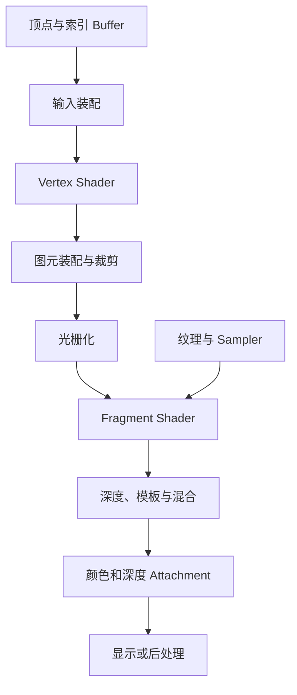
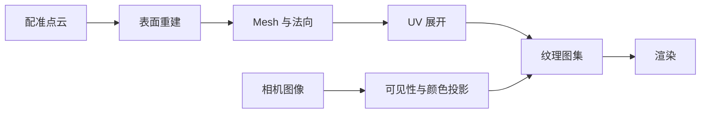

# 从三维场景到最终图像

图形渲染解决的问题是：给定几何、材质、相机和光照，计算屏幕上每个采样位置的颜色与深度。现代管线并非简单把“三维点投影到图片”，而是让可编程 shader 与固定功能阶段共同处理图元、覆盖关系和资源读写。

## 1. 场景由什么组成

| 数据 | 表达什么 | 不自动包含什么 |
| --- | --- | --- |
| 点云 | 离散三维采样，可带颜色、强度和法向 | 三角形拓扑、连续表面、UV |
| Mesh | 顶点与面之间的连接关系 | 真实材质和纹理内容 |
| 材质 | 表面如何响应光照及使用哪些纹理 | 几何形状 |
| 纹理 | 按坐标查询的二维/三维数据 | 将它贴到哪块表面的 UV 关系 |
| 3D Gaussian | 中心、协方差、opacity 与方向外观 | 显式表面拓扑、可通行性 |
| 相机 | 观察位置、方向、投影和视口 | 场景本身的尺度可靠性 |

点云可以直接按 point primitive 绘制，但采样间可能露出空洞，也没有天然遮挡表面。Mesh 用三角形近似连续表面，适合光栅化、碰撞和几何查询；纹理再通过 UV 为表面提供颜色、法线或材质参数。3DGS 不先建立三角面，而把各向异性 Gaussian 投影为屏幕椭圆并按透明度合成，详见[三维高斯场景表示](../../slam/3dgs/gaussian-representation.md)。

SLAM 中这些表示的观测含义见[地图到底存了什么](../../slam/fundamentals/地图到底存了什么.md#_8-点云、surfel-与-mesh)，点云坐标对齐见[点云配准](../../slam/fundamentals/点云配准.md)。渲染结果看起来连续，不代表原地图已经具有可靠拓扑、自由空间或定位观测关系。

## 2. 三次主要坐标变换

顶点通常从模型局部坐标依次进入世界、相机和裁剪空间：

$$
p_{clip}=P\,V\,M\,p_{model}.
$$

- $M$：模型变换，将局部物体放入世界。
- $V$：观察变换，把世界表达为相机坐标。
- $P$：投影变换，建立透视或正交裁剪空间。

随后进行透视除法：

$$
p_{ndc}=\left(\frac{x_c}{w_c},\frac{y_c}{w_c},\frac{z_c}{w_c}\right),
$$

再由 viewport 把 NDC 映射到 framebuffer 坐标。这里的矩阵布局、手性、深度范围和乘法方向由 API 与数学约定共同决定，不能只凭矩阵形状猜测。

## 3. 一次 Draw 的主链

输入装配按 topology 把索引解释为点、线或三角形。vertex shader 为每个输入顶点产生裁剪空间位置和待插值属性。裁剪器处理视锥边界，光栅器把可见图元变为 fragments；fragment shader 计算候选输出，深度、模板与混合再决定 framebuffer 中最终保留什么。

管线图描述的是逻辑阶段，不保证硬件严格串行执行。GPU 可以并行、合并或提前执行某些操作，只要 API 规定的可观察结果保持一致。

## 4. 固定功能与可编程阶段

可编程阶段运行 shader，例如 vertex、fragment 和 compute。固定功能阶段由配置驱动，例如 topology、viewport、culling、rasterization、depth/stencil 和 blending。

“固定功能”不表示不可配置，而是应用选择有限状态，不能给该阶段提供任意程序。兼容层若只翻译 shader，却遗漏 front-face、depth compare、blend factor 或 attachment format，画面仍会错误。

## 5. 一个顶点携带什么

位置只是最基本属性。Mesh 顶点还可能携带：

- 法向与切线，用于光照和法线贴图；
- UV，用于查询纹理；
- 顶点色；
- 骨骼索引与权重；
- 实例数据或自定义属性。

索引 buffer 让多个三角形复用顶点，但“共享位置”是否应共享法向或 UV 取决于表面。硬边、UV seam 处常需要复制几何位置相同的顶点，以保存不同属性。

## 6. Framebuffer 与最终显示

Framebuffer 不是屏幕本身，而是一组渲染目标 attachment 的逻辑组合。常见 attachment 包括颜色、深度、模板，也可以有多个颜色目标供延迟渲染或后处理使用。

最终颜色往往还要经过：

1. 离屏渲染或多 pass 合成；
2. tone mapping、抗锯齿和 UI 叠加；
3. 复制或渲染到 swapchain image；
4. 交给 presentation engine 显示。

因此“一次 draw 完成”不等于“一帧已经显示”。CPU 提交、GPU 完成和显示系统接收是不同时间点。

## 7. 从 SLAM 几何到可渲染资产

把点云变成带纹理 Mesh 通常还需要：

每一步都有独立误差：点云可能存在漂移，表面重建会填洞或平滑，颜色投影依赖相机位姿和曝光，UV atlas 还会引入 seam。漂亮纹理不能证明底层几何准确；同样，准确点云也不会自动变成没有孔洞的 Mesh。

下一篇 [光栅化](./rasterization.md) 具体解释三角形怎样产生 fragments；[纹理与采样](./textures-and-sampling.md) 再说明 UV 如何从图像资源取得表面数据。Gaussian 路线则从[Gaussian Splatting 渲染](../../slam/3dgs/gaussian-splatting-rendering.md)进入另一种覆盖与合成过程。

## 参考入口

- [Vulkan Specification：Pipelines](https://docs.vulkan.org/spec/latest/chapters/pipelines.html)：图形与计算管线的规范性阶段说明。
- [Vulkan Guide：Depth](https://docs.vulkan.org/guide/latest/depth.html)：深度 attachment、格式和测试的实践入口。
- Lichii [`vk_rasterizer.cpp`](https://github.com/zortos293/Lichii/blob/9441129819edfee62e65ff6030749e80f420ba1e/src/video_core/renderer_vulkan/vk_rasterizer.cpp)：公开 Vulkan backend 中 draw/dispatch 状态落地的案例。
- Hookshot [`rx_draw.cpp`](https://github.com/NotRexed/Hookshot/blob/e9975d6c245275aaf89a34e8d17a6bbe8badab46/gpu/render/rx_draw.cpp)：host renderer 组织 draw 的公开实现入口。
