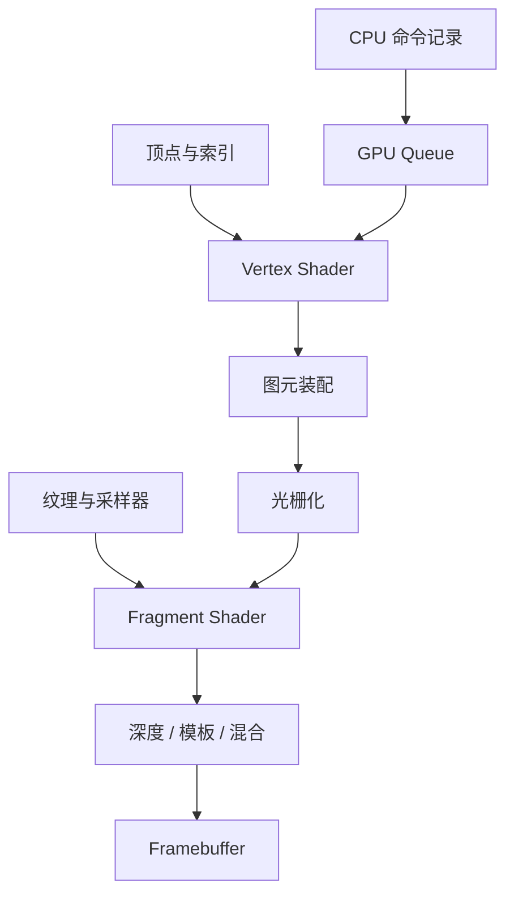

# 图形与 GPU

这一组笔记从“一个三角形怎样变成屏幕上的像素”出发，再讨论现代 GPU 如何调度大量线程、管理资源，并与 CPU 异步协作。这样读 shader recompiler 时，关注的就不只是指令翻译，还包括描述符、纹理、管线状态和同步语义。

## 阅读顺序

| 顺序 | 笔记 | 核心问题 |
| --- | --- | --- |
| 9 | [从三维场景到最终图像](./graphics-pipeline.md) | 点云、Mesh、材质如何进入图形管线并写成图像？ |
| 10 | [光栅化：从三角形到片元](./rasterization.md) | 覆盖、插值、深度、模板和混合分别做什么？ |
| 11 | [纹理、采样器与 Framebuffer](./textures-and-sampling.md) | Texture、UV、Sampler、Attachment 如何连接？ |
| 12 | [Shader：可编程 GPU 阶段](./shaders.md) | Vertex、Fragment 与 Compute Shader 怎样读写数据？ |
| 13 | [GPU 执行架构](./gpu-architecture.md) | SIMT、warp/wave、占用率和显存层次如何影响执行？ |
| 14 | [Vulkan 基础：显式表达 GPU 工作](./vulkan-basics.md) | Vulkan 如何组织资源、pipeline、命令和提交？ |
| 15 | [GPU 内存与同步](./gpu-memory-and-sync.md) | 可用性、可见性、barrier、semaphore、fence 有何区别？ |

这里的编号承接前两组。先学习图形语义，再学习 GPU 怎样执行这些工作，最后进入 Vulkan 的资源与同步模型。

完成本组后，继续阅读编译器板块的第 16 篇 [Shader Recompiler：从 GPU ISA 到 SPIR-V](../compilers/shader-recompilation.md)。它把本组的 Shader、GPU ISA、纹理资源和 Vulkan pipeline，与前面学习的 frontend、IR、lowering 和 backend 串成一条完整翻译链。

## 两条阅读线

第一条是**图形语义线**：输入装配 → shader → 光栅化 → 测试与混合。第二条是**执行与资源线**：CPU 记录命令 → queue 提交 → GPU 执行 → 同步与资源复用。一个兼容层必须同时处理这两条线；只翻译 shader，不能替代资源和管线状态的映射。

已有 [视觉定位的 CPU、GPU 与 NPU 分工](../../robotics-systems/deployment/视觉定位的CPU、GPU与NPU分工.md) 更关注推理工作负载与设备边界；本组则专注图形 API、shader 和 GPU 同步。二者共享内存传输与异步执行的基础，但不重复维护相同内容。
