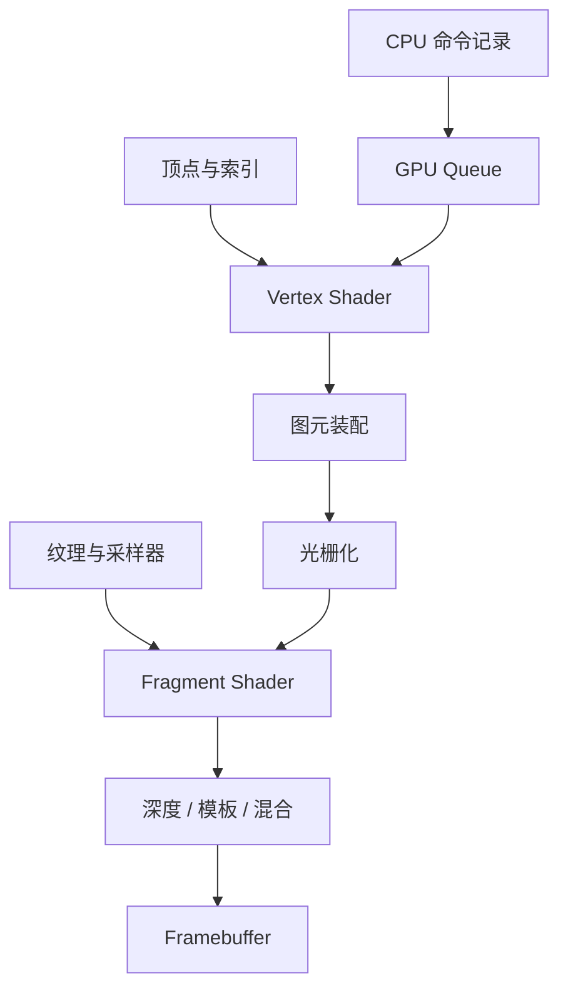

# 图形与 GPU

这一组笔记从“一个三角形怎样变成屏幕上的像素”出发，再讨论现代 GPU 如何调度大量线程、管理资源，并与 CPU 异步协作。这样读 shader recompiler 时，关注的就不只是指令翻译，还包括描述符、纹理、管线状态和同步语义。

## 计划内容

| 稳定文件名 | 核心问题 | 阅读案例时的落点 |
| --- | --- | --- |
| `graphics-pipeline.md` | 顶点、图元、光栅和片元阶段如何传递数据 | 区分固定功能状态和可编程阶段 |
| `rasterization.md` | 覆盖测试、插值、深度与混合如何产生像素 | 判断 guest 与 host 管线状态是否等价 |
| `textures-and-sampling.md` | 纹理布局、坐标、过滤、mipmap 和格式怎样影响采样 | 读资源与 sampler 映射 |
| `shaders.md` | Shader 阶段、接口变量、资源绑定和 SPIR-V 是什么 | 建立 shader 翻译的输入输出契约 |
| `gpu-architecture.md` | SIMT、wave/warp、占用率与内存系统如何工作 | 理解性能，不用 CPU 线程模型生搬硬套 |
| `vulkan-basics.md` | instance、device、queue、command buffer、pipeline 如何协作 | 读 NVN 到 Vulkan 与 renderer 后端 |
| `gpu-memory-and-sync.md` | buffer/image、布局转换、barrier、semaphore 和 fence 约束什么 | 分析异步提交、资源可见性和生命周期 |

## 两条阅读线

第一条是**图形语义线**：输入装配 → shader → 光栅化 → 测试与混合。第二条是**执行与资源线**：CPU 记录命令 → queue 提交 → GPU 执行 → 同步与资源复用。一个兼容层必须同时处理这两条线；只翻译 shader，不能替代资源和管线状态的映射。

已有 [视觉定位的 CPU、GPU 与 NPU 分工](../../robotics-systems/deployment/视觉定位的CPU、GPU与NPU分工.md) 更关注推理工作负载与设备边界；本组则专注图形 API、shader 和 GPU 同步。二者共享内存传输与异步执行的基础，但不重复维护相同内容。
