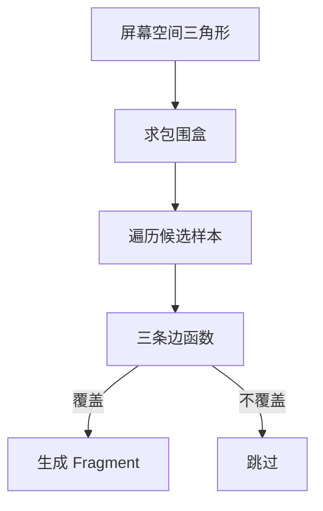

# 光栅化：从三角形到片元

光栅化把屏幕空间中的图元转换成一组候选 fragments。Fragment 是“某个采样位置上的一次图元贡献”，不是 framebuffer 中已经确定的像素；它还可能被裁剪、discard、深度或模板测试拒绝。

## 1. 在光栅化之前

vertex shader 输出裁剪空间位置后，管线先执行：

- 视锥裁剪：跨过裁剪平面的三角形可能产生新顶点；
- 透视除法与 viewport 变换；
- front/back face 判定与 culling；
- scissor，把工作限制到矩形区域。

背面剔除依赖顶点绕序以及 API 的 front-face 配置。坐标系翻转可能改变绕序，兼容层若只改投影矩阵而不校正 culling，模型会出现整面消失。

## 2. 覆盖测试

对屏幕空间三角形 $(v_0,v_1,v_2)$，可用三条有向边函数判断采样点 $p$ 位于哪一侧。满足约定的三条半平面条件时，样本被三角形覆盖。

硬件还需规定共享边如何归属，避免相邻三角形同时漏掉或重复覆盖边界。这类 top-left 规则和亚像素精度属于 rasterization contract，不是 shader 自己决定的。

## 3. 重心坐标与属性插值

覆盖点可表示为三角形顶点的重心组合：

$$
p=\lambda_0v_0+\lambda_1v_1+\lambda_2v_2,
\qquad \lambda_0+\lambda_1+\lambda_2=1.
$$

颜色、法向和 UV 等 varying 会在顶点输出之间插值。透视投影下直接用屏幕空间 $\lambda_i$ 线性插值纹理坐标会产生形变，需使用透视正确插值：

$$
a(p)=
\frac{\sum_i \lambda_i a_i/w_i}
     {\sum_i \lambda_i/w_i}.
$$

也可显式选择 flat 或 no-perspective 等插值模式。顶点 shader 的输出声明与 fragment shader 的输入声明必须在位置、类型和插值规则上兼容。

## 4. Fragment Shader 之后还有什么

一个 fragment 可能输出一个或多个颜色，也可能写自定义深度或执行 discard。随后典型 per-fragment operations 包括：

1. stencil test：根据模板值、比较函数和操作更新/拒绝样本；
2. depth test：比较当前深度与 depth attachment；
3. blending：把源颜色与已有目标颜色组合；
4. color write mask：控制哪些通道真正写回。

逻辑顺序不意味着硬件一定最后才做 depth test。若 shader 不会改变深度、discard 或产生相关副作用，GPU 可以 early depth test，减少无用 fragment shading。

## 5. 深度与透明

深度 buffer 存的是投影后的深度表示，不等同于相机坐标中的米制距离；其非线性程度和范围受投影矩阵与 API 约定影响。near plane 过近会挤压可用深度精度，增加 z-fighting。

普通 alpha blending 常写成：

$$
C_{out}=\alpha_s C_s+(1-\alpha_s)C_d.
$$

它依赖绘制顺序，且预乘 alpha 的 blend factor 不同。开启 blending 不会自动解决透明物体排序，也不是物理正确的体渲染。

## 6. MSAA 与抗锯齿

单个像素可以包含多个 coverage/depth sample。MSAA 对几何覆盖和深度进行多样本处理，fragment shader 是否按 sample 执行则取决于配置。Resolve 最终把多样本 attachment 合成单样本图像。

MSAA 主要改善多边形边缘，不会自动消除纹理缩小时的闪烁；后者依赖 mipmap、anisotropic filtering 或时间域策略。

## 7. Gaussian Splatting 不是三角形覆盖

3DGS 将三维 covariance 投影为二维 ellipse，用 Mahalanobis 距离计算每个像素的 alpha，再按深度近似排序并前到后合成。它同样需要求屏幕 bounding region 和局部候选，但没有三角形 edge function、重心插值和普通“最近深度胜出”。完整算法见[Gaussian Splatting 渲染](../../slam/3dgs/gaussian-splatting-rendering.md)，CUDA 的 tile/排序实现见[Gaussian Rasterizer 的 GPU 实现](./gaussian-rasterizer.md)。

## 8. 兼容层为何容易错

guest 与 host API 即使都有“三角形 + fragment shader”，仍要逐项映射：

- topology、primitive restart 与索引格式；
- viewport 的 Y 方向、深度范围和裁剪约定；
- front face、cull mode 和 polygon mode；
- sample count、sample mask 和 resolve；
- depth/stencil compare 与 write；
- attachment format、blend equation 和通道 mask。

任何一项错误都可能表现为黑面、穿透、闪烁或颜色异常，不能一看到画面错误就归因于 shader 翻译。

下一篇 [纹理、采样器与 Framebuffer](./textures-and-sampling.md) 解释 fragment shader 的图像输入和输出资源；[Shader](./shaders.md) 再进入可编程阶段本身。

## 参考入口

- [Vulkan Specification：Rasterization](https://docs.vulkan.org/spec/latest/chapters/primsrast.html)：裁剪、覆盖、插值和多重采样的规范定义。
- [Vulkan Specification：Fragment Operations](https://docs.vulkan.org/spec/latest/chapters/fragops.html)：深度、模板与 attachment 写入。
- Lichii [`fixed_pipeline_state.cpp`](https://github.com/zortos293/Lichii/blob/9441129819edfee62e65ff6030749e80f420ba1e/src/video_core/renderer_vulkan/fixed_pipeline_state.cpp)：guest 固定功能状态形成 host pipeline key 的公开案例。
