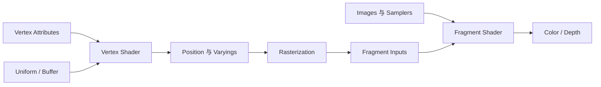
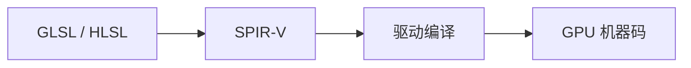

# Shader：可编程 GPU 阶段

Shader 是 GPU 管线中的短程序。它不负责创建窗口、分配 image 或决定整帧执行顺序；应用通过图形 API 建立资源和 pipeline，shader 只在规定的 execution model 下读取输入、访问绑定资源并产生输出。

## 1. 三个核心阶段

| 阶段 | 一次 invocation 对应什么 | 典型输出 |
| --- | --- | --- |
| Vertex Shader | 一个输入顶点 | 裁剪空间位置、待插值属性 |
| Fragment Shader | 一个候选 fragment/sample | 颜色、可选深度或 discard |
| Compute Shader | 一个全局 invocation | 对 buffer/image 的显式读写 |

Vertex 与 fragment 属于 graphics pipeline；compute pipeline 没有顶点、光栅化和 framebuffer 的固定流程。Compute 可以生成几何数据或处理图像，但结果要参与绘制仍需后续 draw 或间接命令。

## 2. Vertex 与 Fragment 怎样衔接

Vertex shader 常执行模型、观察和投影变换，并输出 normal、UV、颜色等 varying。图元装配与光栅化在顶点之间插值这些值，再交给 fragment shader。

两个 stage 的接口必须兼容。位置编号、类型、插值限定和数组布局不一致，可能导致 pipeline 创建失败或未定义结果。

## 3. Compute 的 Workgroup 模型

Compute dispatch 定义若干 workgroup，每个 workgroup 又包含一维、二维或三维 local invocations：

\[
\text{global id}
=\text{workgroup id}\times\text{local size}+\text{local id}.
\]

同一 workgroup 内可使用 shared/workgroup memory，并通过 barrier 协作。Barrier 只覆盖规范规定的执行与内存 scope，不能自动同步另一个 dispatch、另一个 queue 或 CPU。

Local size 影响并行度、shared memory 和寄存器压力。它不是简单等于硬件 warp 大小，也不存在适合所有 GPU 的固定最优值。

## 4. Shader 怎样访问资源

常见资源包括：

- uniform buffer：较小、只读的参数块；
- storage buffer：可进行大范围读写；
- sampled image + sampler：过滤采样；
- storage image：按 texel 显式 load/store；
- push constants：少量、快速更新的参数；
- vertex/index buffer：由输入装配读取，而非普通 descriptor。

Vulkan 使用 descriptor set/layout 描述 shader 可访问的资源槽位。绑定成功只说明地址关系成立，不代表先前写入已经对该 shader 可见；内存依赖由同步机制负责。

## 5. Shader 语言、IR 与机器码

GLSL、HLSL、WGSL 是源语言；SPIR-V 是带类型、控制流、execution model 和 decoration 的二进制中间表示；驱动最终把它编译成设备机器码。

SPIR-V 不是“跨所有 API 可直接运行的 GPU 汇编”。模块还需满足目标 execution environment 的 capability、memory model、资源接口和验证规则。

## 6. 分支、导数与副作用

SIMT GPU 通常成组执行 invocations。相邻 invocation 走不同分支时，硬件可能分批执行各路径，降低有效吞吐。分支并非一律慢；是否发生 divergence、每条路径工作量和编译器优化共同决定成本。

Fragment shader 的隐式纹理 LOD 常依赖邻近 fragments 的导数。非一致控制流中的导数可能受限制或得到未定义结果。Discard、storage write 和 atomic 又会影响 early tests、执行顺序和可见性，不能把 fragment shader 当作纯颜色函数。

## 7. Shader Recompiler 要保存什么

模拟器面对的往往已是 guest GPU 指令，不是原始 shader 源码。重编译器需要：

1. 解码 guest 指令与控制流；
2. 提升为内部 IR；
3. 分析输入输出、资源和 capability；
4. 处理 host/guest 不同的坐标、格式和指令语义；
5. 发射 SPIR-V、GLSL 等 host 表示；
6. 与固定 pipeline state 和 descriptor mapping 一起创建 host pipeline。

Lichii 和 Hookshot 的公开目录都体现了 frontend → IR → optimization/lowering → SPIR-V backend 的分层。代码来源还要区分项目自身修改与继承的第三方 shader recompiler，不能把整棵目录都归因于单一作者。

跨组专题 [Shader Recompiler：从 GPU ISA 到 SPIR-V](../compilers/shader-recompilation.md) 进一步解释 Ampere 指令为何不能直接当作 Maxwell 指令、公共 Shader IR 如何发射 SPIR-V，以及资源状态为什么参与编译与缓存。

下一篇 [GPU 执行架构](./gpu-architecture.md) 解释同一 shader 如何扩展到成千上万 invocations；[Vulkan 基础](./vulkan-basics.md) 则说明应用怎样把 shader、资源和固定状态组装成 pipeline。

## 参考入口

- [SPIR-V Specification](https://registry.khronos.org/SPIR-V/specs/unified1/SPIRV.html)：execution model、SSA、类型和 memory model 的规范定义。
- [Vulkan Specification：Shader Execution](https://docs.vulkan.org/spec/latest/chapters/shaders.html)：shader stage、invocation 与接口。
- Lichii [`shader_recompiler`](https://github.com/zortos293/Lichii/tree/9441129819edfee62e65ff6030749e80f420ba1e/src/shader_recompiler)：guest shader frontend、IR 与多种 backend。
- Hookshot [`gpu/vk/eden/shader_recompiler`](https://github.com/NotRexed/Hookshot/tree/e9975d6c245275aaf89a34e8d17a6bbe8badab46/gpu/vk/eden/shader_recompiler)：当前固定 commit 的 SPIR-V 翻译路径。
