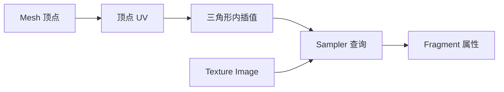
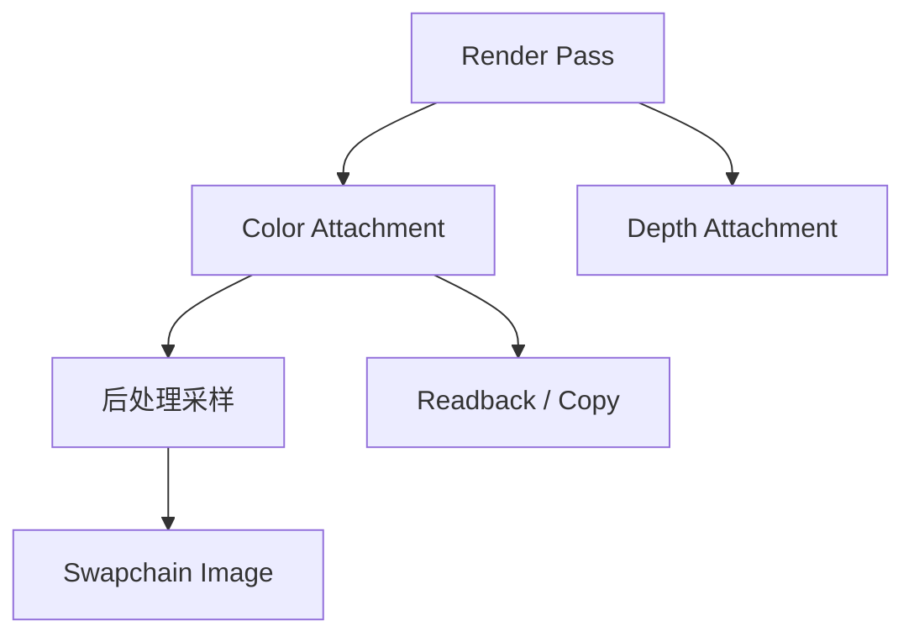

# 纹理、采样器与 Framebuffer

“纹理”常被口语化为一张图片，但 GPU 中至少要区分存储、视图和采样规则：image 保存 texel，image view 选择格式与子资源，sampler 决定坐标越界、过滤和 mip 选择，shader 才把它们组合成一次采样。

## 1. 四个容易混淆的对象

| 对象 | 主要职责 |
| --- | --- |
| Image / Texture storage | 保存一维、二维、三维或数组 texel，以及 mip level |
| Image view | 选择格式解释、aspect、mip 和 array layer 范围 |
| Sampler | 地址模式、放大/缩小过滤、mipmap、各向异性与比较采样 |
| Framebuffer / Attachment | 作为一次渲染的颜色、深度或模板目标 |

同一 image 可以通过不同 view 查看不同 mip 或 layer，也可以先作为 render target 写入，再作为 sampled image 读取；但两种用途之间必须满足 layout 和同步要求。

## 2. UV 把表面连接到纹理

二维纹理坐标通常记为 $(u,v)$，常用归一化范围 $[0,1]^2$。Mesh 顶点保存 UV，光栅器在三角形内部做透视正确插值，fragment shader 再用插值结果采样。

UV 不要求与三维几何一一连续。为了把曲面展开为二维 atlas，Mesh 常在 seam 处复制顶点；一个三维位置可以对应多个 UV。点云通常只有逐点颜色，没有面内 UV，因此不能直接获得连续纹理表面。

## 3. 寻址和过滤

坐标超出范围时，address mode 可以 repeat、mirrored repeat、clamp to edge 或使用 border color。采样位置落在 texel 之间时：

- nearest 选择一个 texel；
- linear 在邻近 texel 间加权；
- cubic 等更高阶方式通常依赖扩展或额外计算。

双线性过滤只在一个 mip level 内插值；trilinear 会在两个相邻 mip level 的结果之间再插值。过滤改善连续性，却不能恢复纹理中本来没有的信息。

## 4. 为什么需要 Mipmap

物体远离相机时，一个屏幕 fragment 可能覆盖许多高分辨率 texel。直接从最高分辨率稀疏取样会产生 aliasing、闪烁和 moiré。Mipmap 预先保存逐级低分辨率图像，采样器根据屏幕空间导数估计 LOD，选择更匹配 footprint 的层级。

各向异性过滤进一步处理斜视表面中细长的 footprint。它通常提升纹理清晰度，也增加采样成本；最大 anisotropy 是质量/成本参数，不是“无条件越大越正确”。

Compute shader 没有 fragment quad 自动提供的同类隐式导数，若使用依赖 LOD 的采样，常需显式给出 level 或 gradient。

## 5. 格式不是字节数的别名

相同 4 bytes 可以解释为 RGBA8 UNORM、sRGB、整数或深度格式。格式决定通道、归一化、颜色空间和允许的用途。

sRGB texture 采样时通常解码到近似线性空间，光照与 blending 应在线性空间完成，再在输出时编码。把 sRGB 数据当作线性值会导致亮度错误；法线、roughness 等数据纹理通常不应做 sRGB 解码。

压缩纹理以 block 为单位存储，不能把任意像素更新当作普通 RGBA 写入。格式转换、block 边界和 host 支持能力也是兼容层的常见难点。

## 6. Framebuffer 与 Texture 的双重身份

颜色 attachment 本质上也是 image view。渲染完成后，它可能：

- 直接用于 presentation；
- 被后处理 pass 采样；
- 复制到 readback buffer；
- 作为下一 pass 的输入 attachment；
- 生成 mipmap 或导出截图。

“Framebuffer”描述用于渲染的一组 attachment 关系；“texture”描述 shader 可采样的用途。一个 image 可以在生命周期不同阶段扮演两者，但不能在没有依赖说明时一边写 attachment、一边读旧内容。

## 7. 点云、Mesh 与纹理如何连接

彩色点云的 RGB 属于离散样本属性。要得到纹理 Mesh，通常先重建表面，再根据相机位姿判断每个三角形在哪些图像中可见，把颜色投影到 UV atlas。遮挡、曝光差异、动态物体和位姿误差都会留下 seam 或重影。

因此：

- 点云颜色不是 texture atlas；
- Mesh 拥有面，不等于拥有 UV；
- UV 完整不等于颜色投影几何正确；
- framebuffer 截图只是渲染结果，不保留原始地图证据。

SLAM 侧的表示边界见[地图到底存了什么](../../slam/fundamentals/地图到底存了什么.md)，RGB-D/双目如何生成点云见[视觉前端、跟踪与深度来源](../../slam/rtabmap/视觉前端、跟踪与深度来源.md)。

接下来读 [Shader](./shaders.md)，理解采样指令在哪个执行阶段发生；[GPU 内存与同步](./gpu-memory-and-sync.md) 会解释 image 在 transfer、attachment 和 sampled 用途之间如何安全切换。

## 参考入口

- [Vulkan Specification：Image Operations](https://docs.vulkan.org/spec/latest/chapters/textures.html)：采样、坐标、过滤与 image 操作。
- [Vulkan Specification：Resource Creation / Image Views](https://docs.vulkan.org/spec/latest/chapters/resources.html#resources-image-views)：image 与 view 的规范关系。
- Lichii [`vk_texture_cache.cpp`](https://github.com/zortos293/Lichii/blob/9441129819edfee62e65ff6030749e80f420ba1e/src/video_core/renderer_vulkan/vk_texture_cache.cpp)：guest image 到 host texture cache 的公开实现案例。
- Hookshot [`rx_texture.cpp`](https://github.com/NotRexed/Hookshot/blob/e9975d6c245275aaf89a34e8d17a6bbe8badab46/gpu/render/rx_texture.cpp)：host renderer 中纹理对象与更新入口。
