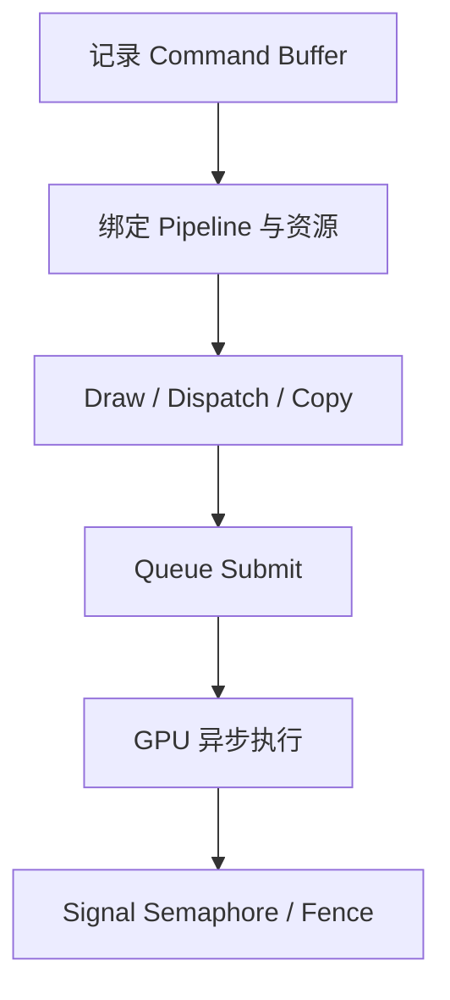

# Vulkan 基础：显式表达 GPU 工作

Vulkan 的核心不是“比 OpenGL 更底层”这句口号，而是把设备选择、资源、pipeline、命令记录和同步责任显式交给应用。驱动仍会编译 shader、管理硬件细节，但 API 不再为每个 draw 隐式猜测大量状态和依赖。

## 1. 从实例到逻辑设备

| 对象 | 职责 |
| --- | --- |
| `VkInstance` | 连接 loader、扩展、validation 与物理设备枚举 |
| `VkPhysicalDevice` | 描述一个可选 GPU 及其 feature、limit、memory type |
| `VkDevice` | 为选定物理设备启用功能并创建逻辑设备 |
| `VkQueue` | 接收 graphics、compute、transfer 或 present 工作 |
| `VkSurfaceKHR` | 平台窗口系统可呈现的抽象表面 |
| Swapchain | 一组由 presentation engine 管理的可呈现 images |

Queue family 声明支持的能力。graphics queue 不一定支持 present，dedicated transfer/compute queue 也不一定更快；选择要依据设备实际 family 和工作负载。

## 2. 资源：Buffer、Image 与 Memory

Buffer 是线性字节范围，常放 vertex、index、uniform、storage 或 transfer 数据。Image 带维度、format、mip、layer、sample count 和 tiling 等图像语义。

创建 buffer/image 不一定自动分配 backing memory。应用查询 memory requirements、选择 memory type、分配并绑定。实际工程会用 allocator 把许多资源放入较大 allocation，以减少调用与碎片。

Image view 选择 image 的格式解释和子资源，sampler 定义过滤；descriptor 再把这些资源暴露给 shader。对象层次分开是为了复用和明确约束。

## 3. Descriptor 与 Pipeline Layout

Descriptor set 是一组具体资源绑定，descriptor set layout 描述槽位类型与 shader stage 可见性。Pipeline layout 组合若干 set layouts 和 push constant ranges，形成 shader 的资源接口契约。

Pipeline 再把 shader stages 与固定功能状态组合起来。部分状态可以声明为 dynamic，在 command buffer 中设置；其余状态属于 pipeline object。Pipeline cache 可以复用编译数据，但其可移植性和生命周期受实现约束。

SPIR-V 仍不是设备机器码。跨组专题 [Shader Recompiler：从 GPU ISA 到 SPIR-V](../compilers/shader-recompilation.md) 解释兼容层如何生成 SPIR-V，以及 Vulkan 驱动为何还要结合 pipeline 状态把它编译到实际 host GPU。

## 4. Command Buffer 只记录意图

Vulkan 命令通常先写入 command buffer：begin rendering/pass、bind pipeline、bind descriptor、draw/dispatch、copy、barrier。记录完成不表示 GPU 已执行；只有提交给 queue 后，设备才获得工作。

Command pool 管理 command buffer 的分配与重置，通常与 queue family 关联。多线程可以并行记录不同 command buffers，但同一个 pool 和对象的 host access 仍需遵守 external synchronization 要求。

## 5. 一帧 Presentation

典型帧循环是：

1. 等待该 frame slot 的 fence，确认旧资源可复用；
2. acquire 一个 swapchain image；
3. 更新本帧资源并记录命令；
4. submit，等待 image-available semaphore；
5. 渲染完成时 signal render-finished semaphore；
6. present queue 等待该 semaphore 后呈现；
7. 处理 resize、out-of-date 和 swapchain 重建。

Acquire 成功只表示获得 image 使用权，不表示可以无视上一用途的 layout/dependency。Present 也不等于屏幕立即完成扫描输出。

## 6. Graphics、Compute 与 Transfer

Graphics pipeline 处理图元与 attachments；compute pipeline dispatch workgroups；transfer 命令负责 copy、blit、clear 等。它们可以在相同或不同 queues 上执行。

拆到多 queue 只有在硬件支持并且依赖/ownership 正确时才可能重叠。额外 queue 会增加 semaphore、queue-family ownership 和资源调度复杂度，不能从“异步 compute”名字直接推断更快。

## 7. Vulkan 没有替你做什么

- 不自动跟踪每个资源上一位读写者；
- 不自动在所有提交之间插入 barrier；
- 不保证不同 queue 按调用顺序串行；
- 不自动回收仍被 GPU 使用的对象；
- 不保证 host 写入立即对 device 可见；
- 不把 validation layer 报告为零等同于渲染正确。

Validation 能发现许多 API 使用错误，但无法证明 shader 算法、资源内容和业务时序正确。

## 8. 图形兼容层中的 Vulkan

把 guest 图形 API 映射到 Vulkan，需要同时处理：

- guest buffer/image 地址与 host Vulkan 资源缓存；
- guest shader ISA 到 SPIR-V；
- guest fixed state 到 host pipeline；
- guest draw/dispatch 到 command recording；
- guest fence、cache 和同步语义到 Vulkan dependency；
- presentation format、尺寸和窗口系统差异。

Lichii 的 `renderer_vulkan` 包含 rasterizer、buffer/texture cache、pipeline cache、scheduler 和 present manager；Hookshot 的公开 renderer 则把 NVN 路径记录/转换到其 Vulkan backend。目录相似不代表两者拥有相同 guest 状态模型或同步策略。

下一篇 [GPU 内存与同步](./gpu-memory-and-sync.md) 专门解释最容易出错的 dependency、visibility、layout 和对象生命周期。

## 参考入口

- [Vulkan Guide](https://docs.vulkan.org/guide/latest/)：Khronos 维护的功能与实践说明。
- [Khronos Vulkan Tutorial](https://docs.vulkan.org/tutorial/latest/)：从设备、swapchain 到渲染循环的学习路径。
- [Vulkan Specification：Pipelines](https://docs.vulkan.org/spec/latest/chapters/pipelines.html)：graphics/compute pipeline 的规范定义。
- Lichii [`renderer_vulkan`](https://github.com/zortos293/Lichii/tree/9441129819edfee62e65ff6030749e80f420ba1e/src/video_core/renderer_vulkan)：公开 Vulkan renderer 对象划分。
- Hookshot [`gpu/vk/VULKAN.md`](https://github.com/NotRexed/Hookshot/blob/e9975d6c245275aaf89a34e8d17a6bbe8badab46/gpu/vk/VULKAN.md)：固定 commit 下的 backend 状态记录，只代表该版本。
