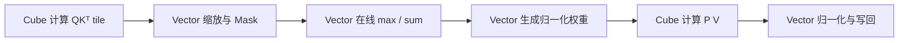

# 昇腾 AI Core

昇腾 AI Core 不是“带更多 ALU 的 CPU core”。官方硬件抽象把计算与搬运拆成多个单元和指令队列：Scalar 负责标量控制与发射，Cube 处理矩阵类计算，Vector 处理逐元素、归约等向量计算，MTE/FixPipe 等流水负责在不同存储层之间搬运或完成相应的数据路径。

## 1. 为什么要拆成 Cube 与 Vector

GEMM、卷积和 Attention 中的 $QK^\mathsf{T}$、$PV$ 有规则的块矩阵乘加，适合 Cube；缩放、mask、逐元素函数、最大值/求和归约和归一化更适合 Vector。Flash Attention 因而不是“一个矩阵指令”：

矩阵与向量阶段共享或转交中间数据时，layout、可见性和同步必须匹配。把全部工作强塞给 Cube 会缺少 softmax 等语义；把 GEMM 展开为普通 Vector 乘加又通常放弃矩阵单元的吞吐优势。

## 2. Scalar 不是主要数值计算单元

Scalar 处理循环、地址、条件和参数，并向不同队列发射指令。官方资料明确指出这些队列可异步执行。因此“Python 源码按行书写”不意味着设备严格逐行完成：数据依赖必须由队列内顺序、event/flag 或 barrier 建立。

这也是 TileLang `T.Scope("C")` 与 `T.Scope("V")` 的意义之一：它们不只是代码分组，而是帮助编译和代码生成区分 Cube 与 Vector 区域，进而处理不同的存储、指令与同步需求。具体见 [Kernel 编程模型](../../ai-infra/kernel-engineering/kernel-programming-model.md)。

## 3. 一条抽象数据路径

官方编程指南给出的典型路径可以概括为：

- Vector：`GM → UB → Vector → UB → GM`；
- Cube：`GM → L1 → L0A/L0B → Cube → L0C → FixPipe/后续路径 → GM`。

这是理解数据流的基础，不是所有算子的唯一实现。具体产品与指令可能支持不同路径，TileLang 也可能插入转换或经 UB 连接 Cube/Vector。文章中的“典型路径”不能替代目标产品的指令文档。

## 4. block 与 core 的边界

一个 kernel 会把输出域分给若干 AI Core block；每个 block 再处理一个或多个 tile。block 数量决定任务并行度，但增大 block 数并不自动加速：过细会增加重复搬运、边界和调度成本，过粗则让部分 core 空闲或使单 block 工作集过大。

TileLang `T.Kernel(extent, is_npu=True)` 在公开实现中建立 NPU launch frame，并返回用于选择工作块的索引；它不是 CUDA thread block 的无条件同义词。其 `threads=1/2` 还有该后端关于 Cube/Vector core 组织的特定语义，不能套用 GPU 的线程数解释。

## 5. 代际边界

不同 Ascend 产品的 Local Memory 容量、支持 dtype、指令形状和 Cube/Vector 组织可能不同。这里不把旧文档中的某个矩阵基础块尺寸或某款芯片容量写成“昇腾固定参数”。在实际 kernel 中，tile 与 intrinsic 选择应由目标 `--npu-arch`、CANN 版本和对应产品指南共同确认。

## 参考入口

- [Ascend C：Hardware Architecture Abstraction（CANN 8.0）](https://www.hiascend.com/document/detail/en/canncommercial/800/opdevg/Ascendcopdevg/atlas_ascendc_10_0015.html)
- [Ascend C：Basic Architecture（CANN 9.1）](https://www.hiascend.com/en-sg/document/detail/en/CANNCommunityEdition/910/programug/Ascendcopdevg/docs/en/guide/programming_guide/advanced_programming/hardware_implementation/basic_architecture.md)
- [TileLang-Ascend `Kernel` 实现（固定 commit）](https://github.com/tile-ai/tilelang-ascend/blob/c3b324ac955271fd245346be465fbdd39fd4bd18/tilelang/language/kernel.py)

