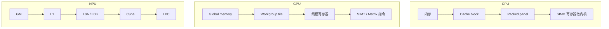

# CPU、GPU 与 NPU

CPU、GPU 和 NPU 都能执行乘加，但它们对“谁决定并行、数据放在哪里、何时同步”的回答不同。对照的目的不是给硬件贴上“通用/并行/AI”标签，而是找出同一优化思想在不同机器上的落点。

## 1. 三种执行取向

| 维度 | CPU | GPU | 昇腾 AI Core |
| --- | --- | --- | --- |
| 主要取向 | 低延迟、复杂控制、强单线程 | 大量线程/调用的吞吐与延迟隐藏 | 面向张量块的数据流与专用矩阵、向量流水 |
| 程序看到的并行 | 线程、SIMD、任务 | grid/workgroup、warp 或 subgroup | AI Core block、Cube/Vector/Scalar 与搬运队列 |
| 主要局部资源 | cache、SIMD 寄存器 | registers、shared memory、cache | L1、L0A/B/C、UB 等片上存储 |
| 常见复用方式 | cache blocking、packing、寄存器微内核 | shared-memory tiling、register reuse | GM 到片上多级搬运、Cube/Vector 分工 |
| 等待隐藏 | 乱序、cache、SMT | 切换可运行 warp/workgroup | 独立流水与异步队列、双缓冲 |

这里不能把 GPU register 直接等同于 L0A/L0B/L0C：前者通常是线程私有标量存储，后者是 Cube 操作数与累加结果的专用局部存储。GPU shared memory 与 L1/UB 也只在“软件管理的局部复用”层面可类比，访问粒度、可见性与指令路径不同。

## 2. 同一个 GEMM 的三种落点

矩阵乘法

$$
C_{ij}=\sum_{k=0}^{K-1} A_{ik}B_{kj}
$$

包含相同的乘加，但数据路径不同：

本人的 CPU GEMM 固定版本 [`1b12596`](https://github.com/Tiansuanyu/CS219-project/tree/1b12596e48f39c7c97632a4f0dde5c6936ef7aa1) 使用宏观分块、A/B packing、8×8 AVX2 FMA 微内核和 OpenMP。它展示了共性：沿 $K$ 维复用操作数，让结果尽量留在近计算单元的位置；但它依赖 cache 与通用寄存器，不具有 NPU 的 L0A/B/C 搬运语义。

GPU Gaussian rasterizer 固定版本 [`23feeef`](https://github.com/Tiansuanyu/gaussian-grouping-project/tree/23feeef7ded25b2374fbb027d667e91500efd1d0) 则是非规则工作量：tile 列表、透明度提前终止与通道融合会共同改变访存、寄存器压力和 occupancy。它说明“分块与复用”是共性，“矩阵规则分块”不是所有 kernel 的共同形状。详见 [GPU Kernel 优化](../graphics-gpu/gpu-kernel-optimization.md)。

## 3. 资源约束如何改变算法形状

tile 过小会增加边界、循环和搬运开销；tile 过大又可能放不进局部资源，降低并行或根本无法编译。对 NPU，至少要同时满足输入 tile、累加 tile、双缓冲副本、对齐和临时 Vector 数据的空间需求。不能只用某一层容量除以元素字节数得到“最佳 tile”。

同理，CPU 的 $B_M,B_N,B_K$ 要考虑 cache 与 packing 成本；GPU 的 block 还受 registers、shared memory 与可驻留 workgroup 数影响。三者共享约束优化的思路，却没有通用的最优尺寸。

## 4. 性能瓶颈不是一个百分比

性能判断至少区分：

- **计算受限**：目标算术流水成为上限；
- **带宽受限**：GM/显存/主存流量主导；
- **延迟受限**：依赖链或并行度不足，流水等待；
- **同步受限**：barrier、flag、queue dependency 或 host/device 等待阻塞；
- **前后处理受限**：kernel 已快，但 layout 转换、launch、数据传输或图调度占主导。

FLOPs、理论带宽、occupancy 或单个 kernel 时间都只能提供一部分证据。比较异构设备还必须固定数学语义、dtype、输入形状、是否包含搬运以及输出容差。

## 5. 编译器为什么不可缺席

在 CPU 上，编译器选择 SIMD 指令并做寄存器分配；在 GPU 上，它把 thread/block 和地址空间降低到设备代码；在 NPU 上，还需要把 tensor layout、存储 scope、Cube/Vector 阶段和同步关系具体化。Tensor DSL 不是绕过硬件，而是把硬件相关的决策提升为可变换、可检查的 IR。下一步先读 [昇腾 AI Core](./ascend-ai-core.md)，再进入 [张量编译器](../compilers/tensor-compilers.md)。

