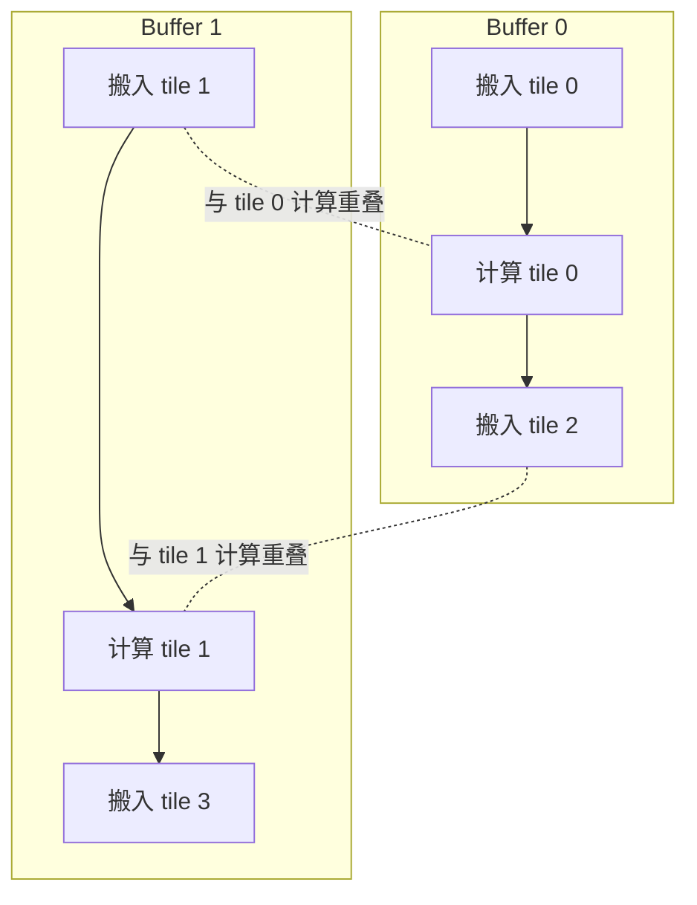

# NPU 执行、流水与同步

数据搬运和计算可以重叠，是因为它们由不同流水处理；同一事实也带来正确性风险：源码先后出现的两个操作，若进入不同队列，完成顺序未必相同。

## 1. 从顺序代码到异步队列

可把一个 tile 的工作抽象为 CopyIn、Compute、CopyOut：

队列内顺序通常能约束同一流水的操作；跨队列依赖则需要 event/flag。官方 CANN 文档用 `SetFlag`/`WaitFlag` 表达不同流水间同步，用 pipe barrier 处理相应的同队列约束。具体可用的同步原语和流水组合仍取决于产品与编程接口。

## 2. 双缓冲为何有效

单缓冲会形成“搬入完才计算，计算完才覆盖”的串行关系。双缓冲把 tile $i$ 的计算与 tile $i+1$ 的搬入放在不同槽中：

它不是自动二倍速：只有搬运与计算时间可重叠、硬件资源允许并发且同步开销足够小时才有收益。双缓冲也把局部空间需求近似翻倍，可能迫使 tile 变小。

## 3. Buffer ownership

每个槽至少经历三个状态：空闲、由生产者写入、由消费者读取。合法复用要求：

1. 生产者获得空闲槽，完成写入后发出 ready；
2. 消费者等待 ready，再读取并计算；
3. 消费者完成最后一次读取后发出 free；
4. 下一轮生产者等待 free，才覆盖该槽。

只等待“生产者写完”而不等待“消费者读完”，下一轮 copy 仍可能过早覆盖。只用 barrier 也未必正确：barrier 必须作用于真正参与该数据依赖的流水和执行主体。

## 4. 软件流水的阶段安排

`T.Pipelined` 把循环体的若干操作标注为 pipeline stages，再由 pass 规划 prologue、steady state 和 epilogue。设阶段数为 $s$，稳定阶段可同时处理不同迭代，但首次结果仍要先填满流水，最后也要排空。因此短 $K$ 循环可能得不到足够重叠收益。

TileLang 公开实现还允许给 `order`、`stage`、`sync`、`group` 和 `cross_interval` 等信息；这说明它不是简单的“把循环 unroll 两次”。具体 lowering 见 [TileLang-Ascend 编译架构](../case-studies/tilelang-ascend/compiler-architecture.md)。

## 5. 自动同步与显式同步的边界

TileLang-Ascend 的 Developer 模式试图从 IR 数据依赖推断 scope、插入同步并规划内存；Expert 模式允许显式 L1/L0/UB、Cube/Vector scope 和 flag。自动化减少模板代码，但仍依赖 IR 中的读写集合、alias 和控制流可分析；显式控制更接近硬件，也更容易写出缺失等待、错误复用或不必要串行化。

验证同步不能只看“多数输入结果正确”。竞态可能依赖 tile 数、形状、队列时序或编译器版本。应先用数学参考检查输出，再通过 IR/生成代码确认依赖，最后用 profiler 判断等待是否成为瓶颈。

## 参考入口

- [Ascend C：Double Buffering（CANN 8.0）](https://www.hiascend.com/document/detail/en/canncommercial/800/opdevg/ascendcbestP/atlas_ascendc_best_practices_10_0033.html)
- [Ascend C：Static Tensor Programming（CANN 8.5）](https://www.hiascend.com/document/detail/en/canncommercial/850/opdevg/Ascendcopdevg/atlas_ascendc_10_00019.html)
- [TileLang `T.Pipelined`（固定 commit）](https://github.com/tile-ai/tilelang-ascend/blob/c3b324ac955271fd245346be465fbdd39fd4bd18/tilelang/language/pipeline.py)
