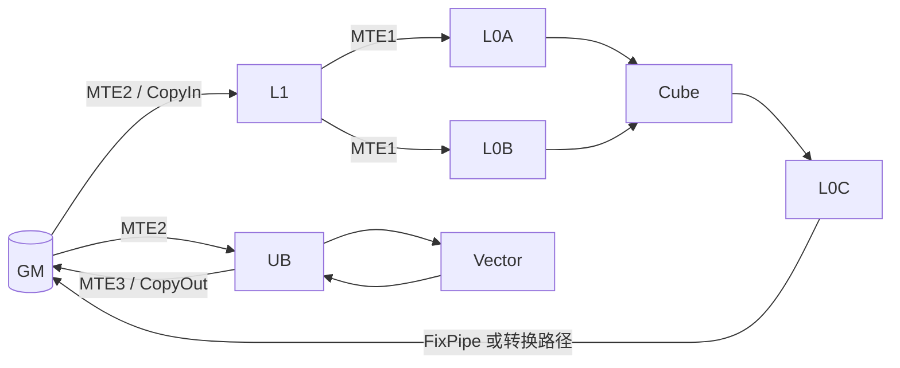

# NPU 存储层次

高吞吐算子的关键问题常不是“乘加怎么写”，而是一个操作数在执行期间从哪里来、被复用几次、以什么布局到达计算单元。昇腾 Local Memory 由多个具有不同职责的存储组成，不能统称为 cache。

## 1. 各层回答什么问题

| 存储 | 典型职责 | 常见数据 |
| --- | --- | --- |
| GM | 容量较大的设备全局存储，跨 block 输入输出 | 原始张量、最终结果 |
| L1 | Cube 路径的较大局部 staging 与复用 | A/B 的较大 tile |
| L0A / L0B | Cube 两侧输入 | 经过所需布局组织的 A/B 子块 |
| L0C | Cube 累加结果 | 较高精度或目标类型的 C tile |
| UB | Vector 的主要局部工作区 | mask、scale、归约统计量、逐元素中间值 |

“典型职责”不表示任意层之间都能直接 copy。合法搬运路径、对齐与数据格式由产品和指令约束决定。

## 2. tile size 是容量不等式

设一个 GEMM block 使用 $M_t\times K_t$ 的 A tile、$K_t\times N_t$ 的 B tile 和 $M_t\times N_t$ 的累加 tile。仅按元素数，局部需求已有

$$
S_A=M_tK_t b_A,\qquad
S_B=K_tN_t b_B,\qquad
S_C=M_tN_t b_C.
$$

若 A/B 双缓冲，输入需求近似乘二；还要加入 padding、对齐、layout 转换和临时 Vector buffer。$b_C$ 也未必等于输入元素字节数。因此实际约束是一组分别作用于 L1、L0A/B、L0C 与 UB 的不等式，不是一个“总片上内存”预算。

tile 还影响复用。理想情况下，A tile 沿 $N$ 方向复用，B tile 沿 $M$ 方向复用，C tile 沿 $K$ 循环留在 L0C 累加。若每个 $K_t$ 都把 C 写回 GM，再读回继续累加，搬运量会显著增加。

## 3. layout 是计算契约

shape 只说明逻辑索引范围，layout 还说明这些索引如何排进物理存储。Cube intrinsic 往往要求特定分块/排列；为此数据可能在 GM→L1、L1→L0 或显式 layout transform 时重排。

TileLang 在 [`allocate.py`](https://github.com/tile-ai/tilelang-ascend/blob/c3b324ac955271fd245346be465fbdd39fd4bd18/tilelang/language/allocate.py) 中把 `shared.l1`、`wmma.matrix_a`、`wmma.matrix_b`、`wmma.accumulator` 和 `shared.ub` 分别用作 L1、L0A、L0B、L0C、UB 的 TIR scope。`shared`/`local.fragment` 等较抽象 scope 则可由后续 pass 推断。scope 是编译契约，不意味着 Python 对象本身占用了真实硬件空间。

## 4. 搬运为什么会成为瓶颈

若一个 tile 只计算一次便被丢弃，或布局转换使同一数据反复往返，Cube 可能等数据而空闲。算术强度可作为第一步：

$$
I=\frac{\text{有效运算量}}{\text{从目标存储层搬运的字节数}}.
$$

但 $I$ 必须注明观察的是 GM、L1 还是其他边界；不同层的带宽和并发能力不同。只以 GEMM 的理论 FLOPs 除以输入输出张量大小，会漏掉 padding、重复加载和中间 materialization。

## 5. 容量、生命周期与正确性

两个逻辑 buffer 生命周期不重叠时，memory planning 可复用同一物理区域；重叠时强行复用会造成读写覆盖。TileLang 的 Ascend memory-planning pass 正是在 IR 上利用生命周期安排地址，但自动规划不能改变真实数据依赖。需要程序或同步 pass 证明旧消费者已经完成，生产者才能取得 buffer ownership。

下一篇 [NPU 执行、流水与同步](./npu-execution-and-sync.md) 解释这份所有权怎样跨异步队列转交。

## 参考入口

- [Ascend C：Basic Architecture（CANN 9.1）](https://www.hiascend.com/en-sg/document/detail/en/CANNCommunityEdition/910/programug/Ascendcopdevg/docs/en/guide/programming_guide/advanced_programming/hardware_implementation/basic_architecture.md)
- [Ascend C C API Programming（CANN 9.0）](https://www.hiascend.com/doc_center/source/en/CANNCommunityEdition/900/programug/Ascendcopdevg/atlas_ascendc_10_00064.html)
- [TileLang-Ascend scope inference（固定 commit）](https://github.com/tile-ai/tilelang-ascend/blob/c3b324ac955271fd245346be465fbdd39fd4bd18/src/transform/ascend_infer_buffer_scope.cc)

