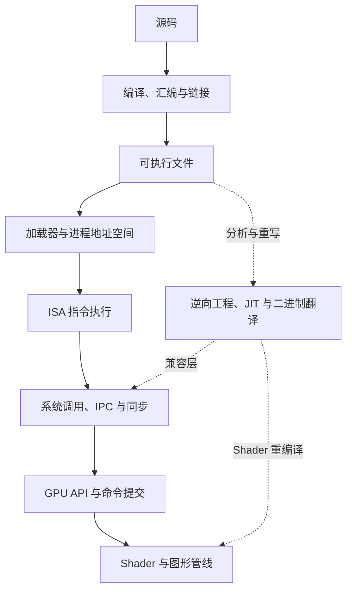

# Computer Systems Overview

这个板块围绕一个问题展开：**一段程序如何从源码变成 CPU 和 GPU 上真正发生的计算，又如何通过操作系统与外部世界交互？**

学习不从模拟器或重编译器的巨大代码库直接钻进去，而是先建立通用原理，再用 [Lichii](./case-studies/lichii/) 和 [Hookshot](./case-studies/hookshot/) 回答“这些原理在大型工程中如何连接”。

## 知识结构

1. [基础原理](./foundations/)：程序生命周期、二进制表示、ISA、ABI 和内存层次。
2. [操作系统](./operating-systems/)：进程、线程、虚拟内存、系统调用、IPC、同步与 HLE。
3. [编译器与程序翻译](./compilers/)：前端、IR、优化、JIT/AOT、binary lifting 与 shader 重编译。
4. [图形与 GPU](./graphics-gpu/)：图形管线、光栅化、纹理、shader、GPU 架构、Vulkan 与同步。
5. [安全与逆向工程](./security-re/)：可执行文件、调试与逆向、secure boot、密码学边界。
6. [源码案例](./case-studies/)：用 Lichii 和 Hookshot 连接 CPU、OS 与 GPU 知识。
7. [实验](./labs/)：通过自己的小程序验证汇编、HLE、软件光栅化和二进制翻译。

## 推荐路线

先读 [程序如何真正运行](./foundations/how-programs-run.md)，再按“ISA/ABI → 进程与虚拟内存 → 编译器与 IR → GPU 管线”建立主干。二进制提升、HLE 和 shader 重编译是综合题，放在主干之后；案例笔记重点说“某个仓库如何组合这些原理”，不复制通用教程。

## 源码基线

本轮规划固定在以下公开版本，后续具体笔记会在页内重新记录 commit：

| 仓库 | 核对版本 | 在本板块中的作用 |
| --- | --- | --- |
| [Lichii](https://github.com/zortos293/Lichii/tree/9441129819edfee62e65ff6030749e80f420ba1e) | `nx2` / `9441129` | 运行时模拟器：CPU JIT、Horizon HLE、GPU 模拟与 shader 重编译 |
| [Hookshot](https://github.com/NotRexed/Hookshot/tree/e9975d6c245275aaf89a34e8d17a6bbe8badab46) | `main` / `e9975d6` | 静态重编译：AArch64 提升到 C、host runtime、NVN2 到 Vulkan |

这些项目的实验日志、兼容性结论和未完成路径都只对对应 commit 成立，不当作永久的通用规律。
