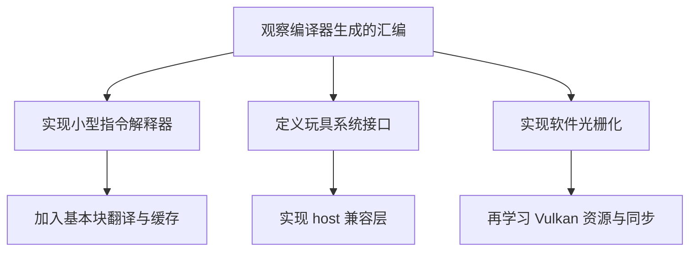

# 实验

实验的目标不是复刻大型项目，而是把每个抽象变成可以观察、失败和解释的小系统。所有输入使用自己编写的程序、合成数据或许可明确的开源样例。

## 计划内容

| 稳定文件名 | 最小产物 | 主要观测 |
| --- | --- | --- |
| `assembly-experiments.md` | 几个 C/Assembly 小函数和反汇编记录 | 调用约定、栈帧、优化、SIMD 与编译器差异 |
| `toy-hle.md` | 一个定义 guest API、host 实现和测试的玩具兼容层 | 句柄、错误码、阻塞、时间和资源生命周期 |
| `software-rasterizer.md` | 只绘制三角形的 CPU 光栅器 | 坐标变换、覆盖规则、重心插值、深度测试 |
| `toy-binary-translator.md` | 只支持少量自定义指令的解释器和翻译器 | 解码、基本块、状态映射、跳转与差分测试 |

## 实验顺序

每个实验都记录：平台与工具链、输入契约、预期行为、可重复命令、失败样例、测量边界和仍未解释的问题。先用 reference interpreter 或朴素实现建立对照，再优化；性能改善必须和正确性检查使用同一份明确输入。

第一项可直接从 [程序如何真正运行](../foundations/how-programs-run.md) 的对象文件、反汇编和系统调用观察开始。等通用原理页完善后，再逐篇把实验结果链接回相应知识点。
