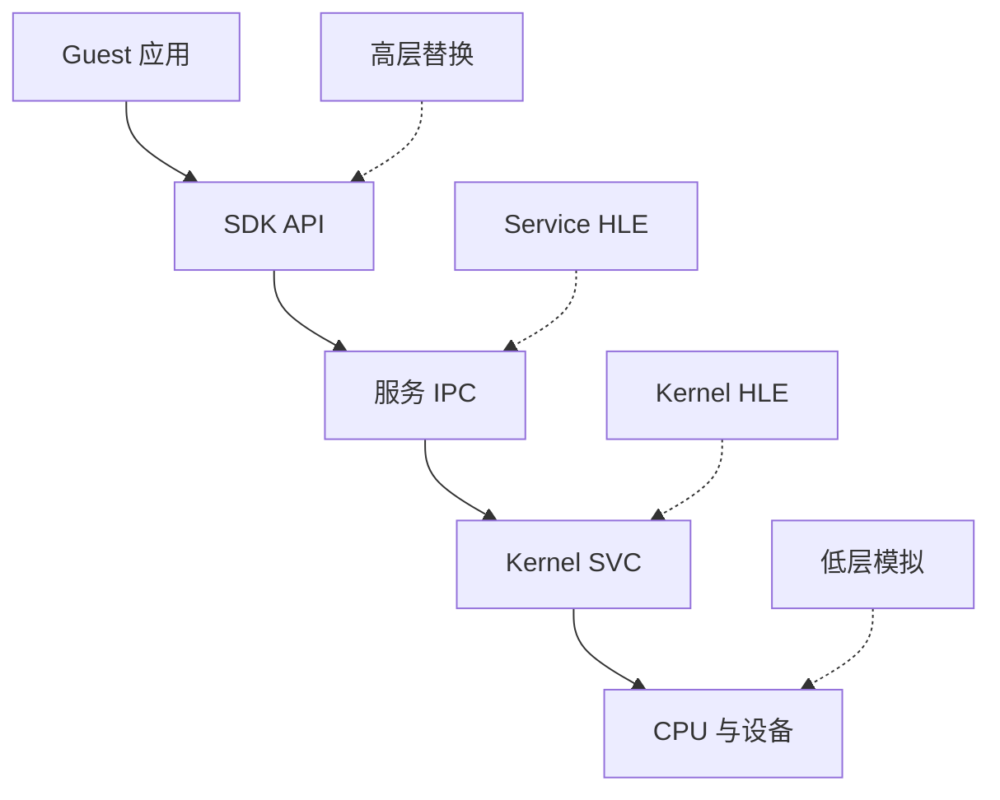
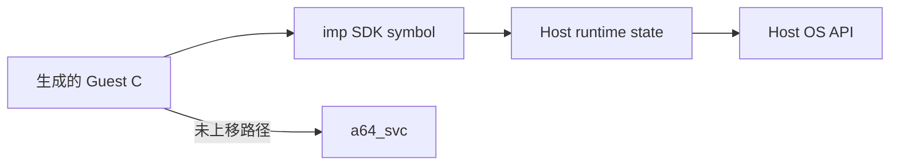

# HLE 与兼容层

兼容程序不一定要启动原始操作系统。只要 guest 能观察到的接口、状态变化和时序约束被充分重现，程序就可能继续运行。这正是 HLE（High-Level Emulation）的核心：**实现行为契约，而不是逐条执行原系统的全部内部代码。**

## 1. “相同结果”包括哪些东西

一个接口的契约远不止函数名与正常返回值，还包括：

- 参数布局、地址有效性与 ABI；
- 结果码、部分成功和错误优先级；
- 对文件、内存、handle 等状态的副作用；
- 是否阻塞、何时唤醒、超时如何计算；
- 并发调用的原子性与可见顺序；
- 对象何时失效，以及关闭后再次使用的行为。

所以“让函数返回 0”只可能是一个 stub。若调用者随后读取输出 buffer、等待事件或依赖对象状态，表面成功会把错误推迟到更难定位的位置。

## 2. 可以在哪一层截获

截获越高，通常越容易直接调用 host 能力，也能跳过大量 guest 中间层；但它更依赖具体 SDK 版本和接口知识。截获越低，保留的 guest 软件路径越多，覆盖面可能更通用；代价是要重现更多内核、设备和时序细节。

这不是一条单调的“高层快、低层准”定律。高层实现若遗漏边界条件也会出错；低层实现若调度或设备语义不对，同样无法兼容。

## 3. Lichii：重建系统对象关系

Lichii 的公开 `core/hle` 体现了较完整的系统分层：

- `KProcess` 持有 page table、handle table 和资源限制；
- `KThread`、scheduler 与 synchronization object 管理可运行和等待状态；
- port、session 与 IPC request 连接 client 和 server；
- service manager 按名字提供服务，service framework 再按命令号分派。

它没有运行原始 Horizon kernel，却在模拟器内部建立一组具有类似职责的 C++ 对象。guest 的 SVC 进入这些对象，服务命令则落到公开实现的 HLE handler。因此“没有原始 OS”与“没有 OS 状态”是两回事：后者仍然必须存在，只是由模拟器持有。

这种方案的优势是多个程序和 SDK 路径可以复用同一套 kernel/service 模型。难点则在于对象关系非常广：handle 生命周期、IPC buffer、调度、内存权限、资源上限和错误码会相互作用。

## 4. Hookshot：把边界上移到 SDK

Hookshot 已经在构建期识别并提升特定程序，所以可以把被调用的 `nn::` 符号直接连到 host runtime。例如文件系统、线程和同步 API 可由 `host/nn_*.c` 实现；guest context 显式保存寄存器，host handler 按 guest ABI 取参和返回。

这里不是简单“把名字换成 Win32 函数”。例如文件系统还要维护 guest mount、路径限制和兼容 handle；线程要保留 guest thread object、优先级/亲和信息、TLS 与唤醒对象；内存要保留 guest 地址范围与映射账本。Host OS 是实现工具，不是 guest 契约本身。

当前版本还保留剩余 SVC 和有限 IPC 兜底。这说明实际系统可以混合多种层级，而不是必须在“完整 OS 模拟”和“全是高层 hook”之间二选一。

## 5. Hostcall 为什么另成一层

某些 API 不只是被直接调用，还会把函数指针返回给 guest。Hookshot 为这类 host handler 分配保留 guest 地址；提升后的间接调用碰到这些地址时，再转回 host 函数。该机制解决的是“guest 世界怎样持有一个可调用目标”，而不等于 SVC 或 service IPC。

它还暴露了兼容层的一个通用问题：**对象和回调会跨越边界存活**。仅在调用瞬间转换参数不够，还要保证地址标识、用户数据、调用线程和释放时机都一致。

## 6. 状态型接口比纯函数更难

可以把兼容接口分成三类：

| 类型 | 示例 | 主要风险 |
| --- | --- | --- |
| 近似纯函数 | 字符串转换、简单查询 | 输入边界、结果码、版本差异 |
| 资源型接口 | 文件、session、共享内存 | handle、所有权、关闭与失败回滚 |
| 时序型接口 | 线程、event、condvar、GPU fence | 阻塞、唤醒、超时、内存可见性 |

后两类不能只对照一组输入输出。一次调用是否“正确”，取决于此前创建了什么对象、其他线程做了什么、失败时状态是否仍可继续使用。

## 7. 如何评价一个 HLE 实现

阅读源码时可以把结论分成四个等级：

1. **转发**：参数经过验证和转换后交给 host 的等价能力。
2. **重建**：兼容层自己维护对象、状态机或协议。
3. **目标化兼容**：只实现当前已知程序实际依赖的子集。
4. **stub**：记录调用，返回固定值或空对象，尚未提供完整语义。

同一文件可以同时包含四种情况。源码中存在 handler 不等于接口已经完整；能启动某个程序也不等于对所有调用序列兼容。

## 8. 两条工程路线怎样选择

| 维度 | Lichii 式 Kernel / Service HLE | Hookshot 式 SDK 高层替换 |
| --- | --- | --- |
| 复用范围 | 面向较多 guest 路径 | 面向固定程序和已知 SDK |
| 需要维护 | 内核对象、IPC、service、调度与内存 | API 覆盖、guest ABI、host 资源与少量底层兜底 |
| 版本敏感点 | 系统服务协议与 kernel 行为 | 符号、SDK 布局与具体调用模式 |
| 调试入口 | SVC、handle、session、service command | 未替换符号、hostcall、host API 与剩余 SVC |
| 常见误判 | “有完整分层就一定兼容” | “host 有同名 API 就可以直接调用” |

下一步读 [Guest 虚拟内存](./virtual-memory.md)，理解两条路线为何都不能把 guest 地址直接当作普通 host 指针；再读 [同步语义](./synchronization.md)，看 host 线程原语为何也不能无条件替代 guest 调度语义。

## 源码阅读入口

- Lichii [`KProcess`](https://github.com/zortos293/Lichii/blob/9441129819edfee62e65ff6030749e80f420ba1e/src/core/hle/kernel/k_process.cpp)、[`KHandleTable`](https://github.com/zortos293/Lichii/blob/9441129819edfee62e65ff6030749e80f420ba1e/src/core/hle/kernel/k_handle_table.cpp)：进程状态与对象能力表。
- Lichii [`ServiceFrameworkBase`](https://github.com/zortos293/Lichii/blob/9441129819edfee62e65ff6030749e80f420ba1e/src/core/hle/service/service.cpp)：命令 handler 与未实现命令策略。
- Hookshot [`hos.h`](https://github.com/NotRexed/Hookshot/blob/e9975d6c245275aaf89a34e8d17a6bbe8badab46/host/hos.h)：SDK HLE 的 guest context ABI。
- Hookshot [`hos_hostcall.c`](https://github.com/NotRexed/Hookshot/blob/e9975d6c245275aaf89a34e8d17a6bbe8badab46/host/hos_hostcall.c)：动态函数指针桥接。
- Hookshot [`nn_fs.c`](https://github.com/NotRexed/Hookshot/blob/e9975d6c245275aaf89a34e8d17a6bbe8badab46/host/nn_fs.c)：以 host 文件系统承接 guest mount、路径和资源语义的具体例子。
