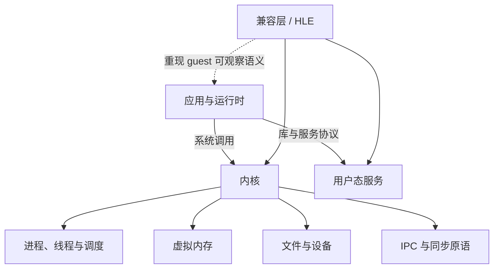

# 操作系统

这一组笔记回答：**应用为什么不能只依靠 CPU 指令完成工作，操作系统又向程序承诺了哪些可观察行为？**

CPU 能执行指令，但进程隔离、内存映射、文件、线程和设备访问都依赖内核与用户态运行时。模拟器中的 HLE 也不只是“补几个同名函数”，它需要在 host 系统上重现 guest 软件实际依赖的接口语义。

## 计划内容

| 稳定文件名 | 核心问题 | 对源码案例的作用 |
| --- | --- | --- |
| `processes-and-threads.md` | 进程、线程、调度与上下文切换分别是什么？ | 识别模拟 CPU 线程、GPU worker 和 host 线程的责任 |
| `virtual-memory.md` | 页表、权限、缺页、映射与地址空间如何工作？ | 理解 guest 地址、host 地址和大范围地址预留 |
| `system-calls-and-ipc.md` | 用户态怎样请求内核或服务，参数怎样跨边界？ | 阅读 SVC、IPC 与 service dispatch |
| `synchronization.md` | 原子操作、锁、条件变量、fence 与内存序解决什么问题？ | 分析 CPU/GPU 异步执行与跨线程资源生命周期 |
| `hle-and-compatibility-layers.md` | HLE、系统模拟和兼容层有哪些责任与边界？ | 比较 Lichii 的运行时 HLE 与 Hookshot 的 host runtime |

## 阅读时保留的边界

- **接口名字相同不代表语义相同。** 返回值、阻塞、时间、权限和资源生命周期都可能是契约的一部分。
- **HLE 不是逐周期硬件模拟。** 它通常在更高层重现 guest 能观察到的行为，因此实现更直接，但也更依赖对接口语义的理解。
- **线程安全不等于时序正确。** 没有数据竞争，只说明一个问题被排除；事件顺序、唤醒条件和 GPU 完成点仍需单独验证。
- **仓库中的 stub 不能当成系统行为说明。** 案例页只记录固定 commit 中能由公开源码和文档确认的路径。

与机器人系统的联系可继续读 [ROS 2 的通信与执行机制](../../robotics-systems/ROS2通信与执行机制.md) 和 [Python 插件、进程内推理与独立 Worker](../../robotics-systems/deployment/Python插件、进程内推理与独立worker.md)。它们是同一组并发与 IPC 原理在机器人软件中的应用。
