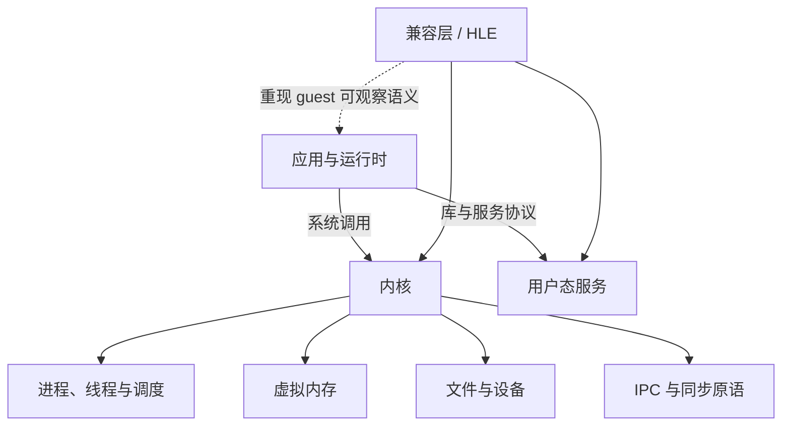

# 操作系统

这一组笔记回答：**应用为什么不能只依靠 CPU 指令完成工作，操作系统又向程序承诺了哪些可观察行为？**

CPU 能执行指令，但进程隔离、内存映射、文件、线程和设备访问都依赖内核与用户态运行时。模拟器中的 HLE 也不只是“补几个同名函数”，它需要在 host 系统上重现 guest 软件实际依赖的接口语义。

## 阅读顺序

| 顺序 | 笔记 | 核心问题 |
| --- | --- | --- |
| 5 | [系统调用、句柄与 IPC](./system-calls-and-ipc.md) | 游戏怎样从普通函数调用进入 Horizon 内核与系统服务？ |
| 6 | [HLE 与兼容层](./hle-and-compatibility-layers.md) | 为什么不运行原始 OS，也能提供足够的兼容行为？ |
| 7 | [Guest 虚拟内存如何落到 Host](./virtual-memory.md) | guest 地址、页表状态与 host 内存怎样连接？ |
| 8 | [同步语义、线程调度与事件](./synchronization.md) | 为什么锁、等待、唤醒和超时必须保持同一套语义？ |

这里的编号承接[编译器与程序翻译](../compilers/)的前四篇。进程、线程与上下文切换还会单独展开；本组先用系统调用入口把内核对象、地址空间和同步关系串起来。

## 阅读时保留的边界

- **接口名字相同不代表语义相同。** 返回值、阻塞、时间、权限和资源生命周期都可能是契约的一部分。
- **HLE 不是逐周期硬件模拟。** 它通常在更高层重现 guest 能观察到的行为，因此实现更直接，但也更依赖对接口语义的理解。
- **线程安全不等于时序正确。** 没有数据竞争，只说明一个问题被排除；事件顺序、唤醒条件和 GPU 完成点仍需单独验证。
- **仓库中的 stub 不能当成系统行为说明。** 案例页只记录固定 commit 中能由公开源码和文档确认的路径。

与机器人系统的联系可继续读 [ROS 2 的通信与执行机制](../../robotics-systems/ROS2通信与执行机制.md) 和 [Python 插件、进程内推理与独立 Worker](../../robotics-systems/deployment/Python插件、进程内推理与独立worker.md)。它们是同一组并发与 IPC 原理在机器人软件中的应用。
