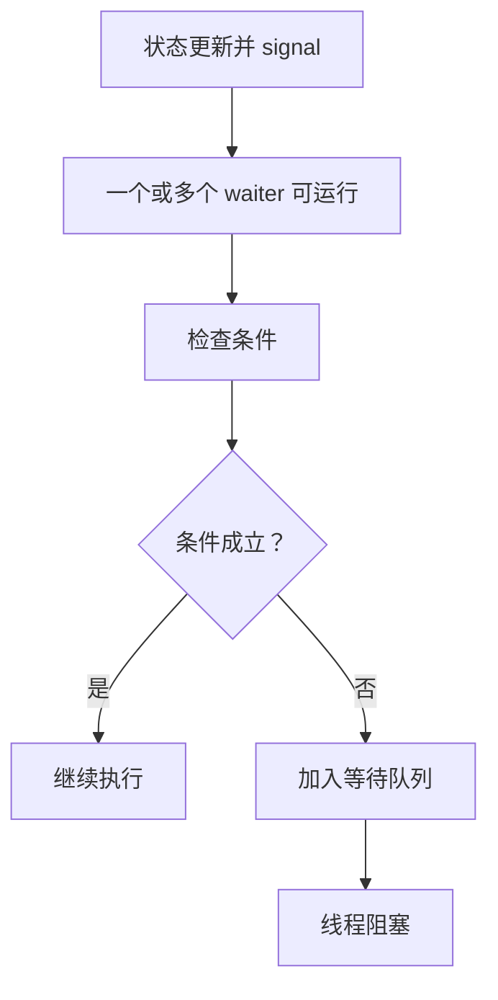
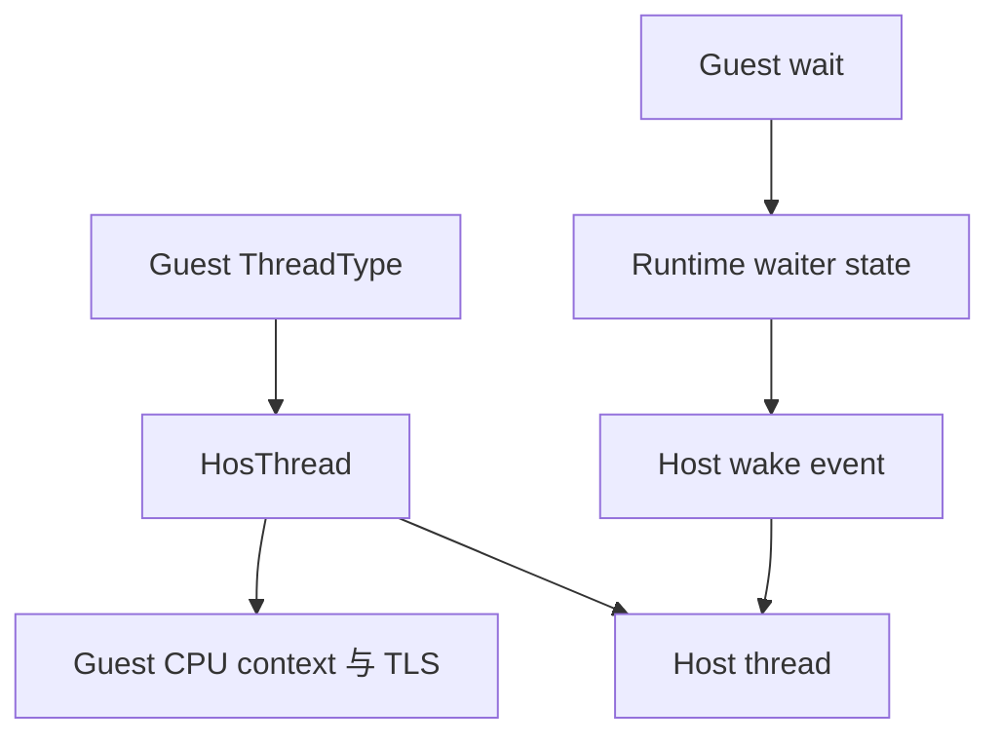

# 同步语义、线程调度与事件

并发兼容最容易出现“多数时候正常、偶尔卡死”的问题。原因是锁和事件不只是 host 数据结构：它们定义了谁能观察到哪些写入、线程何时停止运行、哪一次 signal 可以解除哪一次 wait，以及超时和销毁怎样竞争。

## 1. 同步同时解决三类问题

1. **互斥**：某一时刻只有允许的线程修改共享状态。
2. **顺序与可见性**：一个线程在 release 之前的写入，对 acquire 之后的线程可见。
3. **调度状态**：条件不满足时线程阻塞，满足后进入 runnable，但不保证立刻执行。

只有第一项的实现不能替代完整 guest 同步。用一个 host mutex 保护容器，可以消除 runtime 自身的数据竞争，却不一定重现 guest 的优先级、超时、唤醒数量和公平性。

## 2. 等待必须围绕状态谓词

条件变量或 event 的正确抽象不是“先 wait，之后一定收到一次 signal”，而是：

```text
持锁检查谓词
若谓词为假：原子地释放锁并进入等待
被唤醒后重新持锁，再检查谓词
```

重复检查可以处理虚假唤醒，也能处理另一个线程先消费条件的情况。如果“检查”和“入队等待”之间不是原子边界，signal 可能恰好发生在中间，造成 lost wake-up。



## 3. Lichii：Guest Scheduler 维护线程状态

Lichii 把 thread、scheduler、wait queue 和 synchronization object 作为 kernel 对象。`WaitSynchronization` 先把用户传来的 handle 转成 `KSynchronizationObject`，检查对象状态；若尚未满足，则把当前线程接入等待关系并由 scheduler 切换执行上下文。

`KEvent` 分为 readable 与 writable 两侧：signal 改变可观察状态并唤醒等待者，clear/reset 改变后续 wait 的结果。handle 关闭只释放该进程对对象的引用，并不应在其他引用仍存在时销毁对象。

当前 scheduler 使用 host fiber 在模拟线程上下文间切换，但“由 fiber 实现”不改变其 guest 语义职责：它仍要根据 runnable 状态、优先级、核亲和与调度请求选择下一线程。host OS 只运行模拟器线程，并不知道每个 guest `KThread` 应满足的 Horizon 规则。

## 4. Hookshot：Host Thread 承接 Guest Thread

Hookshot 当前会为 guest `nn::os::ThreadType` 建立 `HosThread`，并在 native Windows 路径创建 host thread。runtime 同时保存 guest context、TLS、thread ID、优先级/亲和信息、kernel-style handle 和用于阻塞的 wake event。

高层 `nn::os` 同步 API 在 `nn_os_sync.c` 中用 SRW lock、condition variable、原子操作等 host 原语实现；仍会执行的 Horizon user-mode mutex、process-wide key 和 address arbiter，则在 `hos_svc.c` 中维护 waiter，并通过 `hos_thread_wait()` / `hos_thread_wake()` 阻塞或唤醒相应 host thread。



这是一种直接映射，但并非“不需要 guest 调度语义”。当前源码还维护 virtual-core checkpoint：线程在阻塞前交出虚拟 core，醒来后重新竞争；高优先级请求可在后续 checkpoint 触发让出。它是在 host scheduler 之上补一层 guest 可观察约束。

## 5. Mutex、Event 与 Semaphore 的差别

| 原语 | 主要状态 | signal / unlock 的含义 | 常见错误 |
| --- | --- | --- | --- |
| mutex | owner 与 waiter | 所有权转移或允许竞争 | 非 owner unlock、遗漏优先级关系 |
| condition variable | 与外部谓词配合的 waiter | 通知重新检查谓词 | 把通知本身当作持久状态 |
| event | signaled 状态及复位方式 | 令 waiter 可通过 | 混淆 auto-reset 与 manual-reset |
| semaphore | 非负计数 | 增加可获取配额 | 丢计数或允许计数越界 |
| address arbiter | 地址值、比较条件与 waiter | 按条件和数量唤醒 | 检查与睡眠不原子 |

把这些原语全部替换成同一个 host event 会丢失语义。特别是 auto-reset event 通常只释放一个 waiter，manual-reset 状态则持续到显式清除；condition variable 的 signal 若没有共享谓词，本身不保存“曾经发生过”。

## 6. 超时不是简单 sleep

等待接口通常允许零超时、有限纳秒和无限等待。兼容层要处理：

- guest 时间单位到 host clock 的转换和溢出；
- 使用单调时钟，避免 wall clock 调整；
- signal 与 timeout 同时发生时只完成一次状态转换；
- 超时返回后从 waiter 队列安全移除；
- 暂停、调试或模拟时钟是否应计入期限。

Hookshot 把纳秒等待换算给 host wait，并在 runtime 中追踪是否超时；Lichii 的 SVC/scheduler 路径则把 deadline 与硬件计时和 thread wait state 连接。两者都不能只调用 `sleep(timeout)`，因为 sleep 不监听对象状态变化。

## 7. 内存序与调度是两条轴

线程被唤醒不自动保证它能看到 signal 线程的全部写入；这要由 lock、atomic 或协议定义的 release/acquire 边界保证。反过来，原子变量更新正确，也不表示等待线程一定被调度唤醒。

因此排查问题时分开问：

- 数据访问是否存在 race，使用了什么 memory order？
- waiter 是否可靠入队，signal 选择了哪些 waiter？
- 对象状态变化和 wake 的先后是否构成 happens-before？
- runnable 之后，guest priority/affinity 是否允许它执行？

GPU fence 也属于同一思想，但它同步的是 CPU 提交与设备完成状态；不能用 CPU mutex 代替 GPU completion。图形侧会在 GPU 同步专题展开。

## 8. 两条路线的比较边界

| 问题 | Lichii | Hookshot |
| --- | --- | --- |
| Guest thread 表示 | `KThread` + guest scheduler | `HosThread` + host thread |
| 等待对象 | kernel synchronization objects | host sync wrappers + 目标化 SVC waiter |
| 上下文切换 | scheduler 在 host fiber 间切换 | host scheduler 运行各 host thread |
| 优先级/核约束 | kernel scheduling state | host 映射并补 virtual-core checkpoint |
| 风险重点 | kernel object 与调度状态完整性 | host 原语语义差异和目标程序覆盖范围 |

不能仅凭“用了真实 host thread”断言时序更真实，也不能凭“实现了 guest scheduler”断言所有竞争顺序都与硬件一致。兼容性依赖程序允许的并发行为集合，而不是重放某一次恰好相同的 interleaving。

## 9. 怎样验证同步实现

有效测试应覆盖状态机，而不是只跑一次主流程：

- signal 发生在 wait 之前、期间和 timeout 边界；
- 多个 waiter，分别测试 wake-one 与 wake-all；
- handle 关闭、对象销毁与等待并发；
- 高频循环下检查丢唤醒和计数漂移；
- 不同优先级、亲和与虚拟 core 数；
- 加入随机调度扰动，并记录可复现的事件序列。

最后应把失败归类为数据竞争、协议状态错误、调度饥饿或 timeout 换算问题，而不是笼统称为“多线程不稳定”。

本组到这里形成完整链条：[系统调用与 IPC](./system-calls-and-ipc.md) 定义请求怎样进入系统，[HLE 与兼容层](./hle-and-compatibility-layers.md) 解释拦截层级，[Guest 虚拟内存](./virtual-memory.md) 解释数据在哪里，本篇则说明多个执行者如何安全共享这些状态。

## 源码阅读入口

- Lichii [`svc_synchronization.cpp`](https://github.com/zortos293/Lichii/blob/9441129819edfee62e65ff6030749e80f420ba1e/src/core/hle/kernel/svc/svc_synchronization.cpp)：handle 校验、多个同步对象与 timeout。
- Lichii [`k_synchronization_object.cpp`](https://github.com/zortos293/Lichii/blob/9441129819edfee62e65ff6030749e80f420ba1e/src/core/hle/kernel/k_synchronization_object.cpp) 与 [`k_event.cpp`](https://github.com/zortos293/Lichii/blob/9441129819edfee62e65ff6030749e80f420ba1e/src/core/hle/kernel/k_event.cpp)：waiter 与 event 对象状态。
- Lichii [`k_scheduler.cpp`](https://github.com/zortos293/Lichii/blob/9441129819edfee62e65ff6030749e80f420ba1e/src/core/hle/kernel/k_scheduler.cpp)：调度请求、fiber 切换与线程选择。
- Hookshot [`nn_os_sync.c`](https://github.com/NotRexed/Hookshot/blob/e9975d6c245275aaf89a34e8d17a6bbe8badab46/host/nn_os_sync.c)：高层 mutex、event、condition variable 与其他同步 API。
- Hookshot [`hos_thread.c`](https://github.com/NotRexed/Hookshot/blob/e9975d6c245275aaf89a34e8d17a6bbe8badab46/host/hos_thread.c)：guest thread、host thread、wake event 与 virtual core。
- Hookshot [`hos_svc.c`](https://github.com/NotRexed/Hookshot/blob/e9975d6c245275aaf89a34e8d17a6bbe8badab46/host/hos_svc.c)：mutex arbitration、process-wide key 与 address arbiter 的 SVC 路径。
