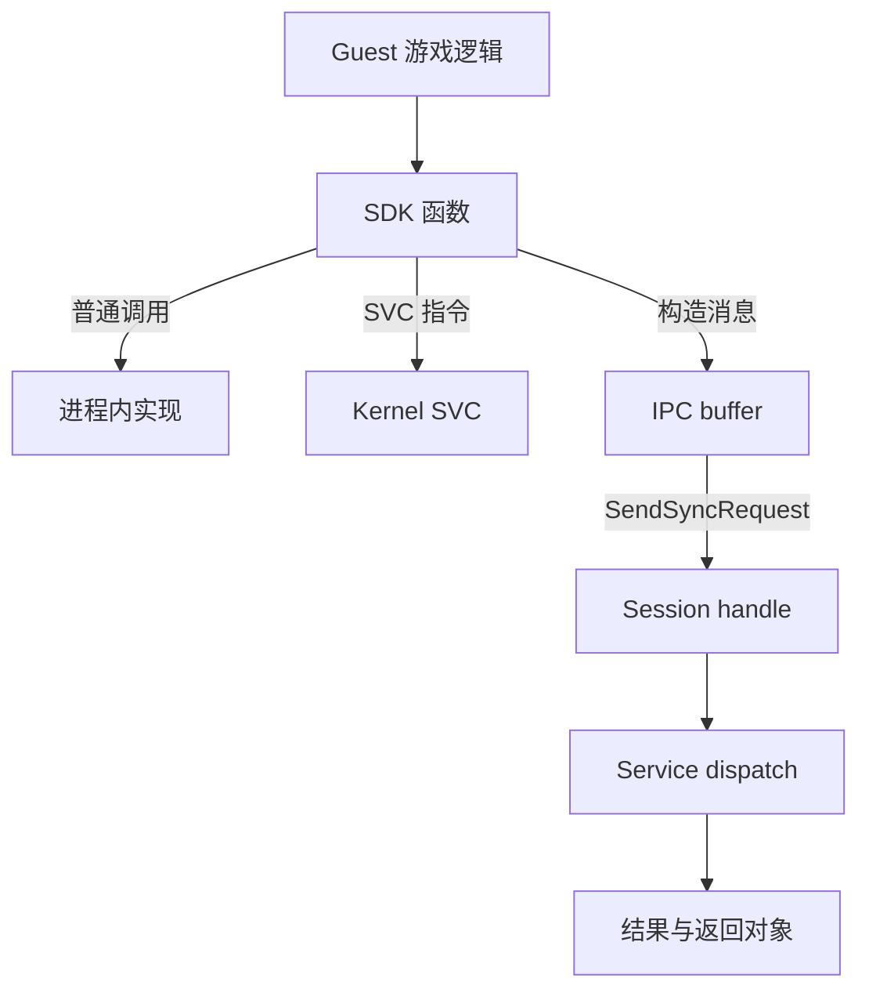
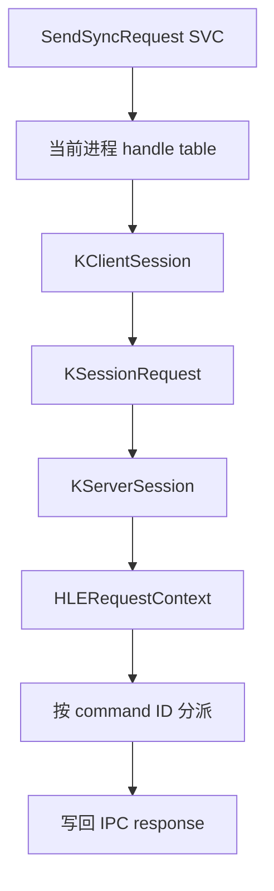
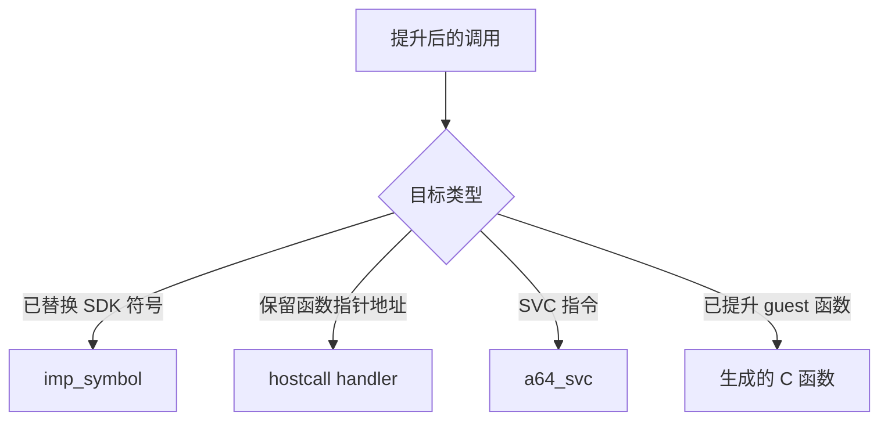

# 系统调用、句柄与 IPC

“游戏向操作系统请求服务”并不是只有一种入口。一次文件读取可能先调用 `nn::fs` 的普通函数，SDK 再通过 IPC 请求文件系统服务；线程等待则可能最终执行 SVC，让内核改变线程状态。分析兼容层时，首先要分清**函数 ABI、内核 SVC 和服务 IPC**三层边界。

## 1. 三种调用不是一回事

| 边界 | 调用对象 | 典型参数载体 | 谁负责返回 |
| --- | --- | --- | --- |
| 普通函数 / SDK API | 同一进程中的库代码 | 寄存器、栈与指针 | 被调用函数 |
| SVC | Horizon 内核 | ABI 约定的寄存器、当前线程与地址空间 | 内核处理器 |
| IPC | 系统服务 | 消息头、命令号、buffer 描述符与 handle | 服务端对象 |

SVC 是从用户态进入内核的机制；IPC 是通过内核管理的 session 把消息交给服务。IPC 的发送动作本身可以由 `SendSyncRequest` 这类 SVC 触发，但不能因此把“服务命令”和“SVC 编号”当成同一层协议。

## 2. Lichii：保留 Kernel 与 Service 两层

Lichii 的公开实现把 SVC、kernel object 和 service framework 分开。以同步 IPC 为例，`SendSyncRequestImpl()` 先从**当前进程的 handle table**取得 `KClientSession`，再由 session 创建请求并交给另一端。服务端解析消息头、buffer 和传递的 handle，最后按 command ID 调用已注册 handler。

一条典型链可以概括为：

这里有几个容易忽略的系统语义：

- **handle 是进程内名字，不是裸指针。** `KHandleTable` 把编码后的 handle 映射到带生命周期的 kernel object，并支持 current process / current thread 伪 handle。
- **复制 handle 与移动 handle 不同。** IPC copy 保留源进程中的引用；move 成功后要从源表移除，再在目标进程生成新 handle。数值可能改变，但所指对象保持一致。
- **buffer 不是随便传一个 host 指针。** user buffer 需要检查地址、大小、页对齐和当前 page table，再在 IPC 期间锁定相应内存。
- **同步请求可以阻塞线程。** 请求完成前，client thread 的运行状态和唤醒都属于内核语义，而不是一次普通 C++ 函数调用的细节。

服务名与命令号也是两级选择。service manager 先按名字找到 port、创建 session；具体服务对象再按命令号分派。一个 session handle 因而同时封装“连接到哪个对象”和“该对象还活着吗”。

## 3. Hookshot：优先在较高层替换

Hookshot 采用静态提升，所以很多已知 SDK 符号可以在构建期直接连到 host runtime。当前 `hos.h` 中的 `HLE(sym)` 把一个 guest import 或 SDK 定义映射为 `imp_<mangled-name>(Ctx*)`：参数从显式 guest context 的寄存器读取，返回值再写回 `x0`。

这意味着文件 API 不必完整经过原来的“SDK client → HIPC → 文件系统服务”链。`nn_fs.c` 直接维护 mount 表，把 guest 路径解析到 host 目录，并用自己的表保存 file/directory handle。它仍需重现：

- mount name、路径规范化和越界防护；
- 只读与可写边界；
- 打开、关闭、枚举和并发读写的生命周期；
- Horizon 风格结果码，而不是直接泄漏 host OS 错误。

这种 handle 也是兼容层分配的稳定 ID，不等于 Windows `HANDLE`，更不应暴露 host 指针。

## 4. Hostcall、SDK 替换与 SVC 兜底

Hookshot 还存在一种 `hostcall`：运行时为 host 函数分配保留的 guest 地址槽。guest 通过函数指针执行 `blr` / `br` 时，若目标不是已提升函数，运行时可以识别该地址并调用绑定的 host handler。这适合“API 返回函数指针”的场景；它与静态符号 HLE 和 SVC 都不同。

当前公开版本中的剩余 SVC 进入 `a64_svc()`，按立即数处理内存、线程、仲裁和少量 IPC。例如 `ConnectToNamedPort` 会产生 session 风格 handle，而 `SendSyncRequest` 对未模拟服务返回一个零填充的成功响应。后者是**当前项目的兼容占位策略**，不能描述为完整实现了 Horizon service IPC；如果 guest 实际依赖输出数据或副作用，空成功同样可能导致后续错误。

## 5. 两种路径的核心差异

| 问题 | Lichii | Hookshot |
| --- | --- | --- |
| 主要兼容边界 | kernel object + service framework | 已知 SDK API 的 host 实现 |
| handle 模型 | 进程级通用 handle table | 各 host 子系统的目标化 ID；另有线程/SVC handle |
| 文件系统 | 经过 HLE service 体系理解接口 | `nn::fs` API 直接映射 host 目录 |
| 未实现服务 | 由 service framework 报告或按当前策略 stub | 剩余 IPC 可返回空成功占位 |
| 适用范围 | 更接近通用模拟器的系统分层 | 面向已知程序和已覆盖接口的静态重编译运行时 |

“层级更低”不自动意味着更准确，“替换层级更高”也不自动意味着更快。前者必须正确维护更多内核状态；后者对 SDK 版本、符号覆盖和被调用行为更敏感。

## 6. 读一次请求时应追什么

可以按以下问题追踪，而不是只找到一个同名函数就停止：

1. guest 从哪个 ABI 边界进入，参数在哪些寄存器或 buffer？
2. 地址是否经过 guest 范围、权限和长度检查？
3. handle 属于哪个表，复制、移动、关闭如何改变引用？
4. 调用是否可能阻塞，谁负责唤醒，超时用哪套时钟？
5. 失败返回什么结果码，是否发生了部分副作用？
6. 当前实现是完整行为、目标化兼容，还是明确的 stub？

下一篇 [HLE 与兼容层](./hle-and-compatibility-layers.md) 继续解释为什么选择不同拦截层仍可能得到可用系统；[Guest 虚拟内存](./virtual-memory.md) 则展开 IPC buffer 和 guest 指针究竟如何被安全访问。

## 源码阅读入口

- Lichii [`svc_ipc.cpp`](https://github.com/zortos293/Lichii/blob/9441129819edfee62e65ff6030749e80f420ba1e/src/core/hle/kernel/svc/svc_ipc.cpp)：session handle 检查、同步请求与 user buffer 生命周期。
- Lichii [`k_server_session.cpp`](https://github.com/zortos293/Lichii/blob/9441129819edfee62e65ff6030749e80f420ba1e/src/core/hle/kernel/k_server_session.cpp)：消息、buffer 描述符与 copy/move handle 的跨进程处理。
- Lichii [`service.cpp`](https://github.com/zortos293/Lichii/blob/9441129819edfee62e65ff6030749e80f420ba1e/src/core/hle/service/service.cpp) 与 [`sm.cpp`](https://github.com/zortos293/Lichii/blob/9441129819edfee62e65ff6030749e80f420ba1e/src/core/hle/service/sm/sm.cpp)：命令分派与服务名解析。
- Hookshot [`hos.h`](https://github.com/NotRexed/Hookshot/blob/e9975d6c245275aaf89a34e8d17a6bbe8badab46/host/hos.h)：`HLE` ABI、guest 地址检查与 runtime 边界。
- Hookshot [`hos_hostcall.c`](https://github.com/NotRexed/Hookshot/blob/e9975d6c245275aaf89a34e8d17a6bbe8badab46/host/hos_hostcall.c)：guest 函数指针到 host handler 的地址槽。
- Hookshot [`nn_fs.c`](https://github.com/NotRexed/Hookshot/blob/e9975d6c245275aaf89a34e8d17a6bbe8badab46/host/nn_fs.c) 与 [`hos_svc.c`](https://github.com/NotRexed/Hookshot/blob/e9975d6c245275aaf89a34e8d17a6bbe8badab46/host/hos_svc.c)：高层文件 API 与剩余 SVC/IPC 的不同覆盖范围。
