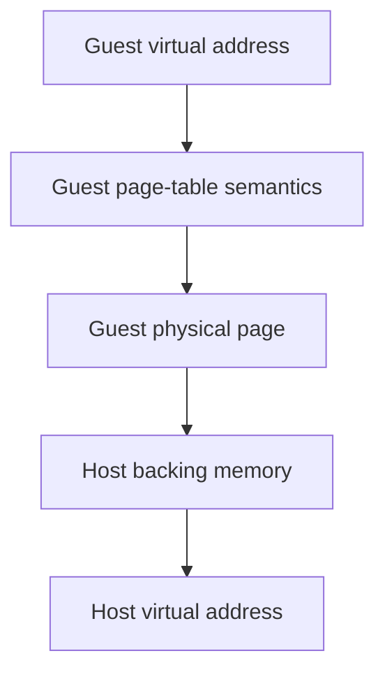
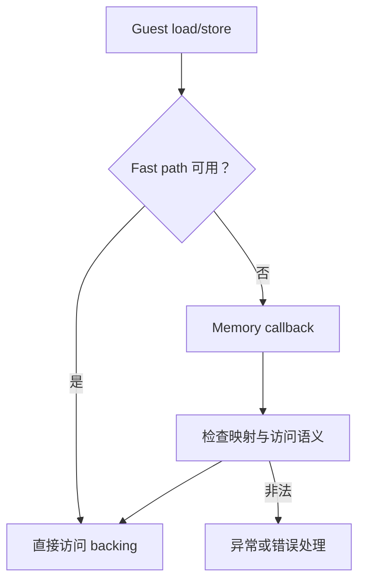

# Guest 虚拟内存如何落到 Host

guest 程序看到的是自己的虚拟地址，host 进程则有另一套虚拟地址空间。兼容层必须回答两个不同问题：**某段 guest 地址在语义上是否已映射、有什么权限**，以及**host 到哪里读取它背后的字节**。

这两个答案可能由同一张 host 映射间接表达，也可能分别由 guest page table 元数据和一块 host backing memory 表达。

## 1. 从虚拟地址到字节

普通操作系统的简化路径是：

$$
\text{VA} = (\text{VPN},\ \text{offset}),\qquad
\text{PA} = \text{page\_table}(\text{VPN}) + \text{offset}.
$$

页表项不仅给出页框，还包含 read/write/execute、用户态可见性和状态位；TLB 缓存近期翻译。访问未映射页或违反权限时，CPU 产生 fault，而不是“读到一个随机值”。

在模拟器里还多一层：

JIT 的 fastmem 可能把常见路径压缩成很少的 host 指令，但慢路径仍要检查映射、权限、跨页访问和设备内存。快只是一种实现，不能删掉 guest 的错误语义。

## 2. 预留、映射和提交要分开

- **地址范围预留**只保证一段 host VA 不被别的映射占用。
- **guest 映射**描述 guest VA 当前属于 code、heap、stack、shared memory 还是 free，以及权限和属性。
- **host backing / commit**决定访问这些字节时是否有真实存储。
- **释放**还涉及清零、引用计数、别名映射和设备是否仍持有页面。

因此“已经预留 512 GiB 窗口”不等于 guest 的每一页都有效；“host 有内存”也不等于 guest 获得了读写权限。

## 3. Lichii：Page Table 是系统状态

Lichii 的 `KProcess` 拥有进程 page table。`KPageTableBase` 负责地址空间布局、heap 扩缩、map/unmap、permission、memory state、IPC 锁定以及 query。SVC 层先检查地址、大小和对齐，再调用 page table 操作；服务 IPC 也会检查 user buffer 是否落在当前进程地址空间。

这使同一批页面可以携带不同语义状态，例如 code、normal、stack、shared、IPC 或 free。`QueryMemory` 返回的不是 host `mmap` 视图，而是 guest 应该看到的 region、state、attribute 和 permission。

CPU JIT 同时需要高效访问这些字节。当前 `ArmDynarmic64::MakeJit()` 把 memory/page-table 能力交给 Dynarmic；普通访问可以走 fastmem，无法直接处理的情况回到 callback。于是：

page table 更新还可能要求 JIT 或地址翻译缓存失效。若 guest 修改可执行页，只更新数据而继续运行旧 host code，就会破坏指令与内存的一致性。

## 4. Hookshot：连续 Guest Window

Hookshot 的静态提升运行时使用一个固定 guest 地址窗口，并通过 `A64_PTR` / `GP` 把 guest 地址换成 host 指针。概念上可以写成：

$$
p_{host} = B_{guest\ window} + a_{guest}.
$$

但这个公式只对该运行时预留的窗口成立，不是虚拟内存的一般规律。当前 `hos.h` 还提供 `hos_guest_range()`：先检查起始地址和长度是否完整落在窗口中，再允许 host handler 解引用，防止整数回绕把 guest 输入变成任意 host 指针。

`hos_mem.c` 另外维护 system region、image、heap 和 address region 的账本。`SetMemoryHeapSize`、region allocation 和 page allocation 会更新这些范围；`hos_mem_region()` 判断一段地址在逻辑上是否属于当前可用 guest memory。

当前 native 与 web 配置对 host 提交方式并不完全相同，所以不能把文件开头某个构建分支的注释外推成所有平台统一行为。稳定的抽象是：**guest window 提供地址转换，region bookkeeping 提供有效性和用途语义**。

## 5. 为什么不能直接强转指针

错误写法的思路通常是“guest 传来 `0x1234`，转成 `void*` 后读取”。它遗漏了：

- guest 与 host 的零地址和布局不同；
- `addr + size` 可能溢出；
- buffer 可能跨越映射边界；
- guest 页可能只读或不可执行；
- 另一个线程可能在检查后改变 guest 内存；
- 设备映射、共享页和普通 RAM 的副作用不同。

Hookshot 的文件路径代码会先把 guest 字符串复制到有上限的 host buffer，再验证 mount 与路径；Lichii 的 IPC user buffer 则通过进程 page table 验证并在请求期间锁定。两者层级不同，但都说明“验证一次裸指针”不够。

## 6. 别名与 handle 不是地址

同一 backing page 可以被映射到多个 guest VA；改变其中一个地址处的字节，应从另一个别名看到相同内容。反过来，同一个数值在不同进程可以映射到不同页面。因此：

- page identity 不等于 virtual address；
- handle 是对象表中的能力，不等于对象地址；
- IPC 中复制 handle 不是复制对象内存；
- 把 guest pointer 长期缓存到 host 对象中，需要证明映射生命周期不会先结束。

这些边界决定了兼容层中的 use-after-free、错误别名和跨进程泄漏问题。

## 7. 两种实现的对照

| 问题 | Lichii | Hookshot |
| --- | --- | --- |
| Guest VA 语义 | 进程 page table 与 memory state | 固定 window + runtime region 账本 |
| 常见快速访问 | Dynarmic fastmem | 生成代码通过 `A64_PTR` 访问 window |
| 慢路径 | memory callback 与 kernel page-table 操作 | host handler 的范围检查与 SVC/runtime 操作 |
| 映射接口 | kernel SVC 调用 page table | SDK memory API 与目标化 SVC |
| 主要目标 | 通用维护 guest 进程内存语义 | 为固定提升程序提供高效、可控地址模型 |

Hookshot 当前 `QueryMemory` 只描述它显式识别的一部分区域，对其他地址给出简化 free page；这适合当前兼容范围，不能当作完整 Horizon page table。Lichii 的 page table 更细，也不代表每个设备或边界条件天然正确，仍需逐个 SVC 和 memory state 验证。

接下来读 [同步语义](./synchronization.md)：映射正确只解决“读哪一块内存”，并发程序还要求原子操作、等待和唤醒对同一状态达成一致。

## 8. 地址有效不等于访问被授权

范围落在某个 mapping 内，只证明地址可解释；还要检查 memory state、读写权限、进程归属、对象生命周期和请求主体。兼容层把 guest 数值转换为 host pointer 时尤其不能用一次 cast 替代这条链。更系统的缺陷分类见 [内存安全](../security-re/memory-safety.md)，资产和攻击者能力的建模见 [威胁模型与信任边界](../security-re/threat-models-and-trust-boundaries.md)。

## 源码阅读入口

- Lichii [`k_page_table_base.cpp`](https://github.com/zortos293/Lichii/blob/9441129819edfee62e65ff6030749e80f420ba1e/src/core/hle/kernel/k_page_table_base.cpp)：地址空间布局、memory state、map/unmap、heap 与 query。
- Lichii [`svc_memory.cpp`](https://github.com/zortos293/Lichii/blob/9441129819edfee62e65ff6030749e80f420ba1e/src/core/hle/kernel/svc/svc_memory.cpp)：SVC 参数检查与 page-table 入口。
- Lichii [`arm_dynarmic_64.cpp`](https://github.com/zortos293/Lichii/blob/9441129819edfee62e65ff6030749e80f420ba1e/src/core/arm/dynarmic/arm_dynarmic_64.cpp)：Dynarmic memory、page table 与 fastmem 配置。
- Hookshot [`hos.h`](https://github.com/NotRexed/Hookshot/blob/e9975d6c245275aaf89a34e8d17a6bbe8badab46/host/hos.h)：guest window、`GP` 与 `hos_guest_range()`。
- Hookshot [`hos_mem.c`](https://github.com/NotRexed/Hookshot/blob/e9975d6c245275aaf89a34e8d17a6bbe8badab46/host/hos_mem.c)：heap、system/address region 与 page 分配账本。
- Hookshot [`hos_svc.c`](https://github.com/NotRexed/Hookshot/blob/e9975d6c245275aaf89a34e8d17a6bbe8badab46/host/hos_svc.c)：当前 SVC memory/query 的目标化覆盖范围。
