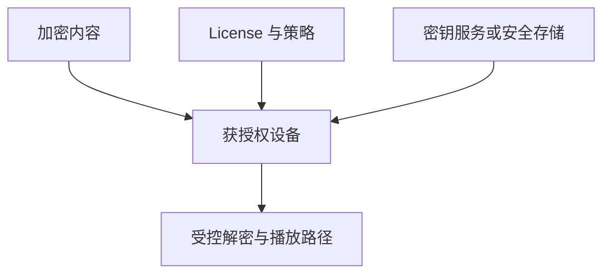

# 密码学机制与 DRM 的边界

密码算法不会自动产生“安全系统”。必须先确定目标，再选择 primitive、密钥和协议。本篇只建立理解固件签名、内容保护与软件授权所需的边界，不讨论规避保护的操作。

## 1. 四个容易混淆的目标

| 目标 | 常见机制 | 它不自动提供什么 |
| --- | --- | --- |
| 完整性 | cryptographic hash、MAC、signature | hash 本身不证明发布者身份 |
| 真实性 | MAC 或数字签名 | 不等于请求已被业务授权 |
| 机密性 | 加密 | 不保证密文未被替换，除非采用认证加密等组合 |
| 授权 | policy、身份、license、capability | 不能只由一种密码算法决定 |

普通 checksum 面向偶然错误，攻击者可以重新计算；密码哈希抗碰撞等性质也只有在具体算法与使用方式成立时才有意义。

## 2. 哈希、MAC 与数字签名

哈希把任意消息映射为固定长度摘要：

\[
h = H(m).
\]

若攻击者能同时替换消息和摘要，单独发布 \(H(m)\) 没有来源认证。MAC 使用通信双方共享的秘密密钥，适合已共享密钥的消息认证；数字签名由私钥签名、公钥验证：

\[
\sigma = \operatorname{Sign}_{sk}(m),\qquad
\operatorname{Verify}_{pk}(m,\sigma) \in \{0,1\}.
\]

签名验证证明“消息与持有相应私钥的主体之间的关系”，前提是验证公钥本身可信、算法和实现正确、私钥未泄漏。它不说明该版本足够新，也不保证程序运行时没有缺陷。

## 3. 密钥管理往往比算法更难

系统要回答密钥如何生成、存储、轮换、吊销、备份和分权。把公钥编进 bootloader 可以建立验证锚点，但 bootloader 如何被首次信任、能否被替换取决于设备更底层的写保护或 ROM 能力。开发密钥、生产密钥与用户密钥不应混用。

日志和错误信息也不得输出私钥或可重建密钥的材料。可复现构建有助于核对产物来源，却不替代签名；签名也不自动使构建过程可信。

## 4. DRM 是协议和执行环境，不是一种算法

DRM 通常组合内容加密、license、设备/账户身份、密钥派生、安全存储、可信执行路径和撤销策略。它需要在授权终端上把内容交给解码或渲染组件，因此终端本身始终是重要边界。

“算法很强”不能回答 host 已被控制、密钥出现在不可信内存、输出可被捕获或 license policy 实现错误等问题。分析 DRM 时应区分密码学保证、平台隔离和商业策略，不把它们合并成“无法破解”的绝对结论。

## 5. 固件签名与内容加密的不同目标

Secure boot 通常需要**真实性与完整性**：设备只能执行由授权发布者签名的镜像。固件不一定需要保密，因此“已签名”不等于“已加密”。反过来，加密固件若没有认证，攻击者可能替换密文或利用错误处理。

防回滚是另一项状态策略：设备需要受保护的版本计数或不可逆状态，拒绝签名有效但已知脆弱的旧版本。数字签名本身不携带“必须比当前新”的保证。

## 6. 与逆向工程的关系

逆向工具可以确认二进制调用了某个密码库或包含某个验证分支，但安全结论还需检查 key provenance、覆盖的消息范围、失败路径、更新状态和实际 trust root。只搜到算法名字不能证明协议正确。

下一篇 [Secure Boot](./secure-boot.md) 用 PX4 的公开条件化实现连接签名、镜像布局和启动决策。

## 参考资料

- [RFC 8032：Edwards-Curve Digital Signature Algorithm](https://www.rfc-editor.org/rfc/rfc8032)
- [NIST SP 800-193：Platform Firmware Resiliency Guidelines](https://csrc.nist.gov/pubs/sp/800/193/final)
- [OWASP Cryptographic Storage Cheat Sheet](https://cheatsheetseries.owasp.org/cheatsheets/Cryptographic_Storage_Cheat_Sheet.html)
