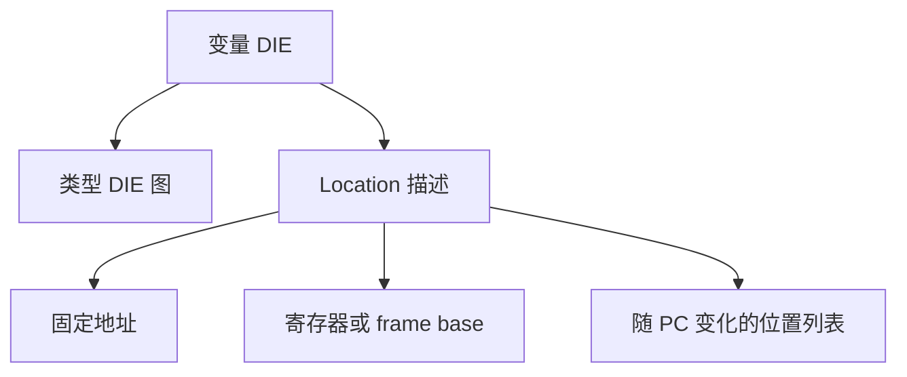

# DWARF 与调试信息

符号表通常只告诉我们某个名字和地址，调试器却能显示源码行、局部变量、结构体字段甚至内联调用。这些能力主要来自 DWARF。核心问题是：**优化后的机器状态怎样重新关联到源码对象？**

## 1. DWARF 不是“更完整的符号表”

DWARF 将信息按 compilation unit 组织，每个 unit 含一棵 Debugging Information Entry（DIE）树。DIE 由 tag 和 attribute 组成：

- `DW_TAG_subprogram` 描述函数；
- `DW_TAG_variable` 与 `DW_TAG_formal_parameter` 描述变量和参数；
- `DW_AT_type` 引用另一个描述类型的 DIE；
- `DW_AT_name`、`DW_AT_decl_file`、`DW_AT_decl_line` 连接源码身份；
- `DW_AT_location` 描述值在某个执行范围内位于何处。

类型并非扁平字符串。指针、数组、typedef、qualifier、结构体和成员偏移构成引用图；递归结构还可能形成环。解析器必须区分“递归深度有限”和“输出规模有限”，只限制深度无法阻止一个巨型数组或超宽结构产生大量结果。

## 2. 变量位置为什么最容易被误解

未优化的全局变量可能用一个简单地址表达；局部变量却可能位于寄存器、栈帧相对位置、若干碎片，或随指令范围改变位置。DWARF location list 表达的正是这种“同一变量在不同 PC 范围有不同位置”。

编译器优化还可能让变量被常量传播、拆分或完全消除。此时“源码有变量”不保证任意断点都能读取一个连续内存地址。调试信息是编译器对优化结果的描述，不会强制机器为每个源码对象保留存储槽。

## 3. ELF Analyzer Wasm 的明确覆盖范围

固定版本 [`src/lib.rs`](https://github.com/CaptainKAZ/elf_analyzer_wasm/blob/04ca1316ad2c8459516dd34d5db153b2cc29008e/src/lib.rs) 会遍历 unit/DIE，读取变量的名称、类型、文件、行和 location，并递归展开 base、pointer、array、struct/union/class、typedef、enum 与 qualifier。

源码直接可确认的限制是：变量位置只接受 `Exprloc` 且表达式中恰好得到一个 `Operation::Address`；`LocationListsRef` 等更一般形式没有变成可监控地址。结构体成员位置也主要处理常量 `Udata/Sdata`。所以它适合查找能归结为静态地址的变量，不是完整 DWARF debugger。

| 结论 | 证据等级 |
| --- | --- |
| 代码只收集单一 `DW_OP_addr` 形式 | 源码事实 |
| 优化构建中的许多局部变量可能不出现 | 由 DWARF 语义与实现范围支持的预期 |
| 某个具体 ELF 必然漏掉某变量 | 需要用该文件和构建参数验证 |
| 存在可利用漏洞 | 仅凭上述限制无法得出 |

## 4. 地址、类型与生命周期必须一起看

即使得到一个绝对地址，使用它还需要回答：

1. 地址属于链接地址、装载后 VA，还是设备的物理/总线地址？
2. PIE/ASLR、重定位或固件布局是否改变基址？
3. 类型大小、对齐与 endian 是否与目标一致？
4. 对象在监控期间是否仍然存活，是否被中断或另一个线程更新？
5. 读取是否有副作用，例如 memory-mapped I/O？

DWARF 解决“编译器怎样描述程序”的一部分，不提供设备访问授权，也不保证并发快照一致。

## 5. 解析器的资源与失败模型

ELF Analyzer Wasm 定义了递归与大小计算的深度上限，这是显式防线；但静态检查还看不到统一的总节点、总数组元素、总字符串或执行时间预算。部分迭代路径使用 `unwrap`，而 release profile 配置 `panic = "abort"`。因此合理结论是：异常输入可能触发实例终止或资源压力的路径值得 fuzz；在未运行验证前，不把它写成已确认拒绝服务漏洞。

在 Wasm 中，线性内存隔离可缩小 host 进程被直接破坏的范围，但不能消除 CPU/内存耗尽、panic、错误结果和宿主导入接口风险。沙箱是额外边界，不是解析正确性的替代品。

## 6. 与逆向分析的关系

有 DWARF 时，类型和源码映射是强证据；strip 后，分析者只能结合 ABI、调用、访问宽度和数据流重建近似类型。请继续读 [逆向工程的方法与证据](./reverse-engineering.md)。若要理解这些信息如何由编译器产生，回到 [编译流水线](../compilers/compilation-pipeline.md)。

## 参考资料

- [DWARF Version 5 Standard](https://dwarfstd.org/dwarf5std.html)
- [Gimli 文档](https://docs.rs/gimli/)
- [ELF Analyzer Wasm 固定版本](https://github.com/CaptainKAZ/elf_analyzer_wasm/tree/04ca1316ad2c8459516dd34d5db153b2cc29008e)
