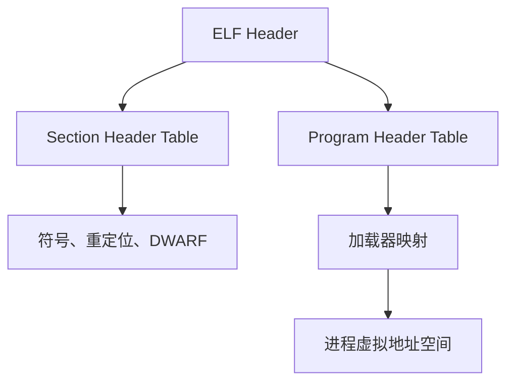

# 可执行文件格式：从磁盘字节到进程映像

编译器生成的机器指令必须和数据、符号、重定位及加载规则一起交付。可执行文件格式就是这些信息之间的契约。本篇关心的不只是字段含义，还关心：**一个解析器凭什么相信文件里的偏移、长度和数量？**

## 1. 文件不是进程内存的平铺快照

以 ELF 为例，ELF header 给出对象类别、字节序、目标机器以及 program/section header table 的位置。两组表服务于不同阶段：

- **section** 主要组织链接与分析信息，例如代码、数据、符号、重定位和 DWARF；
- **segment** 描述加载器如何把文件范围映射成具有读、写、执行权限的进程区域；
- 多个 section 可以落入同一 loadable segment，也有 section 不进入运行时映像；
- `p_memsz` 可以大于 `p_filesz`，多出的内存区域由加载器初始化，而不是从文件读取。



PE/COFF 使用不同字段和术语，但同样要区分磁盘布局、RVA、image base、section 映射和 loader 行为。不要把 ELF 的 section/segment 规则机械套到 PE，也不要因为二者都含“section”就假定权限与对齐规则相同。

## 2. file offset、VA 与 RVA

反汇编器经常同时展示文件偏移和虚拟地址，它们不是同一个坐标：

\[
\text{VA} = \text{image base} + \text{RVA}.
\]

文件偏移需要通过某个映射区间转换到 VA。若某个 load segment 的文件起点为 \(o_0\)，虚拟地址起点为 \(v_0\)，则只在该 segment 覆盖的文件区间内有

\[
v = v_0 + (o-o_0).
\]

零填充区域、未加载 section 和对齐空洞没有这种简单的一一对应。解析器应先找到包含关系，再做 checked arithmetic；“把 image base 加到任意 offset 上”会混淆坐标甚至造成整数溢出。

## 3. 符号、重定位与动态链接

符号表把名字和定义、绑定、可见性、所属 section 连接起来。ELF 常见的 `.symtab` 面向完整链接/分析，`.dynsym` 只保留动态链接所需子集；strip 可以移除大量静态符号，却不会让机器码消失。

重定位表达的是“这里的值还依赖最终布局或另一个符号”。链接器根据重定位类型、符号值、addend 和写入位置计算结果。不同 ISA 的 PC-relative、GOT/PLT、TLS 重定位语义不同，因此解析出一条 relocation entry 仍不足以解释它；要同时知道目标 ABI 和 relocation type。

这也解释了 [Hookshot 的 Binary Lifting](../compilers/binary-lifting.md) 为什么先恢复模块、映射和重定位，再恢复函数：若地址含义尚未确定，控制流目标和数据引用都可能被误判。

## 4. ELF Analyzer Wasm 怎样消费这些结构

公开仓库 [ELF Analyzer Wasm `04ca131`](https://github.com/CaptainKAZ/elf_analyzer_wasm/tree/04ca1316ad2c8459516dd34d5db153b2cc29008e) 在 `analyze_elf_recursively()` 中先用 Rust `object::File::parse()` 解析输入，再经 `gimli::DwarfSections::load()` 读取调试 section。这里有三层责任：

1. `object` 负责对象格式的结构解析；
2. `gimli` 负责 DWARF 单元、条目和属性的编码语义；
3. 应用层负责选择变量、解释位置和递归展开类型。

使用成熟库减少了重复实现，但应用层仍必须约束输出规模、递归深度和支持的表达式。库能成功解析文件，不等于该文件的语义适合当前业务，也不等于资源消耗已受控。

## 5. 不可信文件的结构检查

对任何“offset + size + count”字段，先验证运算，再取 slice：

```rust
let end = offset.checked_add(size).ok_or(ParseError::Overflow)?;
let bytes = input.get(offset..end).ok_or(ParseError::OutOfBounds)?;
```

还要验证：

- header table 的 entry size 与数量是否合理；
- 区间是否允许重叠，重叠时业务语义是什么；
- 对齐是否满足格式约束，而非仅满足 host 指针对齐；
- section/string/symbol 索引是否落在对应表内；
- 文件声明的数量是否会放大为过多对象、字符串或递归节点；
- 32/64 位、大小端和架构字段是否贯穿所有解码步骤。

这些检查保护的是解析器。加载器还需要执行权限、W^X、动态依赖搜索和重定位写入等策略；二者不能混为一层。

## 6. 与编译和运行链的关系

[编译、汇编与链接](../compilers/compilation-pipeline.md) 从生产者角度解释对象文件，本篇从消费者和攻击面角度观察同一契约；[程序如何真正运行](../foundations/how-programs-run.md) 则继续到 loader、进程和系统调用。下一篇 [DWARF 与调试信息](./dwarf-and-debug-information.md) 解释为什么有 ELF 结构还不够恢复变量类型和位置。

## 参考资料

- [System V ABI：Object Files](https://refspecs.linuxfoundation.org/elf/gabi4%2B/ch4.intro.html) 与 [Program Loading](https://refspecs.linuxfoundation.org/elf/gabi4%2B/ch5.pheader.html)
- [Microsoft PE Format](https://learn.microsoft.com/en-us/windows/win32/debug/pe-format)
- [ELF Analyzer Wasm `src/lib.rs`](https://github.com/CaptainKAZ/elf_analyzer_wasm/blob/04ca1316ad2c8459516dd34d5db153b2cc29008e/src/lib.rs)
