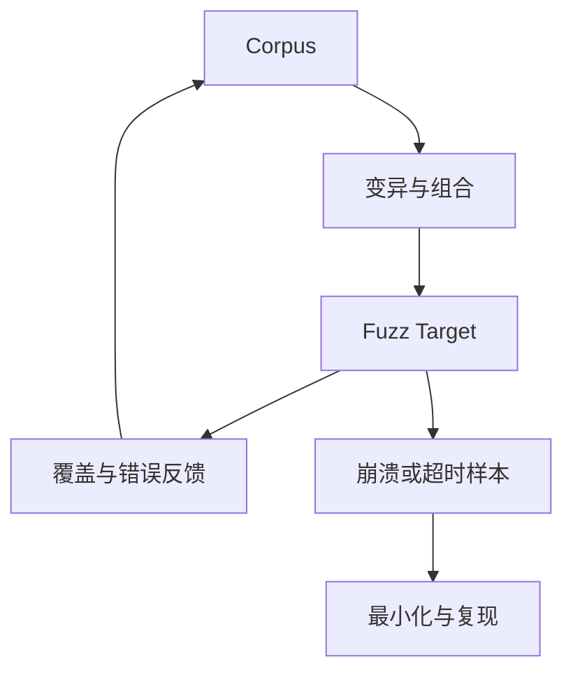

# Fuzzing 与 Sanitizer

Fuzzing 负责探索输入空间，sanitizer 负责让某些错误更早、更明确地暴露。二者组合很有价值，但回答的是“在这些构建、输入和预算内发现了什么”，不是形式化安全证明。

## 1. 覆盖引导 Fuzzing 的反馈环

以 libFuzzer 为例，fuzzer 在同一进程中反复调用目标函数，变异 corpus 输入，并利用代码覆盖反馈保留能到达新路径的样本。

好的 fuzz target 应确定、快速、可重复地处理任意字节，不访问真实外设或网络，不因正常解析失败而 abort，并尽量走到业务解析深处。全程序入口往往太慢、状态太多；先 fuzz 文件/帧 parser，再做集成验证更容易归因。

## 2. Sanitizer 各自观察什么

| 工具 | 主要发现 | 不能推出什么 |
| --- | --- | --- |
| ASan | 越界、use-after-free 等已执行的内存错误 | 未覆盖路径安全；业务地址已授权 |
| UBSan | 已执行路径上的部分 C/C++ 未定义行为 | 所有 UB 都能发现；逻辑语义正确 |
| MSan | 未初始化值流入可观察操作 | 第三方/系统代码未插桩时仍完整 |
| TSan | 某些实际发生的数据竞争 | 所有调度与高级并发协议正确 |

不同 sanitizer 可能需要分别构建和运行。优化级别、符号信息、第三方库插桩与平台支持都会影响结果。崩溃样本应保存构建 commit、flags、sanitizer 报告和最小输入。

Rust parser 也值得 fuzz：目标不只是内存破坏，还包括 panic、极慢输入、过量输出、不同 parser 结果不一致和违反业务属性。

## 3. 为 ELF/DWARF 解析器设计目标

可以分层建立目标：

1. 任意字节送入对象文件 parser，错误必须受控返回；
2. 对解析成功样本加载 DWARF unit/DIE；
3. 展开变量类型时限制节点、深度和输出；
4. 序列化结果不得超出预算；
5. 对同一输入重复执行结果应一致。

seed corpus 应包含不同 class、endian、含/不含 DWARF、strip、截断和最小合法样本。mutation 不应只随机翻转：可以使用 dictionary 提供 ELF magic、DWARF tag/attribute 等格式 token。若同一解析核心同时运行于 native 与 Wasm，还应分别测试两种边界，因为 panic、资源限制和宿主接口的表现可能不同。

## 4. 为流式协议设计目标

流式协议解析器要面对 chunk boundary：同一帧一次送入、逐字节送入或随机分片，应得到相同解析结果。可验证的属性包括：

- 任意 stream 不越过最大 payload 或无限增长 buffer；
- 修改 checksum 后帧不会被当成完整合法帧；
- 长度与命令 payload 形状不匹配时拒绝；
- 噪声后仍能按定义重新同步；
- 解析器接受不等于设备执行未授权地址操作，后者需要独立 policy test。

设备侧 target 若直接读写构造地址会触及真实内存，不适合无隔离 fuzz。应把地址解析与授权决策抽成纯函数，或用受控虚拟 memory map 替代真实解引用。

## 5. 属性、差分和变形测试

- **属性测试**：成功解析的每个区间都在输入内；encode/decode 在规范域内往返一致。
- **差分测试**：两个独立实现对同一版本格式的结构解释一致；差异需要判断谁符合规范。
- **变形测试**：仅改变无关 padding 不应改变语义；重排规范允许无序的条目不应改变集合结果。

差分实现可能共享同一 bug，也可能采用不同容错策略，所以“不一致”是调查入口，“一致”也不是正确性证明。

## 6. 结果怎样升级为结论

1. 用原始构建复现并最小化输入；
2. 判断是 crash、超时、内存增长、错误接受还是语义差异；
3. 从输入字节追到 root cause，不只修最后的 panic；
4. 写回归测试，并确认修复不会把合法输入拒绝；
5. 在相同假设下重新 fuzz；
6. 若涉及真实安全影响，再分析可达性、权限和部署边界。

“跑了若干小时没有崩溃”只是当前 corpus、target 和预算下的阴性结果。覆盖率也只说明代码位置是否到达，不说明断言充分。

## 官方资料

- [LLVM libFuzzer](https://llvm.org/docs/LibFuzzer.html)
- [Clang AddressSanitizer](https://clang.llvm.org/docs/AddressSanitizer.html)
- [UndefinedBehaviorSanitizer](https://clang.llvm.org/docs/UndefinedBehaviorSanitizer.html)
- [MemorySanitizer](https://clang.llvm.org/docs/MemorySanitizer.html)
