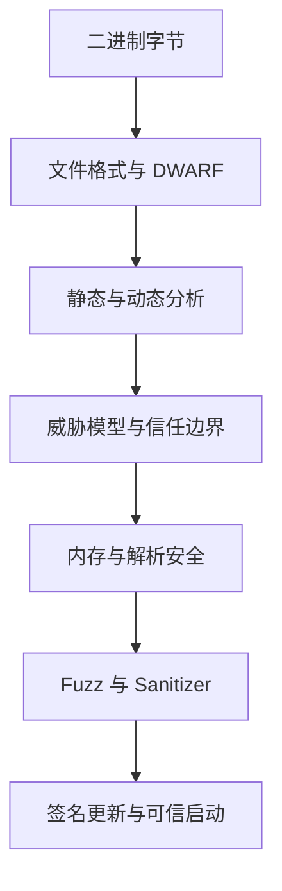

# 安全与逆向工程

这个专题围绕一条工程主线展开：**当程序、文件、设备和更新包跨越信任边界时，怎样理解其语义、限制其能力，并用证据验证安全假设？** 逆向工程负责恢复“程序实际做了什么”，安全工程则继续追问“攻击者能控制什么、哪些检查必须成立、失败会造成什么影响”。

## 知识边界与现状

| 问题 | 主讲位置 | 本专题怎样衔接 |
| --- | --- | --- |
| 源码怎样成为对象和可执行文件 | [编译流水线](../compilers/compilation-pipeline.md) | 从不可信二进制的结构、边界检查与证据可信度继续 |
| ISA、ABI 与函数调用 | [程序如何真正运行](../foundations/how-programs-run.md) 及现有编译器笔记 | 解释反汇编、栈回溯和调用边界所依赖的约定；规划中的独立基础页不作为当前链接 |
| CFG、数据流与机器码提升 | [CS323 控制流与数据流](../compilers/middle-end/control-flow-and-data-flow.md)、[Binary Lifting](../compilers/binary-lifting.md) | 不重复课程与算法推导，讨论分析结果何时只能算推断 |
| Guest 地址与系统调用 | [虚拟内存](../operating-systems/virtual-memory.md)、[SVC 与 IPC](../operating-systems/system-calls-and-ipc.md) | 抽象为范围、权限、对象能力和生命周期检查 |
| ELF/PE 与 DWARF | 本专题 | 从磁盘字节到加载映像、符号、类型和位置描述 |
| 威胁模型、内存安全、解析器验证 | 本专题 | 建立“验证、认证、授权”和“事实、风险、验证”的边界 |
| 固件签名与启动信任链 | 本专题 | 区分完整性、真实性、回滚保护与设备根信任 |

## 推荐阅读顺序

1. [可执行文件格式](./executable-formats.md)：先分清 section、segment、符号、重定位和地址。
2. [DWARF 与调试信息](./dwarf-and-debug-information.md)：理解类型、变量位置和源码映射为什么不是简单表格。
3. [逆向工程的方法与证据](./reverse-engineering.md)：把静态、动态、符号执行和源码证据组织起来。
4. [威胁模型与信任边界](./threat-models-and-trust-boundaries.md)：先定义资产、能力和边界，再谈具体防护。
5. [内存安全](./memory-safety.md) 与 [安全的二进制解析](./safe-binary-parsing.md)：理解缺陷类型和防御式解析。
6. [Fuzzing 与 Sanitizer](./fuzzing-and-sanitizers.md)：用自动生成输入和运行时检查检验实现。
7. [密码学与 DRM 的边界](./cryptography-and-drm.md) 与 [Secure Boot](./secure-boot.md)：把算法、密钥、策略和启动链连接起来。

## 贯穿案例与规范

- **ELF、DWARF 与 PE 官方规范**：用于区分文件布局、装载映像、调试条目和位置表达式；格式规范说明合法编码，不替代实现的资源限制与错误处理。
- **LLVM Sanitizer 与 libFuzzer**：用于说明动态错误检测和覆盖引导测试的能力边界，不把一次无崩溃运行当作安全证明。
- **Lichii 与 Hookshot**：分别用公开模拟器和静态重编译器说明 guest 输入如何跨越内存、SVC、IPC 与 host runtime 边界。实现不完整、目标化覆盖和已确认缺陷必须分开表述。
- **PX4 Secure Boot**：只依据明确支持 secure-boot 的 board/build 变体解释签名固件链；不把某一飞控板的能力外推到全部 PX4 设备。

## 证据与实践边界

阅读代码时至少分四层记录：**源码直接事实、由数据流支持的解释、需要测试的风险、已经复现的结果**。函数名、注释或一次成功运行都不足以证明安全属性；反过来，看到 `unsafe`、裸指针或 `unwrap` 也不能直接宣布存在可利用漏洞。

本专题只分析自己拥有、开源许可允许或已获授权的程序与数据。不记录真实密钥、受保护内容的获取方式或规避访问控制的步骤。Fuzzing、sanitizer 和静态分析可以提高发现缺陷的概率，但不能单独构成“软件已安全”的证明。
