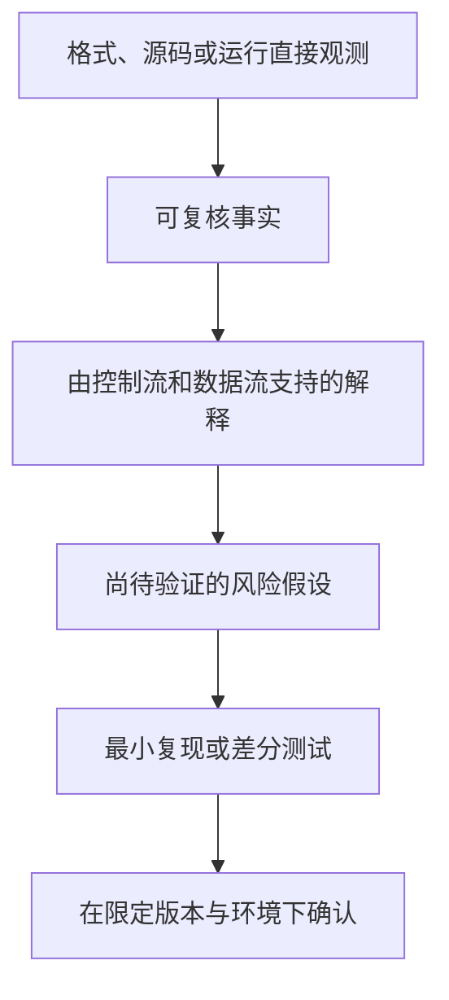

# 逆向工程的方法与证据

逆向工程不是把机器码“恢复成原始源码”，而是从有限观测中建立一个足以回答问题的程序模型。变量名、注释、宏、模板结构和部分类型在编译后可能不可逆地丢失；正确目标是恢复可验证的语义，而不是制造看似可读但证据不足的伪源码。

## 1. 先定义问题，再选择观测

| 问题 | 优先证据 | 常见盲点 |
| --- | --- | --- |
| 某函数如何传参 | ISA、ABI、调用点、DWARF | 把寄存器暂存值误当参数 |
| 文件如何解析 | 输入到长度/偏移的 data flow、失败路径 | 只看正常样本 |
| 间接调用可能去哪里 | relocation、表布局、CFG、运行 trace | 一次 trace 覆盖不全 |
| 某检查能否保护资源 | 检查与使用之间的数据/控制依赖 | 验证和授权混为一谈 |
| 崩溃是否可控 | 最小复现、sanitizer、输入归因 | 仅凭反编译猜漏洞 |

静态分析覆盖潜在路径但容易产生不确定性；动态调试给出具体状态却只覆盖执行过的路径。二者应互相约束。

## 2. 从装载语义到控制流

可靠的静态分析通常按层推进：

1. 解析文件格式、architecture、segment、symbol 和 relocation；
2. 根据入口、导出、异常/展开信息和直接调用发现函数种子；
3. 解码基本块并构建 CFG；
4. 用数据流解释参数、指针、状态与间接目标；
5. 把结论和调用者、错误路径及动态 trace 对照。

[Binary Lifting](../compilers/binary-lifting.md) 已详细解释 Hookshot 如何把 AArch64 指令语义提升为 C。安全分析在此基础上增加“输入可控性”和“边界检查”维度：某个长度来自文件、IPC 还是可信常量？它到达分配、copy 或地址计算前经过哪些条件？

## 3. 动态分析改变了什么

断点、watchpoint、系统调用 trace 和内存快照能确认具体输入下的值与路径，但调试环境可能改变时序、地址布局和反调试行为。一次“没有崩溃”不证明其他长度、并发或错误路径安全。

为了让结果可复现，至少记录：二进制哈希或源码 commit、架构、加载地址/ASLR 条件、输入、构建选项、触发路径和观测工具版本。对开源项目，优先用源码与测试确认意图；反汇编用于核对编译产物，而不是故意忽略更强证据。

## 4. 符号执行与约束求解的边界

符号执行把输入表示为符号变量，沿分支积累约束，再由求解器寻找满足某条路径的输入。它适合局部协议、整数边界和路径可达性问题，但会遇到路径爆炸、复杂内存模型、系统调用、浮点和并发状态。

因此“求解器找到输入”通常证明的是**模型中的一条路径可满足**；仍要在真实二进制、真实运行环境中复现。“在预算内没找到”也不等于不存在。

## 5. 两类公开源码案例

### Hookshot：分析结果要支持重编译

Hookshot 的固定版本通过模块映射、重定位、函数发现、CFG 和指令语义生成 C，再由 Clang/LLD 构建。它的验证标准比“反编译看起来合理”更强：未恢复的目标、指令覆盖和 guest/host 状态同步最终都会影响可执行结果。与此同时，能运行只证明已经覆盖的 workload，不能自动证明所有 guest 路径等价。

### Lichii：源码仍需沿运行边界追踪

Lichii 有公开 C++ 源码，但理解一次 SVC/IPC 仍要从 guest 寄存器、当前进程、handle table、session、buffer 描述符追到 service handler。源码可见不意味着只看同名函数就完成分析；对象生命周期和错误路径仍可能跨多个组件。详见 [系统调用与 IPC](../operating-systems/system-calls-and-ipc.md)。

## 6. 一套可复用的证据分级

写笔记时应让读者知道每句话位于哪一层。尤其避免：从函数名推断安全保证；从 `unsafe` 推断漏洞；从 checksum 推断认证；从一条成功路径推断完整兼容。

## 7. 授权与结果表达

只分析自己编写、公开许可允许或明确授权的目标。笔记保留通用机制、公开源码链接和可复现条件，不收录密钥、私有固件或绕过访问控制的操作。对发现的真实问题，应遵循项目安全策略进行负责任披露，而不是先公开可武器化细节。

下一步阅读 [威胁模型与信任边界](./threat-models-and-trust-boundaries.md)：它把“程序做什么”转成“谁能让它做什么”。

## 参考资料

- [DWARF v5](https://dwarfstd.org/dwarf5std.html)
- [LLVM libFuzzer](https://llvm.org/docs/LibFuzzer.html)
- [Hookshot 固定版本设计文档](https://github.com/NotRexed/Hookshot/blob/ba005ca4fa179ccd2140f06f9308d0ff63894ff6/docs/design.md)
- [Lichii 固定版本 HLE 源码](https://github.com/zortos293/Lichii/tree/9441129819edfee62e65ff6030749e80f420ba1e/src/core/hle)

