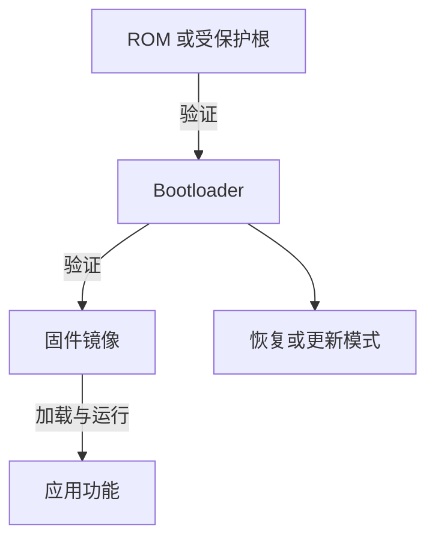

# Secure Boot 与固件信任链

Secure boot 要回答：**复位后第一个可信判断从哪里来，下一阶段在执行前验证了什么，失败时系统进入哪里？** 它不是一个 `verify()` 调用，而是一条从不可轻易替换的根开始延伸的信任链。

## 1. 测量、验证与信任传递

典型链条是：

每条“验证”边至少要明确：验证公钥从哪里来、签名覆盖哪些字节、metadata 是否被覆盖、解析失败如何处理、验证通过后怎样防止被替换。若 bootloader 自身可被未授权改写，仅在其中嵌入公钥不能独立建立硬件根信任。

Measured boot 记录组件摘要供后续证明，verified boot 在执行前执行策略判断；二者可以组合，但目标不同。

## 2. 签名镜像的必要组成

一个可验证镜像通常含 payload、长度/布局 metadata、版本信息和签名。签名覆盖范围必须无歧义，否则“验证的是 A，执行的是 B”会破坏保证。解析顺序也必须先完成安全的长度与区间验证，再定位签名和 payload。

签名验证成功只说明镜像与受信私钥对应；还不能推出：

- 固件没有逻辑或内存安全缺陷；
- 版本满足 anti-rollback policy；
- bootloader 或公钥不可替换；
- 运行时外设、调试口和 DMA 都受约束；
- 更新过程断电后一定可恢复。

## 3. 更新、回滚与恢复

安全更新同时追求真实性、原子性和可恢复性。常见设计用 A/B slot 或 staging region：先写入非活动区，完整验证后再以受控 metadata 切换。版本 counter 或安全 monotonic state 用于拒绝旧但签名有效的镜像；若该状态可随固件一起回滚，就没有真正的防回滚。

恢复路径也属于攻击面。进入恢复模式的条件、可接受镜像、调试能力和物理在场要求必须与正常启动保持一致的信任目标。否则“主链严格、恢复口宽松”会形成旁路。

## 4. PX4 公开 Secure Boot 案例

PX4 官方文档明确把 secure boot 限定在支持且按对应 build variant 构建的板卡，不应外推到所有 PX4 target。当前公开说明以特定 `px4_fmu-v6x` / `v6xrt` secure-boot 变体为例：构建流程使用签名工具生成 signed image，bootloader 内置验证公钥，并使用 Ed25519/Monocypher 验证镜像；无签名、签名错误或密钥不匹配时停留在 bootloader。

公开源码和文档还显示 secure build 的上传流程会在 reboot 前请求签名验证，build 配置含 secure-boot 选项和 signed image 产物。这里可以确认的是**对应版本和构建变体的行为**。没有从这些资料确认所有硬件都具备不可变 Boot ROM 链，也没有确认统一 anti-rollback 状态，因此不作这两项扩展声明。

| 层次 | 从公开资料可确认 | 仍依赖设备/部署确认 |
| --- | --- | --- |
| 构建 | 特定 target 生成签名镜像 | 私钥保护、构建环境供应链 |
| Bootloader | 固定公钥验证签名镜像 | Bootloader 写保护与更底层 root |
| 上传 | secure 流程触发签名验证 | 通信链认证、故障恢复策略 |
| 版本 | 镜像格式可携带 metadata | 是否有受保护的 anti-rollback 状态 |

## 5. 怎样审计一条启动链

1. 固定板卡、MCU、bootloader、固件和工具版本；
2. 画出 reset vector 到应用入口之间每个可执行阶段；
3. 对每条边记录 key、算法、消息范围和失败路径；
4. 检查长度/布局解析是否先于任何 copy 或执行；
5. 检查更新中断、损坏镜像、错误密钥和旧版本；
6. 区分开发解锁、物理调试和量产 policy；
7. 记录已经验证的事实，不用“支持签名”替代整条 root-of-trust 证明。

## 6. 与软件安全的关系

Secure boot 保护“执行被授权的镜像”，内存安全保护“镜像运行时如何处理对象”，威胁模型定义“授权者和攻击者是谁”。三者互补：已签名的解析器仍可能有漏洞，健壮固件若可被旧脆弱版本替换也仍有风险。

## 官方资料

- [PX4 Bootloader Secure Boot](https://docs.px4.io/main/en/advanced_config/bootloader_secure_boot)
- [PX4 Bootloader Update](https://docs.px4.io/main/en/advanced_config/bootloader_update)
- [PX4 `px4_uploader.py`](https://github.com/PX4/PX4-Autopilot/blob/main/Tools/px4_uploader.py)
- [NIST SP 800-193](https://csrc.nist.gov/pubs/sp/800/193/final)
