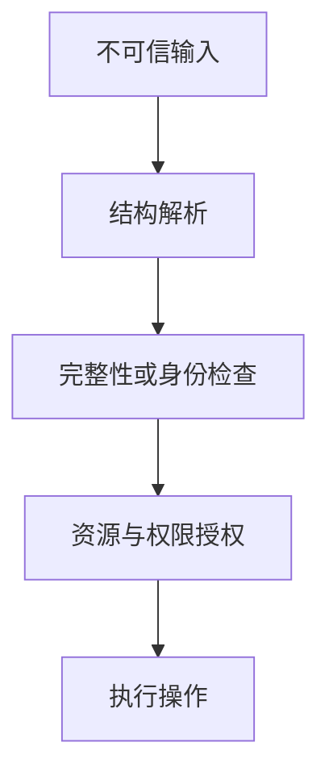
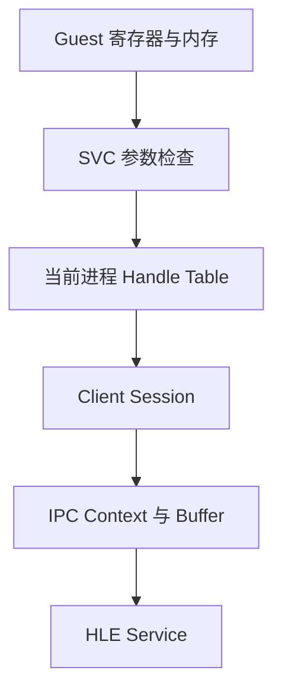

# 威胁模型与信任边界

“这里做了校验”不是完整的安全结论。必须先回答：**保护什么资产，攻击者能控制什么，数据跨越了哪条边界，失败后有什么权限？** 威胁模型把安全从模糊担忧变成可检验的假设。

## 1. 威胁模型的最小要素

- **资产**：代码执行权、密钥、固件完整性、传感器数据、文件和设备可用性。
- **主体与信任**：谁发起请求，谁负责决策，哪些组件允许被假定为可信。
- **攻击者能力**：能构造文件、发送串口帧、控制 guest、替换固件，还是只能旁路观察。
- **入口与边界**：文件解析器、系统调用、IPC、网络/串口、FFI、bootloader 更新接口。
- **安全目标**：机密性、完整性、真实性、授权、隔离、可用性或可审计性。
- **明确不保护的范围**：例如不假定能抵抗物理探针，或不覆盖 host kernel 已失陷的情形。

模型不是永久事实。设备从实验台接到共享总线、调试接口从开发版进入量产版，攻击者能力就改变了。

## 2. 验证、认证与授权不是同一件事

以一个含长度和 checksum 的串口帧为例：

1. **结构验证**：帧头、长度、命令和结尾是否符合协议；
2. **完整性检查**：传输中是否发生某类偶然错误；
3. **认证**：消息是否来自持有合法凭据的主体；
4. **授权**：该主体是否允许对这个地址执行这个操作。

XOR checksum 可以发现部分传输错误，却不能阻止能重新计算 checksum 的主动发送者。即使换成消息认证码，也仍需独立决定“已认证调试端能否写任意设备地址”。

## 3. AresPlot：格式正确并不等于地址可访问

公开版本 [Web Serial Plotter `bb1e018`](https://github.com/CaptainKAZ/web-serial-plotter/tree/bb1e018a431d05c81662f6513b36039b73ed2396) 的 JavaScript 解析器为帧设置了 2048 字节上限，并检查 SOP、长度、XOR checksum、EOP 和命令形状。设备侧 `aresplot_client.c` 也限制监控变量数量并核对 payload 长度。这些是源码中可确认的格式与资源检查。

同一设备侧代码会把帧中的 32 位数值转为指针，用于监控读取或设置变量。静态阅读未看到这些 handler 对地址范围、对齐、读写权限或允许变量集合做白名单验证。准确表述应是：**固定版本的源码显示一个需要由部署信任假设兜底的地址访问边界**；是否可从外部到达、目标 MCU 如何处理非法访问、是否有外围认证，都需要具体系统测试，不能仅凭静态阅读宣布漏洞或影响等级。

更稳健的协议应尽量发送受限的变量 ID，由设备把 ID 映射到预注册的地址、类型与操作权限，而不是让输入直接携带裸地址。

## 4. Lichii：Guest 到 HLE 的多重边界

Lichii 的 guest 可控制 SVC 参数、IPC buffer 和 handle 数值，但不应因此获得任意 host 对象能力。公开源码中的一次请求大致跨越：

每层检查不同性质的属性：地址范围和 memory state、handle 是否存在且类型正确、copy/move 是否改变所有权、session 生命周期、buffer 的方向与大小、service command 的参数语义。只在最外层检查一个数值不足以覆盖后续对象转换。

这不是在宣称固定 Lichii 版本存在某个缺陷，而是从公开架构提取审计问题。具体结论要落到对应函数、输入和运行复现。

## 5. 最小权限、隔离与失败策略

- **最小权限**：解析 ELF 不需要设备写权限；监控工具也不应默认拥有整个地址空间。
- **能力收窄**：使用对象 ID、handle 或 capability 代替可任意构造的 host 指针。
- **进程/沙箱隔离**：即便解析器崩溃，也限制影响范围；但仍需 CPU、内存和超时预算。
- **失败关闭**：签名或权限不确定时拒绝敏感操作，同时避免把错误处理本身变成无限重试或不可恢复停机。
- **可审计性**：记录版本、决策和失败原因，不记录密钥或敏感内容。

## 6. 一份紧凑记录模板

| 项目 | 问题 |
| --- | --- |
| 资产 | 失败时真正受影响的是什么？ |
| 不可信输入 | 哪些字节、参数、时序或对象由攻击者控制？ |
| 信任边界 | 哪个组件把输入转换为权限或资源访问？ |
| 现有检查 | 它验证结构、身份、权限还是资源预算？ |
| 失败模式 | 崩溃、错误写入、泄漏、持久化还是降级？ |
| 证据 | 源码事实、静态推断、测试结果分别是什么？ |

下一步读 [内存安全](./memory-safety.md)，理解边界错误如何落成越界、悬空引用或数据竞争。

## 源码入口

- AresPlot [`aresplot_protocol.js`](https://github.com/CaptainKAZ/web-serial-plotter/blob/bb1e018a431d05c81662f6513b36039b73ed2396/js/modules/aresplot_protocol.js) 与 [`aresplot_client.c`](https://github.com/CaptainKAZ/web-serial-plotter/blob/bb1e018a431d05c81662f6513b36039b73ed2396/aresplot_client.c)
- Lichii [`svc_ipc.cpp`](https://github.com/zortos293/Lichii/blob/9441129819edfee62e65ff6030749e80f420ba1e/src/core/hle/kernel/svc/svc_ipc.cpp) 与 [`k_server_session.cpp`](https://github.com/zortos293/Lichii/blob/9441129819edfee62e65ff6030749e80f420ba1e/src/core/hle/kernel/k_server_session.cpp)
