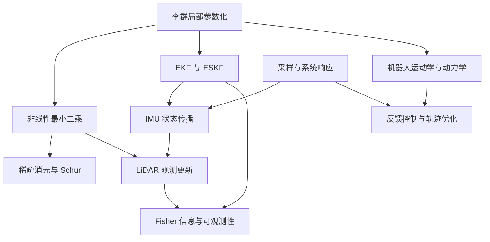

# Mathematics Overview

这里整理算法工程中反复使用、又容易因符号和约定不同而混淆的数学工具。它不重写线性代数、微积分和概率论课程，而是从具体估计与优化问题出发，给出关键推导、近似条件和应用边界。

## 统一约定

- 向量默认是列向量，$[a]_\times b=a\times b$。
- $T_{A\leftarrow B}$ 把 B 系坐标变到 A 系，链式相乘时中间坐标应相消。
- 位姿切向量默认按 $\xi=(\rho,\phi)\in\mathbb R^6$ 排列，即平移在前、旋转在后。
- 左右扰动、残差正负号、误差所在坐标系必须在每篇文章中再次声明；不同约定的公式不能直接拼接。
- $\hat x$ 表示估计或名义状态，$\delta x$ 表示其局部误差；连续时间噪声密度与离散协方差不混用。

## 推荐阅读路径

1. [几何与流形](./geometry/)：从 $SO(3)$、$SE(3)$ 到局部扰动和雅可比。
2. [最优化](./optimization/)：从非线性最小二乘到 GN、LM 与 Schur 消元。
3. [概率状态估计](./probabilistic-estimation/)：从 EKF、ESKF 到迭代更新和可观测性。
4. [信号与系统](./signals-and-systems/)：从采样、频谱和系统响应进入滤波、噪声与时间延迟。
5. [惯性导航与里程计](./inertial-odometry/)：把 IMU、点云残差和 LIO 串成完整估计链。
6. [机器人建模与控制](./robot-modeling-control/)：从运动学、动力学到闭环控制与轨迹优化。
7. [深度学习数学](./deep-learning/)：组织自动微分、损失、优化器、注意力与低秩方法的后续阅读。
8. [数值计算方法](./numerical-methods/)：关注条件数、分解、浮点精度和复杂度。

数学篇负责定义和推导；[SLAM](../slam/) 负责算法任务、地图与评估，[Robotics Systems](../robotics-systems/) 负责系统接口和运行边界，[AI Infra](../ai-infra/) 负责训练、推理与部署。

## 当前核心链路

