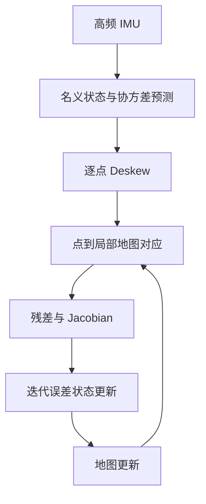

# LiDAR–Inertial Odometry 数学模型

LiDAR–Inertial Odometry（LIO）用 IMU 提供高频运动预测和扫描内运动补偿，用 LiDAR 几何观测校正姿态、位置、速度与 bias。不同系统可采用 iterated ESKF、滑窗优化或因子图，但都必须闭合状态、时间、外参和观测残差。

## 1. 状态选择

最小惯性状态为

$$
x=(R_{W\leftarrow I},p_W,v_W,b_g,b_a).
$$

实际 LIO 还可能估计重力 $g_W$、LiDAR–IMU 外参 $T_{I\leftarrow L}$、时间偏移或其他传感器参数。增加状态只有在观测和运动提供足够信息时才有意义；否则会引入强相关和退化。

本文以 15 维误差

$$
\delta x=(\delta\theta,\delta p,\delta v,\delta b_g,\delta b_a)
$$

说明主链。IMU 预测的 $F,G,\Phi,Q_d$ 见[ESKF](../probabilistic-estimation/error-state-kalman-filter.md)。

## 2. 一帧 LiDAR 到来前的 IMU 预测

每个 IMU 样本推进名义状态和协方差：

$$
\hat x_{k+1}^-=f(\hat x_k^+,u_k),
\qquad
P_{k+1}^-=\Phi_kP_k^+\Phi_k^\mathsf T+Q_{d,k}.
$$

高频预测有三个作用：输出连续 odometry、给点云配准提供初值、为一帧扫描中的每点时间提供 deskew 轨迹。它不会消除漂移；在没有外部观测时，bias 和噪声继续积分。

## 3. Deskew 的坐标链

设原始 LiDAR 点 $p_L(t)$ 采于时刻 $t$，希望统一到扫描参考时刻 $t_r$ 的 LiDAR 系。利用外参 $T_{I\leftarrow L}$ 和预测 IMU 位姿：

$$
p_L(t_r)=T_{L(t_r)\leftarrow I(t_r)}
T_{I(t_r)\leftarrow W}
T_{W\leftarrow I(t)}
T_{I(t)\leftarrow L(t)}p_L(t).
$$

刚性安装时两端外参互逆但数值固定。时间偏移会使 $T_{W\leftarrow I}(t)$ 取错时刻；高速旋转时即使很小的偏移也会形成系统性扭曲。

## 4. 点到地图观测

将 deskew 点通过当前状态和外参变到世界：

$$
p_W=R_{W\leftarrow I}
(R_{I\leftarrow L}p_L+t_{I\leftarrow L})+p_{W,I}.
$$

记 $s=R_{I\leftarrow L}p_L+t_{I\leftarrow L}$。地图对应平面由点 $q_W$ 和单位法向 $n_W$ 表示：

$$
r=n_W^\mathsf T(p_W-q_W).
$$

对右乘姿态误差 $R=\hat R\operatorname{Exp}(\delta\theta)$：

$$
p_W\approx\hat R(s-[s]_\times\delta\theta)
+\hat p+\delta p.
$$

因此对 15 维误差的观测 Jacobian 为

$$
H=
\begin{bmatrix}
-n_W^\mathsf T\hat R[s]_\times&
n_W^\mathsf T&0&0&0
\end{bmatrix}.
$$

符号对应残差“预测点到平面”的定义。若残差定义相反、使用左误差或状态旋转方向相反，Jacobian 也会改变。

## 5. LiDAR 残差怎样进入 ESKF

堆叠有效点得到

$$
r\approx H\delta x+v,
$$

然后计算创新协方差、Kalman Gain 和误差修正。大量点使 $m\gg n$，实现可利用信息形式和矩阵恒等式在状态维度上求解，而不是直接求逆巨大的 $m\times m$ 矩阵。

由于点—面对应依赖当前位姿，许多直接 LIO 在同一帧内迭代：更新候选状态、重新找局部平面、重算残差/Jacobian，直到收敛。先验协方差应固定为该帧预测值，同一 LiDAR 帧不能被当成多份独立测量重复缩 covariance；见[迭代 EKF](../probabilistic-estimation/iterated-ekf.md)。

## 6. LiDAR 为什么能修正惯性误差

LiDAR 残差直接约束姿态和位置。由于 ESKF 的 $P$ 含姿态/位置与速度、bias 的交叉协方差，Kalman Gain 可把几何创新传递给速度和 bias：

$$
K=PH^\mathsf T(HPH^\mathsf T+R)^{-1}.
$$

这不是 LiDAR 直接测到了 gyro bias，而是历史 IMU 动力学在协方差中建立了相关性。若初始化或协方差传播错误，这条间接修正也会错误。

## 7. 紧耦合与松耦合

**紧耦合**直接把点/平面等原始或中间几何残差接入联合状态，保留每条观测方向和与 bias 的相关性。**松耦合**先由独立 LiDAR odometry 产生 Pose 及其 covariance，再把 Pose 当测量融合。

松耦合接口清晰、模块可替换，但上游 Pose 已压缩原始几何信息，其 covariance 还必须反映配准退化和与下游先验的相关性。若 LiDAR odometry 已使用同一 IMU，再把它作为“独立 Pose”与同一 IMU 滤波器融合，可能重复计算信息。

## 8. 退化场景

局部信息近似

$$
\Lambda_L=H^\mathsf TR^{-1}H.
$$

长直走廊、单平面、远距离稀疏点或重复结构会让某些特征值很小。IMU 可短期预测弱方向，却不能长期替代缺失几何；bias、外参与时间偏移还需要多轴转动、加减速和结构变化提供激励。

退化检测只能支持降权、冻结弱方向或进入降级状态。给 Hessian 加阻尼让系统可解，不等于场景提供了信息。

## 9. FAST-LIO2、LIO-SAM 与 Super-LIO 的位置

- FAST-LIO2 采用高效紧耦合 iterated Kalman filter，直接将原始点注册到增量地图；其 ikd-Tree 主要解决地图更新和近邻查询效率。
- LIO-SAM 使用 IMU preintegration、局部 scan matching 和因子图平滑，便于加入回环、GPS 等因子；它与 ESKF 的计算组织不同。
- Super-LIO 在公开论文中以 FAST-LIO2 类 LIO 框架为基础，OctVox 控制 voxel 内地图表示与密度，HKNN 利用空间局部性加速近邻搜索。二者主要改变地图和对应搜索，可能间接改变被选观测及其几何分布，但不应被描述为一种新的 Kalman 基本公式。

具体论文报告的耗时和精度只适用于其数据、版本和硬件。这里不把实现结果外推成通用规律。

## 10. 误差闭环

地图更新必须使用经过定义的状态时刻；动态物体、错误对应和未经验证的更新会反过来污染下一帧观测。估计器、地图和时间链因此构成闭环，而不是“IMU 模块 + ICP 模块”的简单串联。

## 参考资料

- Xu 等，[FAST-LIO2: Fast Direct LiDAR-inertial Odometry](https://arxiv.org/abs/2107.06829)，2021。
- Shan 等，[LIO-SAM: Tightly-coupled Lidar Inertial Odometry via Smoothing and Mapping](https://arxiv.org/abs/2007.00258)，2020。
- Wang 等，[Super-LIO: A Robust and Efficient LiDAR-Inertial Odometry System with a Compact Mapping Strategy](https://arxiv.org/abs/2509.05723)，2025；[官方仓库](https://github.com/Liansheng-Wang/Super-LIO)。
